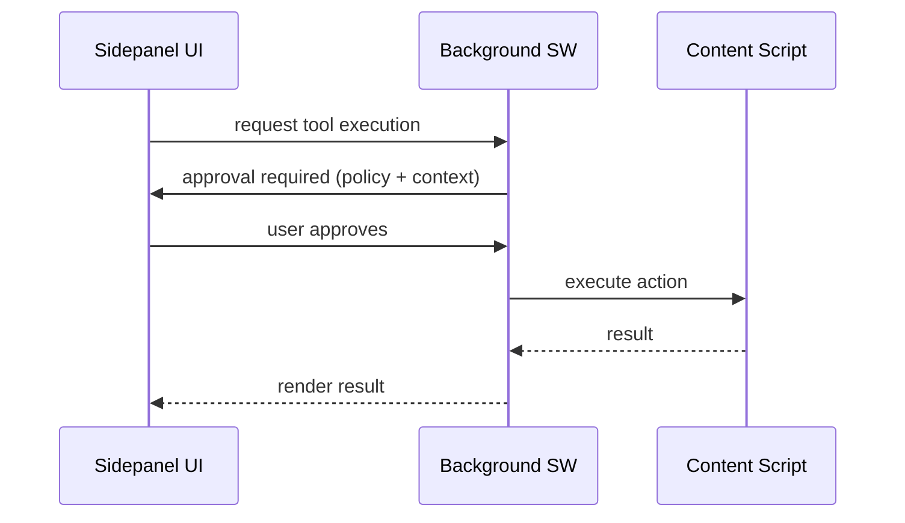

## Cognito AI Docs Revamp (Fumadocs) — Phase-by-Phase Execution Plan

This document is a **procedural execution plan** for revamping the Docs application in `apps/docs/` (Next.js + Fumadocs). It is written to be executed by **another agent** with **zero prior context**.

### Goals (what “done” looks like)

- **User-first** docs site: task-driven, step-by-step, clear prerequisites, clear outcomes.
- **Production-quality**: accurate, consistent, linkable, searchable, with diagrams and troubleshooting.
- **Code-verified**: any claim about behavior/config/flows must be verified against the **current codebase**, not older docs.
- **Maintainable long-term**: easy to update, clear ownership, and clear “needs verification” signals when code changes.

### Non-goals (explicit)

- This plan does **not** implement the revamp. It defines how to implement it.
- This plan does **not** assume legacy docs are correct. Legacy docs are treated as **inputs**, not sources of truth.

---

## How to execute this plan (agent runbook)

This section makes the plan “agent-ready”: it specifies what the agent must **ask**, **write**, **validate**, and **pause for approval** on.

### Agent operating rules (do not skip)

- **Rule: no silent assumptions**
  - If you (the agent) do not know something (shipping status, UI labels, install method), you must:
    - ask the repo owner, OR
    - verify it in code/running app, OR
    - mark it with `<!-- NEEDS_VERIFICATION: ... -->`.
- **Rule: docs claims need evidence**
  - Every behavioral/config claim must have at least one **code reference** (`code_refs: ...`) or be tagged `NEEDS_VERIFICATION`.
- **Rule: stop at approval gates**
  - This plan is executed for a human owner. At each phase gate, you must stop and ask for approval before proceeding.
- **Rule: write trackable artifacts**
  - If the phase requires creating a file (tracker, style guide, backlog), create it in the repo at the specified path, then link it in your progress update.

### “Approval gates” (explicit stop points)

- **Gate A (after Phase 0)**: Owner approves:
  - audiences + scope
  - tone/style guide
  - final IA (sidebar structure)
- **Gate B (after Phase 1)**: Owner approves:
  - what to keep / rewrite / archive / delete
  - what is public docs vs internal notes
  - priority order (what gets written first)
- **Gate C (after Phase 2)**: Owner approves:
  - the new sidebar/navigation (skeleton pages)
  - URL changes/redirects plan
- **Gate D (after Phase 3)**: Owner approves:
  - core “Get Started” + “Using Cognito” pages (minimum shippable docs)
- **Gate E (after Phase 5)**: Owner approves:
  - verification report and remaining `NEEDS_VERIFICATION` items

### Required working files (create early and keep updated)

- `apps/docs/STYLE_GUIDE.md`
  - Contains: voice/tone, page template, terminology rules, diagram/comment conventions, verification rules.
- `apps/docs/REVAMP_TRACKER.md`
  - Single source of truth for page status: `planned | stubbed | drafting | needs_verification | verified | shipped`.
- `apps/docs/REVAMP_INVENTORY.md`
  - Inventory of all legacy docs and what happens to each.
- `apps/docs/DIAGRAM_BACKLOG.md`
  - List of diagrams + ids + target pages + what they represent.
- `apps/docs/VERIFICATION_REPORT.md`
  - Summary of what was verified (with code refs) and what remains unverified.

---

## Current reality (repo facts you must assume)

### Docs app fundamentals (Fumadocs)

- **Docs content source**: `apps/docs/content/docs/**`
- **Navigation (sidebar)**: `meta.json` files in `apps/docs/content/docs/**` (root: `apps/docs/content/docs/meta.json`)
- **Fumadocs config**: `apps/docs/source.config.ts`
- **Docs layout**: `apps/docs/src/app/docs/layout.tsx` uses `tree={source.pageTree}`
- **Docs page renderer**: `apps/docs/src/app/docs/[[...slug]]/page.tsx`

### Existing documentation sources (ALL are “inputs”, not truth)

- **Docs app content** (already in Fumadocs):
  - `apps/docs/content/docs/**`
- **Extension technical docs** (high volume; many likely stale):
  - `apps/extension/docs/**`
- **Root-level engineering docs** (design notes, investigations):
  - `docs/**`
- **Root guides that are likely stale** (verify!):
  - `SETUP.md` (contains old extension file paths; treat as **NEEDS_VERIFICATION**)
  - `MONOREPO.md` (good high-level but still requires verification)
- **Feature list / privacy policy (may be marketing/aspirational; must verify):**
  - `apps/extension/FEATURES.md`
  - `apps/extension/PRIVACY_POLICY.md`

### Known “smells” already present (treat as verification triggers)

- Some Docs app pages reference extension paths that don’t match current WXT entrypoints.
  - Example: `apps/docs/content/docs/architecture/webmcp-integration.mdx` references `src/contents/webmcp-proxy.ts` but the extension currently has `apps/extension/src/entrypoints/webmcp-proxy.content.ts`.
- Several pages contain ASCII box diagrams; requirement is to migrate to Mermaid with searchable placeholders.

---

## Standardized placeholder comments (MANDATORY)

These comments are required so you can later search, replace, or audit content quickly. Use them verbatim and consistently.

### Comment taxonomy

- **Needs verification**
  - Use when content is copied/ported, or written before code confirmation.

```md
<!-- NEEDS_VERIFICATION: <short reason> | owners: <names/handles> | code_refs: <paths> | last_checked: YYYY-MM-DD -->
```

- **Mermaid diagram placeholder**
  - Use before every Mermaid diagram block.
  - The `id` must be unique repo-wide (recommend prefix by area).

```md
<!-- MERMAID_DIAGRAM: <id> | type: <flow|sequence|component|state|data-model> | represents: <what it explains> | code_refs: <paths> -->
```

- **Mermaid diagram end marker (optional but recommended)**
  - Helps “replace whole diagram” operations.

```md
<!-- /MERMAID_DIAGRAM: <id> -->
```

- **Temporary / placeholder content**

```md
<!-- TEMP_CONTENT: <what is temporary> | replace_with: <what> | by: YYYY-MM-DD -->
```

- **Manual review required**

```md
<!-- MANUAL_REVIEW: <what to review> | why: <reason> | by: YYYY-MM-DD -->
```

- **Source carried over from legacy docs**
  - Use when you port content from `apps/extension/docs` or root `docs/`.

```md
<!-- SOURCE_LEGACY_DOC: <path> | action: <rewrite|summarize|extract|delete> -->
```

### How to embed Mermaid (MDX-compatible)

Always include the placeholder comment immediately above the Mermaid block:

```md
<!-- MERMAID_DIAGRAM: extension.tool-approval.sequence | type: sequence | represents: user approval flow before sensitive tool execution | code_refs: apps/extension/src/** -->

<!-- /MERMAID_DIAGRAM: extension.tool-approval.sequence -->
```

---

## Proposed new documentation structure (sidebar / IA)

This is the target information architecture. Implement it using Fumadocs `meta.json` and folders under `apps/docs/content/docs/`.

### Top-level sidebar outline

- **Home**
  - `index` (landing / “what is Cognito”)
- **Get Started**
  - Introduction / What is Cognito?
  - Quickstart (non-dev user)
  - Install (Chrome Web Store OR “load unpacked” dev install)
  - Configure AI provider (BYOK vs Backend mode)
- **Using Cognito**
  - Side panel basics (threads, attachments)
  - Browser automation (what it can/can’t do)
  - Voice mode (if shipped)
  - Memory system
  - Web search
  - YouTube analysis
  - Reminders (note: implemented in `apps/webapp`)
- **Integrations**
  - MCP overview
  - Remote MCP servers (connect/auth/troubleshoot)
  - WebMCP (page-provided tools)
  - Supermemory integration
  - Backend services (Cloudflare ElevenLabs proxy, Vercel backend)
- **Configuration**
  - Settings overview (what lives where: extension vs webapp)
  - Environment variables (per package)
  - Feature flags & modes (AIProviderMode / ToolsMode / ChatMode / Backend mode)
  - Permissions & host permissions
- **Architecture (for contributors)**
  - Monorepo overview
  - Extension architecture (WXT entrypoints, messaging, storage)
  - AI system (Vercel AI SDK v6, tool architecture, adaptive mode)
  - Tool approval system (human-in-the-loop)
  - MCP client architecture
  - WebMCP architecture
- **Security & Privacy**
  - Privacy model and data flow
  - Secrets & key handling
  - Permissions explained
  - Threat model (practical)
- **Troubleshooting**
  - Install issues
  - Extension not working on a site
  - MCP connection/auth issues
  - WebMCP discovery issues
  - Voice issues
  - Logging/debugging (where to look)
- **FAQ**
  - Common “zero context” questions
  - Limitations and expectations
- **Contributing**
  - Dev setup (monorepo)
  - Repo tour (where things live)
  - Coding standards (high-signal subset; link out to deeper docs)
  - Adding a tool (verified)
  - Adding an MCP server (verified)
  - Release/deploy overview (docs/app/backends)
- **Reference**
  - Glossary
  - Env var reference
  - Message types (where applicable)
  - Config schemas (where applicable)

### Target folder structure in `apps/docs/content/docs/`

Implement this as folders with `index.mdx` + `meta.json` per section:

```text
apps/docs/content/docs/
  index.mdx
  meta.json
  getting-started/
    meta.json
    index.mdx
    installation.mdx
    quickstart.mdx
    provider-setup.mdx
  using-cognito/
    meta.json
    index.mdx
    browser-automation.mdx
    voice-mode.mdx
    memory.mdx
    web-search.mdx
    youtube.mdx
    reminders.mdx
  integrations/
    meta.json
    index.mdx
    mcp-overview.mdx
    remote-mcp.mdx
    webmcp.mdx
    supermemory.mdx
    backends.mdx
  configuration/
    meta.json
    index.mdx
    settings-overview.mdx
    env-vars.mdx
    modes-and-feature-flags.mdx
    permissions.mdx
  architecture/
    meta.json
    index.mdx
    monorepo.mdx
    extension-architecture.mdx
    ai-system.mdx
    tools-and-approval.mdx
    mcp-client.mdx
    webmcp-architecture.mdx
  security/
    meta.json
    index.mdx
    privacy-model.mdx
    secrets-and-keys.mdx
    threat-model.mdx
  troubleshooting/
    meta.json
    index.mdx
    install.mdx
    extension.mdx
    mcp.mdx
    webmcp.mdx
    voice.mdx
    debugging.mdx
  faq/
    meta.json
    index.mdx
  contributing/
    meta.json
    index.mdx
    dev-setup.mdx
    repo-tour.mdx
    coding-standards.mdx
    adding-tools.mdx
    adding-mcp-server.mdx
  reference/
    meta.json
    index.mdx
    glossary.mdx
    env-vars.mdx
    message-types.mdx
```

### URL/redirect plan

- Preserve old URLs where reasonable using:
  - Fumadocs redirects if supported, or
  - Next.js redirects (`apps/docs/next.config.mjs`) if needed.
- Any removed pages must have:
  - A redirect to the new canonical page, OR
  - A short “archived” page explaining the replacement.

---

## Execution plan (phases)

Each phase below includes objective, concrete tasks, inputs/outputs, and validation.

### Phase 0 — Establish baselines, definitions, and working agreements (OWNER INTERVIEW + STYLE GUIDE)

**Objective**

- Agree on audiences, scope, voice, and “single source of truth” rules before editing content.

**Agent procedure (do in order)**

1. **Read baseline repo docs (context only)**
   - Read: `MONOREPO.md`, `SETUP.md`, `apps/extension/AGENTS.md`, `apps/webapp/README.md`.
   - Output: a short list of “known areas likely stale” (do not change files yet).
2. **Ask the owner the Phase 0 question set (copy/paste)**
   - Do not start restructuring until the owner answers.
3. **Draft `apps/docs/STYLE_GUIDE.md` from the owner’s answers**
   - Use the template below.
   - Include the standardized placeholder comments from this plan.
4. **Propose final IA (sidebar) and confirm “public vs internal” boundaries**
   - Present the proposed IA (can be the one in this plan, updated based on owner answers).
5. **Stop for approval (Gate A)**
   - Ask owner to approve or request edits to:
     - the style guide
     - the IA
     - verification policy (“no claims without code refs”)

**Inputs**

- Existing docs: `apps/docs/content/docs/**`, `apps/extension/docs/**`, `docs/**`, `SETUP.md`, `MONOREPO.md`
- Product reality: code in `apps/extension/`, `apps/webapp/`, `packages/*`

**Outputs**

- `apps/docs/STYLE_GUIDE.md`
  - Must be written from owner answers (not generic).
  - Must include: page template, terminology rules, diagram/comment conventions, verification rules.
  - Must include: what content is “official product documentation” vs “internal engineering notes”.
- `apps/docs/REVAMP_TRACKER.md` (create as a stub even if Phase 1 inventory isn’t done yet)
  - Include a placeholder list of the planned pages from the IA with status `planned`.
  - Tag it with `<!-- TEMP_CONTENT: tracker will be filled after Phase 1 inventory -->`.
- IA approval (record in the style guide or as `apps/docs/REVAMP_DECISIONS.md`)

**Owner question set (Phase 0) — copy/paste**

- **Audience & scope**
  - Who is the #1 audience for the docs site right now (end users vs contributors)?
  - Should we prioritize: (a) user onboarding docs, (b) contributor architecture docs, or (c) both equally?
  - Are we writing as if the product is shipped to production today, or as a “developer preview”?
- **Installation truth**
  - Is Cognito currently available on the Chrome Web Store? If not, what install path should be “primary” (load unpacked / dev build)?
  - What is the official “supported Chrome version” statement (if any)?
- **Branding**
  - What is the correct product name and short tagline to use on the landing page?
  - Do you want the docs to say “Cognito AI” or “Cognito” consistently?
- **Feature truth**
  - Which features are definitely shipped and must be documented (top 5)?
  - Which features exist but should be treated as experimental or hidden (so docs must include warnings)?
  - Which features should be removed from docs entirely for now (even if code exists)?
- **Security/privacy positioning**
  - What privacy stance do you want on the docs site (e.g., “local-first”, “BYOK”, “no tracking”)?
  - Are there any claims you do NOT want stated until legal/security review?
- **Tone/style**
  - Do you prefer: concise/technical, friendly/onboarding, or product-marketing tone?
  - Any stylistic constraints (e.g., “no emojis”, “avoid hype”, “be direct”)?
- **Diagram workflow**
  - Confirm: diagrams will be authored as Mermaid in-docs, then you will replace them with exported images (Excalidraw). Any naming convention preference for ids?

**Style guide template (agent fills with owner answers)**

Create `apps/docs/STYLE_GUIDE.md` with (at minimum) the following sections:

- **Purpose & audiences**
- **Voice & tone rules**
- **Terminology**
  - canonical naming (Cognito vs Cognito AI, WebMCP vs Web MCP, etc.)
- **Page template**
  - What you’ll learn
  - Prerequisites
  - Steps
  - Expected result
  - Troubleshooting
  - References
- **Verification policy**
  - “No claims without code refs” + how to use `NEEDS_VERIFICATION`.
- **Diagram policy**
  - Required `MERMAID_DIAGRAM` placeholders + id format.
- **Comment policy**
  - The standardized comment taxonomy from this plan.

**Validation criteria**

- Gate A approval is recorded (comment in the tracker or a short “approved by” note in `STYLE_GUIDE.md`).
- `apps/docs/STYLE_GUIDE.md` exists and contains owner-specific decisions (not boilerplate).

---

### Phase 1 — Audit & inventory (do not rewrite yet) (INVENTORY FILE + OWNER TRIAGE)

**Objective**

- Build a complete inventory of all docs sources and mark what must be rewritten, migrated, or deleted.

**Agent procedure (do in order)**

1. **Enumerate doc inputs (generate file list)**
   - Collect a list of:
     - `apps/docs/content/docs/**/*.mdx` and `meta.json`
     - `apps/extension/docs/**/*.md`
     - `docs/**/*.md`
     - repo root: `README.md`, `SETUP.md`, `MONOREPO.md`, `CONTRIBUTING.md`
2. **Create `apps/docs/REVAMP_INVENTORY.md` (table + rules)**
   - Use the inventory schema below.
   - Add an explicit rule at the top: “legacy docs are inputs, not truth”.
3. **Fill the inventory row-by-row (no skipping)**
   - For each file:
     - assign an audience
     - decide a disposition (keep/rewrite/split/merge/archive/delete)
     - list “claims to verify” (file paths, APIs, flows, env vars, UI steps)
     - propose a new canonical target path (or “internal-only, keep out of nav”)
     - set `verification_status = unverified` by default
4. **Create/expand `apps/docs/REVAMP_TRACKER.md`**
   - Convert the inventory into a “future-state page list” (the new IA pages).
   - Each tracker row must have: page path, owner, status, blockers.
5. **Ask the owner for triage decisions (Gate B questions)**
   - Present a short list of “high impact/controversial” decisions from the inventory and ask the owner to approve.
6. **Stop for approval (Gate B)**
   - Do not restructure nav or delete/archive anything until the owner approves the inventory dispositions.

**Inputs**

- Files listed above

**Outputs**

- `apps/docs/REVAMP_INVENTORY.md` (complete)
- `apps/docs/REVAMP_TRACKER.md` (page-by-page execution status)

**Inventory schema (copy/paste)**

At the top of `apps/docs/REVAMP_INVENTORY.md`, define the columns and what they mean. Use a table like:

| Source path | Source type | Audience | Action | New canonical path | Verification status | Claims to verify | Diagrams needed | Notes |
|---|---|---|---|---|---|---|---|---|

Where:

- **Source type**: `docs-app | extension-doc | root-doc | root-guide`
- **Action**: `keep | rewrite | split | merge | archive | delete`
- **Verification status**: `unverified | needs_verification | verified`
- **Claims to verify**: bullet list (keep it specific: exact env var name, exact message type, exact UI label)
- **Diagrams needed**: list of Mermaid diagram ids you plan to add

**Owner triage questions (Phase 1) — must ask**

- Which doc sources are allowed to be “official docs”?
  - Confirm: Do we treat `apps/extension/docs/**` as internal engineering notes (not in nav)?
  - Confirm: Do we treat `docs/**` as internal only?
- What should we do with internal docs long-term?
  - Keep but out of nav? Move to `apps/docs/content/internal/`? Archive folder?
- What is the MVP scope for a first “ship” of docs?
  - Example MVP: “Get Started”, “Using Cognito”, “Troubleshooting”, plus minimal “Integrations”.
- Which topics are sensitive and require your explicit review before publishing?

**Validation criteria**

- 100% of doc files are inventoried (no “unknown” or “we’ll find later”).
- Each doc item has an explicit action and target audience.
- Every extension-related doc item is marked as **NEEDS_VERIFICATION** until code-confirmed.

---

### Phase 2 — Restructure IA + create skeleton pages (navigation first) (FUMADOCS NAV SKELETON)

**Objective**

- Implement the new sidebar structure in Fumadocs and create stub pages that will be filled in later.

**Agent procedure (do in order)**

1. **Create folders + `meta.json` for each top-level section**
   - Implement the final IA approved in Gate A/B under `apps/docs/content/docs/`.
2. **Create stub pages for every planned page**
   - Do not leave “planned” pages without files; create an `.mdx` with frontmatter + stub structure.
3. **Add required placeholders in each stub**
   - Add `TEMP_CONTENT` blocks where content is missing.
   - Add `MERMAID_DIAGRAM` placeholders where diagrams will eventually go.
4. **Update navigation**
   - Update `apps/docs/content/docs/meta.json` and section-level `meta.json` files.
5. **Validate locally**
   - Run `pnpm --filter @cognito/docs dev` and click through the sidebar.
6. **Stop for approval (Gate C)**
   - Ask the owner to review the sidebar structure and confirm labels/order.

**Inputs**

- Approved IA (from Phase 0)
- Fumadocs behavior: `apps/docs/src/lib/source.ts`, `apps/docs/source.config.ts`

**Outputs**

- New nav skeleton visible in the docs site
- Stub pages created for all planned content

**Validation criteria**

- Running `pnpm --filter @cognito/docs dev` shows the full new sidebar.
- No MDX build errors; all stub pages render.
- Every planned page exists as a file (no “coming soon” without a stub).

---

### Phase 3 — Content rewrite (user-first, step-by-step) — with embedded verification (WRITE + VERIFY LOOP)

**Objective**

- Rewrite documentation content so it’s accurate, step-by-step, and assumes zero context.

**Agent procedure (repeat per page)**

For each page in `apps/docs/REVAMP_TRACKER.md` marked `drafting`:

1. **Identify the source of truth**
   - List the code paths you believe implement the behavior.
2. **Read the code**
   - Confirm: names, flows, config keys, UI labels, file paths.
3. **Draft the doc**
   - Use the page template from `apps/docs/STYLE_GUIDE.md`.
4. **Add evidence**
   - Add `code_refs:` to any `NEEDS_VERIFICATION` comment.
   - Prefer referencing stable “entrypoints” and “stores” rather than deep internals.
5. **Decide verification status**
   - If verified: remove `NEEDS_VERIFICATION`.
   - If not verified: keep `NEEDS_VERIFICATION` and add a concrete “how to verify” note in the comment.
6. **Update tracker**
   - Move status: `drafting → needs_verification` or `drafting → verified`.
7. **Batch reviews**
   - After finishing a cluster (e.g., “Get Started”), stop and ask owner to review before moving on.

**Concrete tasks (global rules)**

- Use a standard page template:
  - What you’ll learn
  - Prerequisites
  - Steps (numbered)
  - Expected result
  - Troubleshooting
  - References (code paths, configs)
- For every claim about behavior/config:
  - **Read the relevant source code**
  - Confirm naming (env vars, settings keys, message types)
  - Confirm file paths are current (WXT entrypoints vs old folders)
  - Confirm UX steps match current UI text/flows
- Add `<!-- NEEDS_VERIFICATION: ... -->` whenever:
  - you haven’t confirmed the claim in code, OR
  - you copied from legacy docs, OR
  - behavior differs by mode/provider and you haven’t tested both.
- Replace any ASCII diagrams with Mermaid + `MERMAID_DIAGRAM` placeholder comments.

**Concrete tasks (content order to execute)**

- **3A — Get Started (highest priority)**
  - Installation paths:
    - Chrome Web Store install (if applicable) OR
    - Load unpacked dev build (verify current output dir)
  - First-run flow:
    - Opening the side panel, onboarding, providers
  - Provider setup:
    - BYOK vs Backend mode (verify how the toggle behaves in current UI + stores)
- **3B — Using Cognito**
  - How chat works (threads, attachments)
  - What browser automation can do safely (and what it can’t)
  - Memory system (what is stored, where, how to manage)
  - Web search & research modes (what APIs are used; how to enable)
  - Voice mode (only if it is actually shipped/usable; otherwise mark as TEMP_CONTENT)
- **3C — Integrations**
  - MCP overview + “connect a server” (verify auth flow and storage keys)
  - WebMCP discovery/execution (verify entrypoints and message types)
  - Backend services (what runs where; how to configure endpoints)
- **3D — Configuration**
  - Settings surface area: extension UI vs `apps/webapp` pages
  - Env vars per package (verify names and defaults in code)
  - Permissions: explain why they exist, based on manifest + code usage
- **3E — Architecture (contributors)**
  - Monorepo layout
  - Extension runtime architecture:
    - Background service worker
    - Content scripts + isolated world constraints
    - Messaging patterns (type-safe messaging)
  - AI system architecture (Vercel AI SDK v6, tools, adaptive mode)
  - Tool approval system
- **3F — Security & Privacy**
  - “What data is sent where” (BYOK vs backend; external services)
  - Key handling and local storage claims MUST be validated in code
  - Permissions explained (mapped to features)
- **3G — Troubleshooting + FAQ**
  - Start from user symptoms (“X doesn’t work”) then map to root causes.
  - Include “where to look” (UI, sidepanel console, background console).

**Inputs**

- Inventory + tracker
- Current codebase (`apps/extension`, `apps/webapp`, `packages/*`, `packages/shared`)

**Outputs**

- Fully rewritten MDX pages under the new structure
- Legacy pages either:
  - rewritten and replaced, OR
  - redirected to the new canonical pages, OR
  - archived with explicit warnings

**Validation criteria**

- Each rewritten page contains:
  - Clear steps
  - Correct current file paths (no stale references)
  - No unresolved placeholders unless explicitly tagged (`TEMP_CONTENT`, `NEEDS_VERIFICATION`)
- No ASCII diagrams remain in official docs pages.

---

### Phase 4 — Diagrams (Mermaid-first, replaceable) (DIAGRAM BACKLOG + PLACEHOLDERS)

**Objective**

- Add high-signal diagrams that make key flows understandable to a zero-context reader.

**Agent procedure (do in order)**

1. **Create `apps/docs/DIAGRAM_BACKLOG.md`**
   - One row per diagram with: id, page, type, represents, code refs.
2. **Add placeholders to target pages**
   - Add `MERMAID_DIAGRAM` placeholder comments even if the Mermaid isn’t authored yet.
3. **Replace ASCII diagrams**
   - Convert ASCII diagrams to Mermaid **or** to Mermaid placeholders immediately.
4. **Owner review**
   - Ask owner to confirm which diagrams should be prioritized for Excalidraw replacement.

**Inputs**

- Rewritten pages requiring diagrams
- Verified code paths

**Outputs**

- Mermaid diagrams embedded in MDX pages
- Each diagram has a searchable placeholder comment and a stable id

**Validation criteria**

- Searching for `MERMAID_DIAGRAM:` returns all diagrams.
- Mermaid renders in local docs preview.
- There are no remaining ASCII art diagrams in official docs pages.

---

### Phase 5 — Code verification pass (hard requirement) (REMOVE UNVERIFIED CLAIMS OR TAG THEM)

**Objective**

- Ensure docs match the current codebase and runtime behavior across major modes.

**Agent procedure (do in order)**

1. **Generate verification worklist**
   - Search for `NEEDS_VERIFICATION:` across `apps/docs/content/docs/**` and list all hits.
2. **Verify each item**
   - For each `NEEDS_VERIFICATION` block:
     - read referenced code paths
     - confirm the claim
     - either remove the marker or update it with correct details and a concrete “how to verify”.
3. **Run-time verification**
   - Validate user-facing flows by actually running:
     - docs app (`pnpm --filter @cognito/docs dev`, `types:check`)
     - extension (`pnpm --filter @cognito/extension dev`, load unpacked)
4. **Write `apps/docs/VERIFICATION_REPORT.md`**
   - Include:
     - what was verified
     - what is still unverified and why
     - exact next steps for remaining verification
5. **Stop for approval (Gate E)**
   - Ask owner to accept remaining unverified items or scope them out.

**Inputs**

- All rewritten pages
- The running extension and docs site

**Outputs**

- Verified docs with minimal outstanding `NEEDS_VERIFICATION` markers
- A final verification report (recommended):
  - `apps/docs/VERIFICATION_REPORT.md`

**Validation criteria**

- There are **no untagged** unverified claims.
- All “how to” steps work end-to-end in a real run (or are tagged as TEMP_CONTENT).

---

### Phase 6 — Final polish (UX, consistency, and correctness) (SHIP-READY PASS)

**Objective**

- Make the docs site feel production-ready: consistent, easy to navigate, and free of obvious paper cuts.

**Agent procedure (do in order)**

1. **Terminology consistency sweep**
   - Ensure terms match `apps/docs/STYLE_GUIDE.md`.
2. **Link sweep**
   - Fix broken internal links and obvious external link issues.
3. **UX sweep**
   - Add “Next steps” links between related pages.
   - Ensure each page has prerequisites and expected results.
4. **Run build/lint**
   - `pnpm --filter @cognito/docs build`
   - `pnpm --filter @cognito/docs lint`

**Inputs**

- Verified docs content

**Outputs**

- “Release candidate” docs site

**Validation criteria**

- `pnpm --filter @cognito/docs build` succeeds.
- `pnpm --filter @cognito/docs lint` succeeds.
- No broken internal links in common navigation paths.

---

### Phase 7 — Ongoing maintenance (prevent docs from rotting again) (GOVERNANCE + AUTOMATION)

**Objective**

- Put lightweight governance in place so docs stay accurate as code changes.

**Concrete tasks**

- Establish ownership:
  - Who reviews docs changes
  - Which areas map to which teams (extension/webapp/backend)
- Add a “docs drift” process:
  - When code changes significantly, add `NEEDS_VERIFICATION` tags to impacted pages.
- Add automation (recommended):
  - CI job to run `pnpm --filter @cognito/docs types:check` and `pnpm --filter @cognito/docs build`
  - CI check that fails if:
    - `TEMP_CONTENT:` exists on `main` (or at least reports it)
    - `NEEDS_VERIFICATION:` exists on pages marked “shipped”

**Inputs**

- Your team’s release process

**Outputs**

- A sustainable maintenance workflow

**Validation criteria**

- The repo has a documented process for keeping docs accurate.

---

## Appendix A — “Needs verification” hotspots (start here)

These areas have high risk of being outdated and should be prioritized for verification early:

- **Extension architecture + entrypoints**
  - WXT entrypoints have replaced older “src/background.ts / src/contents/*” layouts in many repos.
- **WebMCP docs**
  - Existing docs in `apps/docs/content/docs/architecture/webmcp-integration.mdx` contain hardcoded file paths and message types; assume staleness until verified.
- **Remote MCP docs**
  - Existing docs include detailed OAuth and transport narratives; verify every endpoint, header name, and message type against current code.
- **Root `SETUP.md`**
  - Contains old extension file path references; treat as untrusted until updated or replaced by docs site pages.

---

## Appendix B — Code verification checklist (use per page)

For each page, you must be able to answer “what code proves this?” before marking it verified.

- **Code reality**
  - Which file(s) implement this feature today?
  - What are the exported/public function names?
  - What are the runtime entrypoints that wire it up?
- **Config reality**
  - Where is it configured (env var / settings store / manifest / backend env)?
  - What are the exact names (case-sensitive)?
- **UX reality**
  - Do the UI labels/buttons match what the doc says?
  - Are there mode differences (BYOK vs backend)?
- **Failure reality**
  - What errors can users see?
  - What do we recommend they do?

---

## Appendix C — Recommended “Definition of Done” for the revamp

- Sidebar matches the proposed IA (or updated IA) and is stable.
- “Get Started” works end-to-end for a new user.
- Every doc page is either:
  - verified (no `NEEDS_VERIFICATION`), OR
  - explicitly marked with `NEEDS_VERIFICATION` and tracked.
- No ASCII diagrams remain; diagrams are Mermaid with searchable placeholders.
- Troubleshooting exists for top 10 user pain points (install, permissions, MCP auth, WebMCP discovery, voice, backend mode).
- Docs build and type-check pass reliably.

---

## Appendix D — Legacy docs mapping (starter triage list)

Use this table as a starting point during Phase 1 inventory. Do **not** treat any “legacy content” as correct; treat it as a backlog to verify and rewrite.

### Legacy docs already inside the Docs app (`apps/docs/content/docs/**`)

| Legacy file | Likely topic | Recommended action | Target location (new IA) |
|---|---|---|---|
| `apps/docs/content/docs/getting-started/index.mdx` | Dev commands only (no user install) | Rewrite (user-first) | `apps/docs/content/docs/getting-started/quickstart.mdx` + `installation.mdx` |
| `apps/docs/content/docs/guides/adding-tools.mdx` | Extension dev “add a tool” | Verify + rewrite | `apps/docs/content/docs/contributing/adding-tools.mdx` |
| `apps/docs/content/docs/guides/adding-mcp-server.mdx` | MCP server integration guide | Verify + rewrite | `apps/docs/content/docs/contributing/adding-mcp-server.mdx` and/or `integrations/remote-mcp.mdx` |
| `apps/docs/content/docs/architecture/remote-mcp-integration.mdx` | Remote MCP (detailed) | Verify every claim; replace ASCII with Mermaid | `apps/docs/content/docs/integrations/remote-mcp.mdx` + `architecture/mcp-client.mdx` |
| `apps/docs/content/docs/architecture/webmcp-integration.mdx` | WebMCP (detailed; likely stale paths) | High priority verify + rewrite | `apps/docs/content/docs/integrations/webmcp.mdx` + `architecture/webmcp-architecture.mdx` |
| `apps/docs/content/docs/architecture/supermemory-integration.mdx` | Supermemory | Verify + rewrite | `apps/docs/content/docs/integrations/supermemory.mdx` |
| `apps/docs/content/docs/architecture/web-search-integration.mdx` | Web search (Tavily/Jina) | Verify + rewrite | `apps/docs/content/docs/using-cognito/web-search.mdx` + `integrations/backends.mdx` |
| `apps/docs/content/docs/architecture/content-features/*` | Writer/Rewriter | Verify + split user vs contributor content | `using-cognito/*` and `architecture/ai-system.mdx` |
| `apps/docs/content/docs/contributing/**` | Contrib docs | Verify; consolidate with new contrib section | `apps/docs/content/docs/contributing/**` (new) |

### Legacy extension docs (`apps/extension/docs/**`) (treat as “needs verification” by default)

| Legacy file | Likely topic | Recommended action | Target location (new IA) |
|---|---|---|---|
| `apps/extension/docs/TOOL_APPROVAL_SYSTEM.md` | Human-in-the-loop tool approvals | Verify + rewrite (public, high priority) | `architecture/tools-and-approval.mdx` + `security/threat-model.mdx` |
| `apps/extension/docs/SERVER_TOOLS_ARCHITECTURE.md` | Backend tools architecture | Verify + rewrite | `architecture/ai-system.mdx` + `integrations/backends.mdx` |
| `apps/extension/docs/REMOTE_MCP_INTEGRATION.md` | Remote MCP | Verify + rewrite | `integrations/remote-mcp.mdx` |
| `apps/extension/docs/WEBMCP_INTEGRATION.md` | WebMCP | Verify + rewrite | `integrations/webmcp.mdx` |
| `apps/extension/docs/ADAPTIVE_MODE_ARCHITECTURE.md` | Adaptive tools mode | Verify + rewrite | `architecture/ai-system.mdx` |
| `apps/extension/docs/MCP_STDIO_ARCHITECTURE.md` | Stdio MCP (if present/used) | Verify; likely contributor-only | `architecture/mcp-client.mdx` |
| `apps/extension/docs/MODEL_CONFIGURATION_SYNC.md` | Model selector/mode sync | Verify | `configuration/modes-and-feature-flags.mdx` |
| `apps/extension/docs/TYPE_SAFE_MESSAGING.md` | Messaging architecture | Verify + rewrite | `architecture/extension-architecture.mdx` |
| `apps/extension/docs/TECHNICAL_DOCUMENTATION.md` | Mixed / broad | Split into smaller pages | Multiple |
| `apps/extension/docs/plans/**` | Implementation plans | Archive (internal) unless shipped | Keep out of official nav |
| `apps/extension/docs/bugs/**` | Bug notes | Archive (internal) | Keep out of official nav |

### Root engineering docs (`docs/**`) (mostly internal)

| Legacy file | Likely topic | Recommended action | Target location (new IA) |
|---|---|---|---|
| `docs/MODEL_SELECTOR_SYNC.md` | Model selector design | Verify; summarize for official docs if user-facing | `configuration/modes-and-feature-flags.mdx` |
| `docs/CENTRALIZED_LOGGING.md` | Logging design | Verify; include only if contributor value | `troubleshooting/debugging.mdx` |
| `docs/*IMPLEMENTATION_PLAN*.md` | Plans | Archive (internal) | Keep out of official nav |


