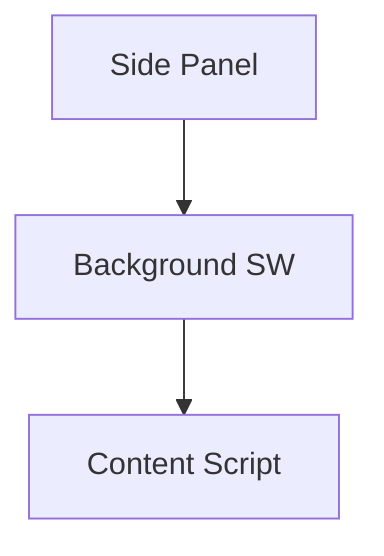

# Cognito AI Documentation Style Guide

This guide defines the voice, structure, and conventions for all Cognito AI documentation. Based on [Fuma Nama's principles for good docs](https://fuma-nama.vercel.app/blog/good-docs).

---

## Purpose & Audiences

### Primary Audience
- **End Users**: Non-developers using Cognito AI for browsing and research
- **Contributors**: Developers extending or contributing to the project

### Documentation Goals
1. Help users accomplish tasks quickly
2. Enable contributors to understand and extend the codebase
3. Be accurate and verified against the current codebase

---

## Writing Style

### Use Simple Words

Use simple, accurate words. Non-native English speakers are a significant portion of readers.

| ❌ Don't | ✅ Do |
|----------|-------|
| utilize | use |
| facilitate | help |
| leverage | use |
| commence | start |
| terminate | stop |

### No Redundant Decorations

Remove filler words like "you can", "you may try", "please".

| ❌ Before | ✅ After |
|-----------|---------|
| Please don't put this in A | Don't put this in A |
| You can configure the library | Configure the library |
| If it doesn't work, you may update | If it doesn't work, update |
| Personally, I would recommend A | Use A |
| To enable B, you can configure C | To enable B, configure C |

### Subject First

Place the subject at the beginning of sentences.

| ❌ Before | ✅ After |
|-----------|---------|
| One of the documentation frameworks, Fumadocs, is popular | Fumadocs is a documentation framework |
| Moreover, as a web framework, Next.js... | Next.js is a web framework... |
| You can configure C to enable B | To enable B, configure C |

### No Long Paragraphs

- **Max 10-12 words per line**
- **Max 9 lines per paragraph**
- Give each paragraph a meaningful heading

### Avoid Sequential Language

Don't use "first... then..." or ordered lists for steps. People read top to bottom. Use meaningful headings instead.

| ❌ Don't | ✅ Do |
|----------|-------|
| 1. Install the extension | ### Install the Extension |
| 2. Configure your API key | ### Configure Your API Key |
| First, install... Then, configure... | Install first. Configure next. |

---

## Syntax & Formatting

### Use Lists for Key Points

Instead of complex English connectives, use bullet lists.

### Use Tables

Tables express conditions and properties better than multiple "if" statements.

### Use Bold for Skimming

Emphasize important terms with **bold**. Most readers skim rather than read.

### Use Code Blocks

For technical docs, code speaks louder than text.

```typescript
// Good: Show code, explain in comments
const apiKey = ENV.GOOGLE_AI_API_KEY; // Loaded from environment
```

**Enhanced Code Blocks:**

Add a `title` attribute to the code block to display a filename or title:

````md
```bash title="Terminal"
pnpm install
```
````

### More Headings

- Headings provide anchors for linking
- Give short summaries to paragraphs
- Help readers find information faster

### Use Hyperlinks

Link relevant resources when mentioning names (e.g., [Fumadocs](https://fumadocs.vercel.app)).

### Callouts

Use the `<Callout>` component from Fumadocs for notes, tips, and warnings. Do NOT use GitHub-style alerts (e.g., `> [!TIP]`) or blockquotes.

**Available types:**

| Type | Usage |
|------|-------|
| `info` (default) | General information |
| `warn` | Important notes, warnings |
| `error` | Critical warnings, breaking changes |

**Examples:**

```mdx
<Callout>
  General information or tip.
</Callout>

<Callout type="warn">
  Important note about closed-source backend.
</Callout>

<Callout title="Custom Title">
  Callout with a custom title instead of the default.
</Callout>
```

**Do NOT** duplicate the type in the title (e.g., `title="Note"` when `type="warn"` already shows "Note").

---

## Page Organization

### Dedicated Pages

Create dedicated pages for specific topics. When behavior changes, update one page.

### No Duplicate Content

Avoid mentioning the same behavior in multiple pages. Changes require updating only one location.

### Learning Curve

Order pages for beginners:
1. Build correct context first
2. Reveal complexity as readers learn deeper

### Acronyms

- Spell out acronyms the first time
- Maintain a glossary page for terminology

### FAQ Section

Include FAQ sections for common problems, bug fixes, and workarounds.

---

## Page Template

Every documentation page should follow this structure:

```mdx
---
title: Page Title
description: One-line description of what this page covers.
---

{/* TEMP_CONTENT: ... */}
{/* NEEDS_VERIFICATION: ... */}

## What You'll Learn

- Key outcome 1
- Key outcome 2

## Prerequisites

- Prerequisite 1
- Prerequisite 2

## Main Content

### Heading 1

Content with **bold** for emphasis.

### Heading 2

Content with code examples:

```typescript
// Example code
```

## Next Steps

- [Related Page 1](/docs/path)
- [Related Page 2](/docs/path)
```

---

## Terminology

Use consistent terminology throughout:

| Term | Usage |
|------|-------|
| **Cognito AI** | Full product name |
| **Cognito** | Acceptable short form |
| **Side panel** | Not "sidebar" or "side bar" |
| **BYOK** | "Bring Your Own Key" (spell out first mention) |
| **MCP** | "Model Context Protocol" (spell out first mention) |
| **WebMCP** | One word, capital W and MCP |

---

## Verification Policy

### No Claims Without Evidence

Every behavioral/configuration claim must have:
- A `code_refs:` reference, OR
- A `NEEDS_VERIFICATION` tag

### Placeholder Comments

Use JSX comments in MDX files:

```mdx
{/* TEMP_CONTENT: description | replace_with: what | by: YYYY-MM-DD */}

{/* NEEDS_VERIFICATION: reason | owners: names | code_refs: paths | last_checked: YYYY-MM-DD */}

{/* MERMAID_DIAGRAM: id | type: flow|sequence|component | represents: description | code_refs: paths */}

{/* SOURCE_LEGACY_DOC: path | action: rewrite|summarize|extract */}
```

---

## Diagram Policy

### Mermaid Placeholders

Add `MERMAID_DIAGRAM` comments before every diagram:

```mdx
{/* MERMAID_DIAGRAM: extension.architecture | type: component | represents: WXT entrypoints | code_refs: apps/extension/src/entrypoints/ */}


```

### Diagram Types

| Type | Use For |
|------|---------|
| `flow` | Decision trees, data flow |
| `sequence` | API calls, message passing |
| `component` | Architecture, system parts |
| `state` | State machines, approval flows |

---

## Review & Approval

Gate A approved: 2024-12-30
- Audiences: End users + Contributors
- Tone: Simple, direct, no frills
- IA: 10 sections, 52 pages
