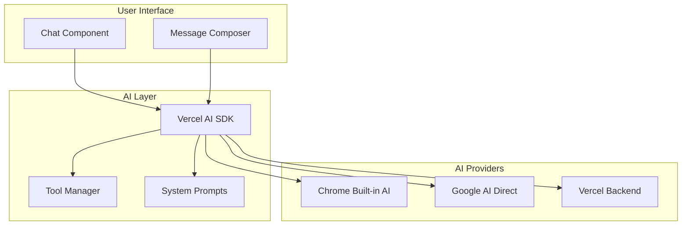
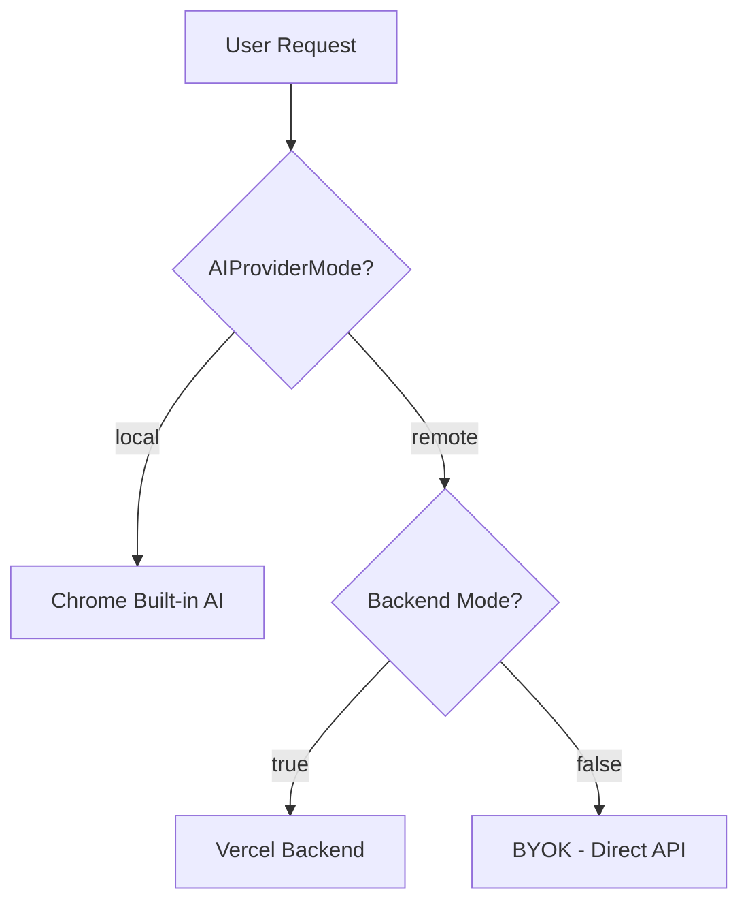
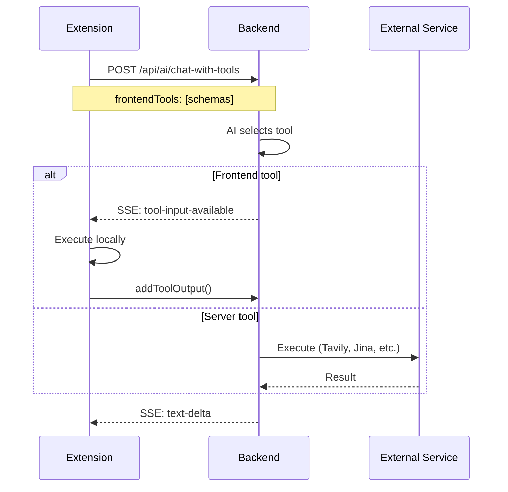

{/* VERIFIED: 2024-12-31 | code_refs: apps/extension/src/ai/ */}

Cognito AI uses the **Vercel AI SDK v6** for AI integration, supporting multiple providers and execution modes.

## Overview

{/* MERMAID_DIAGRAM: ai.overview | type: component | represents: AI system architecture | code_refs: apps/extension/src/ai/ */}



## AI Provider Modes

| Mode | Provider | Requirements | Model |
|------|----------|--------------|-------|
| **Local** | Chrome built-in AI | Chrome with AI | Gemini Nano |
| **BYOK** | Google AI directly | Your API key | Any Gemini |
| **Backend** | Vercel backend | None | gemini-2.5-flash |

### Provider Selection Flow



### Switching Providers

```typescript
// Via store
useModelStore.getState().setMode('remote');
useSettingsStore.getState().setUseBackendMode(true);

// Result: Uses Vercel backend
```

## Tool Architecture

Tools extend AI capabilities through structured function calls.

### Tool Categories

| Category | Execution | Examples |
|----------|-----------|----------|
| **Frontend** | Browser | `readPageContent`, `navigateTo` |
| **Server** | Backend | `web_search`, `retrieve_url` |
| **MCP** | Remote | Notion tools, Linear tools |
| **WebMCP** | Page | Page-provided tools |

{/* VERIFIED: 2024-12-31 | code_refs: apps/extension/src/ai/tools/manager.ts */}

### Tool Manager (`src/ai/tools/manager.ts`)

Aggregates tools from all sources:

```typescript
async function setupRemoteTools() {
  const extensionTools = await getAllTools();
  const mcpTools = await getMCPToolsFromBackground();
  const webmcpTools = await getWebMCPToolsFromBackground();
  const serverTools = getServerTools();
  
  return {
    ...extensionTools,
    ...mcpTools,
    ...webmcpTools,
    ...serverTools,
  };
}
```

### Frontend Tools

Executed in the browser with full DOM access:

```typescript
const readPageContent = {
  description: 'Read the current page content',
  parameters: z.object({}),
  execute: async () => {
    const content = await chrome.tabs.sendMessage(tabId, {
      type: 'dom/read'
    });
    return content;
  }
};
```

### Server Tools (Backend Mode)

Schema sent to backend, executed server-side:

{/* MERMAID_DIAGRAM: ai.server-tools | type: sequence | represents: Server tools pattern | code_refs: apps/extension/src/ai/backend/ */}



## Tools Mode

Controls which tools are available:

| Mode | Tools | Use Case |
|------|-------|----------|
| **chat** | Minimal (read page, screenshot) | Simple Q&A |
| **agent** | Full automation | Complex tasks |
| **adaptive** | Dynamic discovery | On-demand |
| **custom** | User-selected | Personal preference |

### Adaptive Mode

Uses meta-tools for on-demand discovery:

```typescript
const discoverTools = {
  description: 'Discover available tools based on task',
  parameters: z.object({ task: z.string() }),
  execute: async ({ task }) => {
    // Return relevant tools for the task
    return filterToolsForTask(task);
  }
};

const executeTools = {
  description: 'Execute discovered tools',
  parameters: z.object({
    toolName: z.string(),
    args: z.record(z.unknown())
  }),
  execute: async ({ toolName, args }) => {
    return await executeTool(toolName, args);
  }
};
```

## System Prompts

Different prompts for different modes:

| Mode | Prompt Focus |
|------|--------------|
| `chat` | Conversational, minimal tool guidance |
| `agent` | Tool usage instructions, agentic behavior |
| `adaptive` | discoverTools/executeTools workflow |

### Prompt Structure (`src/ai/prompts/`)

```text
src/ai/prompts/
├── systemPrompts.ts     # Mode-specific prompts
├── contextBuilder.ts    # Page context formatting
└── memoryPrompts.ts     # Supermemory integration
```

## Streaming Architecture

Uses AI SDK's streaming for real-time responses:

```typescript
const { textStream, toolCalls } = await streamText({
  model: googleModel,
  messages,
  tools,
  system: systemPrompt,
});

// Process stream
for await (const chunk of textStream) {
  // Update UI with chunk
}
```

### Backend Streaming

Backend streams responses via SSE:

```text
SSE Events:
- text-delta: Partial text
- tool-input-available: Tool was called
- tool-output-available: Tool completed
- finish: Stream complete
```

## Content Features

Specialized AI features for content generation and transformation.

| Feature | Location | Purpose |
|---------|----------|---------|
| **Writer** | `src/background/writer/` | Generate content |
| **Rewriter** | `src/background/rewriter/` | Transform text |
| **Summarizer** | `src/background/summarizer/` | Condense content |

Each uses the shared `@cognito/shared` constants:

```typescript
import { TONE_INSTRUCTIONS, PRESET_PROMPTS } from '@cognito/shared';
```

## Graceful Degradation

When backend rate limits are exceeded:

```typescript
// In backend response
if (status === 429 && hasApiKey) {
  // Auto-switch to BYOK
  useSettingsStore.getState().setUseBackendMode(false);
  notify('Switched to BYOK mode due to rate limit');
}
```

## Module Structure

```text
src/ai/
├── agents/            # Specialized agents (YouTube, PDF)
├── backend/           # Backend mode streaming
│   └── streamBackend.ts
├── core/              # Core AI functionality
├── hooks/             # React hooks for AI
├── mcp/               # MCP tool proxy
│   └── proxy.ts       # MCP tool execution
├── models/            # Model configuration
├── planning/          # Task planning
├── prompts/           # System prompts
│   ├── systemPrompts.ts
│   └── contextBuilder.ts
├── setup/             # AI initialization
├── stream/            # Streaming utilities
├── suggestions/       # Action suggestions
├── tools/             # Tool management
│   ├── manager.ts     # Tool aggregation
│   ├── registry.ts    # Tool definitions
│   └── webmcpTools.ts # WebMCP integration
├── transport/         # Communication layer
├── types/             # Type definitions
└── utils/             # AI utilities
```

## Next Steps

- [Tools & Approval](/docs/architecture/tools-and-approval) — Tool approval system
- [MCP Client](/docs/architecture/mcp-client) — MCP architecture
- [Backend Services](/docs/integrations/backends) — Backend API details
