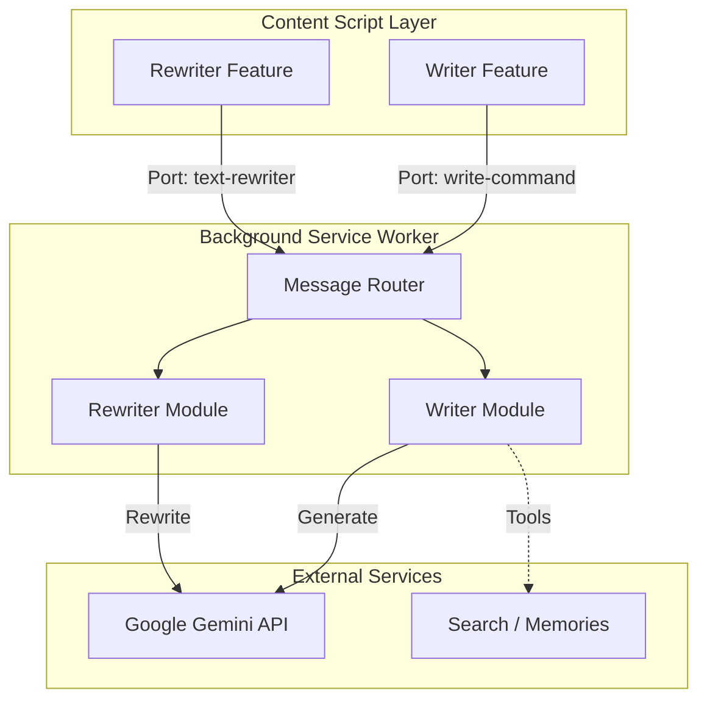

# Content Features Architecture

This section details the architecture of the **Writer** and **Rewriter** features—the client-facing AI capabilities that run directly within web pages via Content Scripts.

## Overview

The Gemini Writer and Rewriter leverage Google's Gemini API to generate and transform text. While they serve different user needs, they share a common underlying architecture handling communication, state, and API interactions.

- **[Writer](./content-features/writer)**: Generates new content from scratch (e.g., "Write a reply to this email").
- **[Rewriter](./content-features/rewriter)**: Transforms existing selected text (e.g., "Make this more professional").

## High-Level Architecture

The architecture consists of three main layers:
1.  **Content Script Layer**: The UI and logic running in the context of the webpage.
2.  **Background Service Worker**: Handles secure API calls and routing.
3.  **External Services**: Google Gemini API and optional tools.

## Shared Components

### Port Communication

Both features use Chrome's `runtime.connect()` for reliable bidirectional messaging. This ensures that the connection stays alive during long-running streaming generations.

**Lifecycle:**
1.  Content Script opens a port (e.g., `write-command`).
2.  Background accepts connection and listens for messages.
3.  Messages are exchanged (`WRITE_GENERATE`, `WRITE_STREAM_CHUNK`).
4.  Port is disconnected when the operation is complete or the UI is closed.

### Tool Integration

Both features support "Tools" that enhance the AI's capabilities:

-   **URL Context**: Fetches and analyzes the current page content.
-   **Google Search**: providing real-time information.
-   **Memory Search**: Accesses the user's personal knowledge base via Supermemory.

**Tool Selection Logic:**
-   If built-in tools (URL/Search) are enabled, the system may specific "Tools" mode.
-   If Memory Search is enabled, the system uses a **Function Calling Loop** to let the AI decide when to search memories.

### Error Handling

Common error handling strategies are used across both features:

| Error Code | Description | User Feedback |
| :--- | :--- | :--- |
| `NO_API_KEY` | Missing API key | "Please configure your API key in settings" |
| `RATE_LIMITED` | API rate limit hit | "Too many requests. Please wait..." |
| `NETWORK_ERROR` | Connection failure | "Network error. Check your connection" |
| `PORT_DISCONNECTED` | Connection lost | "Connection lost. Please try again" |

### Security

-   **API Key Protection**: Keys are stored in Chrome secure storage and never exposed to the content script.
-   **Isolation**: Features run in an Isolated World (Content Script) and use Shadow DOM to prevent CSS conflicts with the host page.
-   **Sanitization**: All user inputs are treated as untrusted and passed safely to the LLM.

