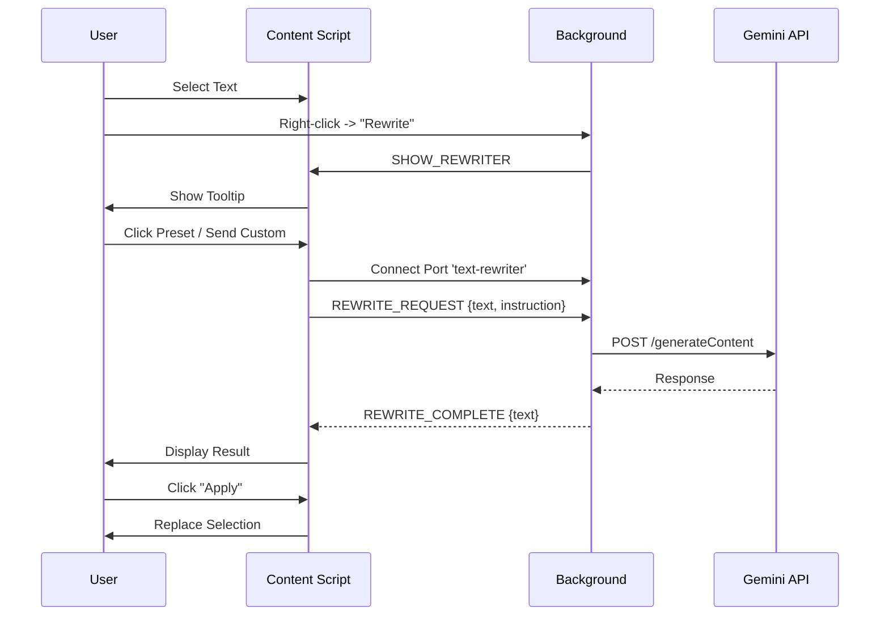

# Rewriter Architecture

The **Rewriter** feature allows users to transform selected text on any webpage using presets or custom instructions.

## Trigger Mechanism

1.  **Selection**: User highlights text on a webpage.
2.  **Context Menu**: User right-clicks and selects "Rewrite with Cognito AI".
3.  **Message**: Background script sends a `SHOW_REWRITER` message to the active tab.
4.  **UI Launch**: The `RewriterTooltip` appears near the selected text.

## UI Component (RewriterTooltip)

The UI is a lightweight tooltip that offers:
-   **Presets**: Quick actions like "Shorter", "Professional", "Fix Grammar".
-   **Custom Input**: Field for typing specific instructions.
-   **Tool Toggles**: URL Context, Search, Memory.
-   **Diff View**: (Planned) or direct replacement of text.

## Presets

| Preset | Description |
| :--- | :--- |
| `shorter` | Condense while preserving meaning. |
| `longer` | Expand with more detail. |
| `professional` | Formal business tone. |
| `casual` | Friendly, relaxed tone. |
| `improve` | Fix grammar, clarity, and flow. |
| `simplify` | Make language easier to understand. |

## Data Flow



## GeminiRewriter Class

The `GeminiRewriter` class handles the transformation logic:

-   **Model**: Defaults to `gemini-2.5-flash-lite`.
-   **Logic**: Wraps the user's text and instruction into a prompt designed for rewriting.
-   **Mode**: Generally uses non-streaming responses for atomic updates, though streaming is supported in underlying classes.

### Message Protocol

**Request (`REWRITE_REQUEST`):**
```typescript
{
  selectedText: string;
  instruction: string; // e.g. "Make it shorter" or custom
  preset?: string;
  enableUrlContext?: boolean;
}
```

**Response (`REWRITE_COMPLETE`):**
```typescript
{
  text: string; // The fully rewritten text
}
```
