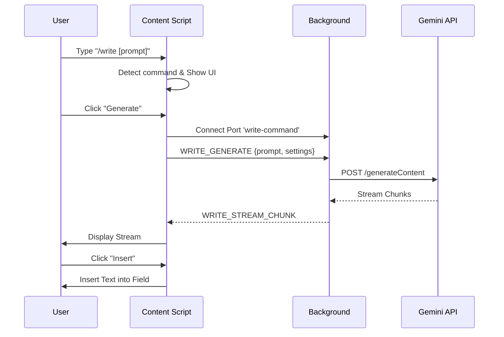

# Writer Architecture

The **Writer** feature allows users to generate new content from scratch using the `/write` command in any editable field.

## Trigger Mechanism

1.  **Detection**: The `useWriteCommandDetection` hook listens for `input` events on the active element.
2.  **Activation**: When the user types `/write`, the text is captured, and the command is removed from the input field.
3.  **UI Launch**: The `WriterOverlay` component is mounted into the DOM (using Shadow DOM if possible).

## UI Component (WriterOverlay)

The UI is a draggable, floating panel that allows users to:
-   Enter prompts (e.g., "Draft a follow-up email").
-   Attach files (images, PDFs) for multimodal input.
-   Toggle tools (URL Context, Search, Memory).
-   Preview and Insert the generated text.

## Data Flow



## Platform Detection

The Writer uses intelligent platform detection to customize the **System Prompt** and suggested **Tone**.

| URL Pattern | Platform | Suggested Tone |
| :--- | :--- | :--- |
| `mail.google.com` | Gmail | Professional |
| `linkedin.com` | LinkedIn | Professional |
| `twitter.com`, `x.com` | Twitter | Casual |
| `slack.com` | Slack | Casual |
| `github.com` | GitHub | Professional |
| `*` (Default) | Web | Professional |

## GeminiWriter Class

The `GeminiWriter` class in the background script handles the core logic:

-   **Model**: Defaults to `gemini-2.5-flash-lite`.
-   **Context Builder**: Assembles the system prompt based on platform and user settings.
-   **Generation**: Supports both streaming (`generateStream`) and non-streaming responses.

### Message Protocol

**Request (`WRITE_GENERATE`):**
```typescript
{
  prompt: string;
  pageContext?: { url: string, title: string, platform: string };
  settings?: {
    tone?: 'professional' | 'casual' | 'friendly';
    enableUrlContext?: boolean;
    enableGoogleSearch?: boolean;
  };
  attachment?: { ... };
}
```

**Response (`WRITE_STREAM_CHUNK`):**
```typescript
{
  text: string; // The accumulated or chunk text
  done: boolean;
}
```

## Settings

| Setting | Default | Description |
| :--- | :--- | :--- |
| `enabled` | `true` | Master toggle for the feature. |
| `defaultTone` | `professional` | Default tone for new sessions. |
| `includePageContext` | `true` | Whether to send page URL/Title to the AI. |

