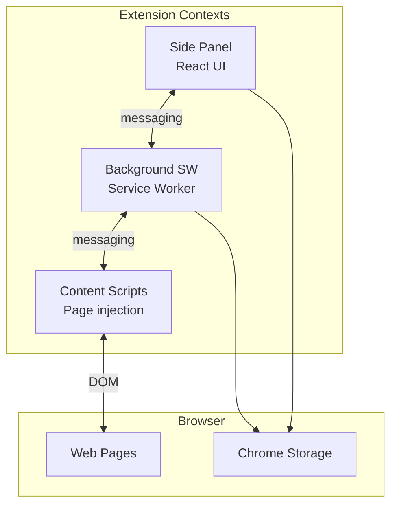

{/* VERIFIED: 2024-12-31 | code_refs: apps/extension/src/entrypoints/ */}

The Cognito Chrome extension is built with [WXT](https://wxt.dev/) and React 19. This page covers the extension's internal architecture.

## Extension Contexts

Chrome extensions run in multiple isolated contexts:

{/* MERMAID_DIAGRAM: extension.contexts | type: component | represents: Extension execution contexts | code_refs: apps/extension/src/entrypoints/ */}



| Context | Purpose | Lifecycle |
|---------|---------|-----------|
| **Side Panel** | User interface | When panel is open |
| **Background SW** | Core logic, connections | Persistent (ish) |
| **Content Scripts** | Page interaction | Per-tab |

## WXT Entrypoints

```text
apps/extension/src/entrypoints/
├── sidepanel/                    # Main UI (React)
│   ├── index.html                # HTML shell
│   ├── main.tsx                  # React entry
│   └── App.tsx                   # Root component
├── background.ts                 # Service worker
├── webmcp-proxy.content.ts       # WebMCP discovery
├── unified-overlay.content/      # Content overlays
│   ├── TextRewriterApp.tsx       # Rewriter UI
│   ├── TextSummarizerApp.tsx     # Summarizer UI
│   └── WriteCommandApp.tsx       # Writer UI
├── ask-ai-button.content/        # Ask AI button injection
├── options/                      # Options page
└── sandbox-executor/             # Sandboxed code execution
```

### Side Panel (`sidepanel/`)

The main user interface built with React 19.

**Responsibilities:**
- Chat interface
- Settings panels
- Tool display
- Voice mode UI

**Key files:**
```text
sidepanel/
├── main.tsx           # React root
├── App.tsx            # Main component
├── index.html         # HTML entry
└── index.css          # Global styles
```

### Background Service Worker (`background.ts`)

Runs in the background, handles:
- MCP connections
- Message routing
- Chrome API access
- Tool orchestration

**Key modules:**
```text
src/background/
├── initializer.ts       # Entry point & initialization
├── messaging/           # Message handlers
│   ├── router.ts        # Route to handlers
│   ├── mcpHandler.ts    # MCP messages
│   ├── webmcpHandler.ts # WebMCP messages
│   ├── fileHandler.ts   # File operations
│   ├── uiHandler.ts     # UI messages
│   └── geolocationHandler.ts
├── mcp/                 # MCP management
├── webmcp/              # WebMCP state management
│   └── manager.ts       # Active tab tool tracking
├── supermemory/         # Memory services
│   ├── searchService.ts # Memory search
│   └── extraction/      # Auto-extraction
├── writer/              # Writer feature backend
├── rewriter/            # Rewriter feature backend
├── summarizer/          # Summarizer feature backend
└── providers/           # AI provider capabilities
```

### Content Scripts

Inject into web pages for DOM access.

| Script | Purpose |
|--------|---------|
| `webmcp-proxy` | Discover page MCP tools |
| `unified-overlay` | Writer, Rewriter, Summarizer UIs |
| `ask-ai-button` | Inline AI button injection |

## Message Passing

Contexts communicate via Chrome messaging:

```typescript
// Side panel → Background
chrome.runtime.sendMessage({ 
  type: 'mcp/notion/tool/call',
  payload: { name: 'create_page', args: {...} }
});

// Background → Content script
chrome.tabs.sendMessage(tabId, {
  type: 'webmcp/tool/execute',
  toolName: 'search',
  args: { query: '...' }
});
```

### Message Router (`background/messaging/router.ts`)

Routes messages by type prefix:

```typescript
// Message routing
if (type.startsWith('mcp/')) → mcpHandler
if (type.startsWith('webmcp/')) → webmcpHandler
if (type.startsWith('tool/')) → toolHandler
// ...
```

### Type-Safe Messages

Messages are typed for safety:

```typescript
interface McpToolCallMessage {
  type: `mcp/${string}/tool/call`;
  payload: {
    name: string;
    arguments: Record<string, unknown>;
  };
}
```

## State Management

Uses **Zustand** stores with Chrome storage sync.

### Store Pattern

```typescript
import { create } from 'zustand';
import { persist } from 'zustand/middleware';

interface SettingsState {
  useBackendMode: boolean;
  setUseBackendMode: (value: boolean) => void;
}

export const useSettingsStore = create<SettingsState>()(
  persist(
    (set) => ({
      useBackendMode: true,
      setUseBackendMode: (value) => set({ useBackendMode: value }),
    }),
    { name: 'settings' }
  )
);
```

### Available Stores

| Store | Purpose |
|-------|---------|
| `useSettingsStore` | User preferences |
| `useModelStore` | AI model config |
| `useChatStore` | Messages, threads |
| `useToolsStore` | Tool state |
| `useUINavigationStore` | UI state |
| `useMcpStore` | MCP servers |
| `useVoiceModeStore` | Voice settings |

### Selective Subscriptions (Critical)

**Always use selectors to avoid re-render loops:**

```typescript
// ✅ CORRECT - Selective subscriptions
const messages = useChatStore((state) => state.messages);
const addMessage = useChatStore((state) => state.addMessage);

// ❌ WRONG - Subscribes to entire store
const store = useChatStore();
```

## Component Structure

```text
src/components/
├── ui/               # Primitives (shadcn)
│   ├── primitives/   # Never modify directly
│   ├── Button.tsx
│   └── ...
├── features/         # Feature-specific
│   ├── chat/         # Chat components
│   ├── mcp/          # MCP management
│   └── settings/     # Settings UI
└── shared/           # Reusable components
```

## React 19 Patterns

The extension uses React 19 with important changes:

### `ref` as Prop

```typescript
// ✅ React 19 - ref as prop
interface Props {
  ref?: React.RefObject<HTMLDivElement | null>;
}

function MyComponent({ ref, ...props }: Props) {
  return <div ref={ref} {...props} />;
}
```

### `useRef` Null Handling

```typescript
// ✅ React 19 - explicit null in type
const inputRef = useRef<HTMLInputElement | null>(null);
```

## Chrome APIs Used

| API | Purpose |
|-----|---------|
| `chrome.storage` | Persist data |
| `chrome.tabs` | Tab interaction |
| `chrome.sidePanel` | Side panel display |
| `chrome.runtime` | Messaging |
| `chrome.scripting` | Script injection |
| `chrome.identity` | OAuth flow |
| `chrome.alarms` | Background tasks |

## Next Steps

- [AI System](/docs/architecture/ai-system) — AI integration architecture
- [Tools & Approval](/docs/architecture/tools-and-approval) — Tool system
- [Repo Tour](/docs/contributing/repo-tour) — Detailed file walkthrough
