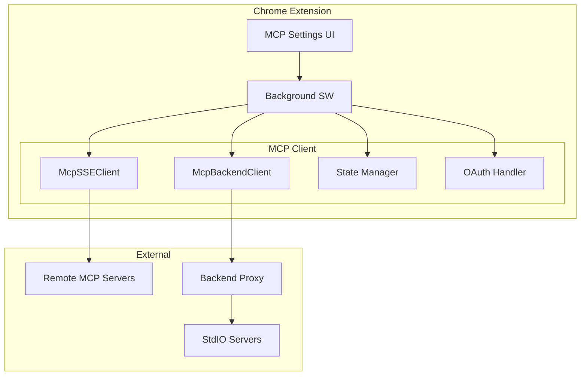
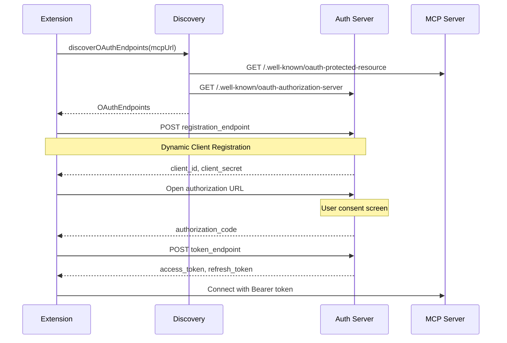

{/* VERIFIED: 2024-12-31 | code_refs: apps/extension/src/mcp/client/ */}

Cognito AI implements a full MCP client supporting multiple transport mechanisms. This page covers the client architecture.

## Architecture Overview

{/* MERMAID_DIAGRAM: mcp.client-architecture | type: component | represents: MCP client components | code_refs: apps/extension/src/mcp/ */}



## Transport Types

| Transport | Protocol | Client | Use Case |
|-----------|----------|--------|----------|
| **Streamable HTTP** | POST + SSE | McpSSEClient | Modern servers |
| **HTTP+SSE** | GET + SSE | McpSSEClient | Legacy servers |
| **StdIO** | stdin/stdout | McpBackendClient | CLI tools |

## Module Structure

```text
apps/extension/src/mcp/
├── client/                  # SSE client components
│   ├── McpSSEClient.ts      # Main SSE client
│   ├── transportDetector.ts # Protocol detection
│   ├── streamProcessor.ts   # SSE stream parsing
│   ├── requestManager.ts    # Request/response
│   ├── connectionManager.ts # Reconnection
│   ├── messageHandler.ts    # Message routing
│   └── errorHandler.ts      # Error handling
├── discovery.ts             # OAuth discovery
├── oauth.ts                 # OAuth 2.0 flow
├── authHelpers.ts           # Token utilities
├── scopeHandler.ts          # Scope management
├── state.ts                 # Connection state
├── types.ts                 # Type definitions
└── events.ts                # Event system
```

## McpSSEClient

The main client for SSE/HTTP transport:

```typescript
import { McpSSEClient } from '@/mcp/client';

const client = new McpSSEClient({
  serverUrl: 'https://mcp.example.com',
  serverId: 'example-server',
  accessToken: '...'
});

// Connect and initialize
await client.connect();
await client.initialize();

// List available tools
const { tools } = await client.listTools();

// Execute a tool
const result = await client.callTool('tool_name', { arg: 'value' });
```

### Transport Detection

The client auto-detects transport protocol:

```typescript
// transportDetector.ts
async detectAndConnect(messageId: number) {
  // Try POST first (Streamable HTTP - newer)
  const postResponse = await fetch(url, { method: 'POST', ... });
  if (postResponse.ok) {
    this.transportType = 'streamable-http';
    return postResponse;
  }
  
  // Fall back to GET (HTTP+SSE - older)
  if (postResponse.status === 405) {
    const getResponse = await fetch(url, { method: 'GET', ... });
    this.transportType = 'http-sse';
    return getResponse;
  }
}
```

### Connection States

| State | Description |
|-------|-------------|
| `disconnected` | Ready to connect |
| `needs-auth` | OAuth required |
| `registering` | Dynamic client registration |
| `authorizing` | User in OAuth flow |
| `authenticated` | OAuth complete |
| `connecting` | Establishing connection |
| `connected` | Fully operational |
| `error` | Connection failed |
| `token-refresh` | Refreshing token |

## McpBackendClient

Proxy client for StdIO servers:

```typescript
// McpBackendClient.ts
export class McpBackendClient implements McpClient {
  constructor(serverId: string, accessToken: string | null) {
    this.serverId = serverId;
    this.accessToken = accessToken;
  }
  
  async initialize() {
    // Discover tools via backend
    const response = await fetch('/api/ai/mcp/discover', {
      method: 'POST',
      body: JSON.stringify({ 
        serverId: this.serverId,
        credentials: { apiKey: this.accessToken }
      })
    });
    this.tools = await response.json();
  }
  
  async callTool(name: string, args: object) {
    // Execute via backend
    return fetch('/api/ai/mcp/execute', {
      method: 'POST',
      body: JSON.stringify({ 
        serverId: this.serverId,
        credentials: { apiKey: this.accessToken },
        toolName: name,
        toolArgs: args
      })
    });
  }
}
```

> **Security**: Backend client sends only `serverId` + credentials. Commands are stored in a secure server-side registry.

## OAuth Flow

OAuth 2.0 with Dynamic Client Registration (RFC 7591):

{/* MERMAID_DIAGRAM: mcp.oauth-detailed | type: sequence | represents: OAuth flow | code_refs: apps/extension/src/mcp/oauth.ts */}



### OAuth Discovery (`discovery.ts`)

Implements RFC 9728 and RFC 8414:

```typescript
async function discoverOAuthEndpoints(mcpUrl: string) {
  // Try Protected Resource Metadata (RFC 9728)
  const prm = await fetch(`${origin}/.well-known/oauth-protected-resource${path}`);
  
  // Get Authorization Server Metadata (RFC 8414)
  const asm = await fetch(`${authServer}/.well-known/oauth-authorization-server`);
  
  return {
    authorization_endpoint,
    token_endpoint,
    registration_endpoint,
    scopes_supported
  };
}
```

## State Management

Centralized state for all MCP connections:

```typescript
// state.ts
interface ServerState {
  client: McpSSEClient | McpBackendClient | null;
  tokens: McpOAuthTokens | null;
  credentials: DynamicClientCredentials | null;
  status: McpServerStatus;
  oauthEndpoints: OAuthEndpoints | null;
  oauthState: OAuthState | null;
  isEnabled: boolean;
}

const serverStates = new Map<string, ServerState>();
```

### State Persistence

- **Tokens**: Stored in `chrome.storage.local`
- **Credentials**: Stored in `chrome.storage.local`
- **Enable state**: Stored in `chrome.storage.local`
- **Runtime state**: In-memory only

## Background Handlers

### Message Router

```typescript
// mcpHandler.ts
function handleMcpMessage(message) {
  // Parse: mcp/{serverId}/{action}
  const [, serverId, ...actionParts] = type.split('/');
  const action = actionParts.join('/');
  
  switch (action) {
    case 'auth/start': return startOAuthFlow(serverId);
    case 'disconnect': return disconnectServer(serverId);
    case 'tool/call': return callTool(serverId, payload);
    case 'status/get': return getServerStatus(serverId);
  }
}
```

### Manager Functions

```typescript
// manager.ts
export async function connectMcpServer(serverId: string) {
  const config = getServerConfig(serverId);
  
  if (config.isBackendOnly) {
    // StdIO server via backend
    const client = new McpBackendClient(serverId, accessToken);
  } else {
    // SSE/HTTP server
    const client = new McpSSEClient(config);
  }
  
  await client.connect();
  await client.initialize();
  
  updateServerState(serverId, { client, status: 'connected' });
}
```

## Error Handling

### Error Categories

| Category | Examples | Handling |
|----------|----------|----------|
| **Network** | Timeout, offline | Retry with backoff |
| **Auth** | Token expired, invalid | Refresh or re-auth |
| **Protocol** | Invalid message | Log and report |
| **Server** | Tool execution failed | Return to AI |

### Reconnection Strategy

```typescript
// connectionManager.ts
const BACKOFF = [1000, 2000, 4000, 8000, 16000, 30000];

async function reconnect(attempt: number) {
  const delay = BACKOFF[Math.min(attempt, BACKOFF.length - 1)];
  await sleep(delay);
  
  try {
    await client.connect();
  } catch (error) {
    if (attempt < MAX_RETRIES) {
      return reconnect(attempt + 1);
    }
    throw error;
  }
}
```

## Tool Execution Proxy

MCP tools are proxied through the background:

```typescript
// proxy.ts
function createMcpProxyTool(tool: McpTool, serverId: string) {
  return {
    description: tool.description,
    parameters: convertMCPSchemaToZod(tool.inputSchema),
    execute: async (args) => {
      return chrome.runtime.sendMessage({
        type: `mcp/${serverId}/tool/call`,
        payload: { name: tool.name, arguments: args }
      });
    }
  };
}
```

## Next Steps

- [Remote MCP](/docs/integrations/remote-mcp) — User guide
- [MCP Overview](/docs/integrations/mcp-overview) — Protocol introduction
- [WebMCP Architecture](/docs/architecture/webmcp-architecture) — Page-provided tools
