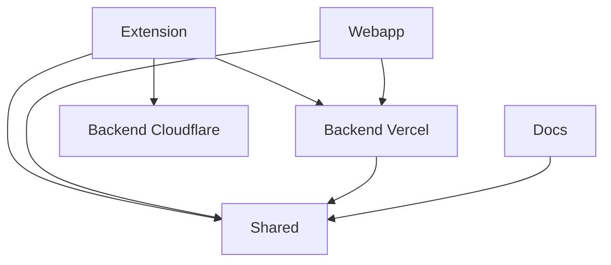

{/* VERIFIED: 2024-12-31 | code_refs: MONOREPO.md, pnpm-workspace.yaml */}

Cognito AI uses a **pnpm monorepo** containing the Chrome extension, documentation, webapp, and backend services.

## Workspace Structure

```text
cognito-ai/
├── apps/
│   ├── extension/          # @cognito/extension - Chrome Extension
│   ├── docs/               # @cognito/docs - Documentation (Fumadocs)
│   └── webapp/             # @cognito/webapp - Web application
├── packages/
│   ├── shared/             # @cognito/shared - Shared types/constants
│   ├── backend-cloudflare/ # @cognito/backend-cloudflare - ElevenLabs proxy
│   └── backend-vercel/     # @cognito/backend-vercel - AI API + services
└── [root config files]
```

## Package Overview

| Package | Scope | Purpose | Technology |
|---------|-------|---------|------------|
| Extension | `@cognito/extension` | Chrome Extension | WXT + React 19 |
| Docs | `@cognito/docs` | Documentation site | Next.js + Fumadocs |
| Webapp | `@cognito/webapp` | Settings pages | Next.js 16 |
| Shared | `@cognito/shared` | Types & constants | TypeScript |
| Backend Cloudflare | `@cognito/backend-cloudflare` | ElevenLabs proxy | Hono + Workers |
| Backend Vercel | `@cognito/backend-vercel` | AI API | Express + Vercel |

## Dependency Graph

{/* MERMAID_DIAGRAM: monorepo.dependencies | type: flowchart | represents: Package dependencies | code_refs: package.json files */}



## Package Details

### Extension (`apps/extension/`)

The Chrome extension built with [WXT](https://wxt.dev/) and React 19.

**Key directories:**
```text
apps/extension/
├── src/
│   ├── entrypoints/     # WXT entrypoints (sidepanel, background, contents)
│   ├── components/      # React components
│   ├── stores/          # Zustand state
│   ├── ai/              # AI integration
│   ├── mcp/             # MCP client
│   └── utils/           # Utilities
├── wxt.config.ts        # WXT configuration
└── package.json
```

### Webapp (`apps/webapp/`)

Settings and configuration pages as a Next.js app.

**Routes:**
| Route | Purpose |
|-------|---------|
| `/settings` | User preferences |
| `/onboarding` | First-time setup |
| `/reminders` | Reminder management |
| `/providers` | AI provider setup |

### Backend Vercel (`packages/backend-vercel/`)

Express API for AI chat, transcripts, and content services.

**Endpoints:**
| Path | Purpose |
|------|---------|
| `/api/ai/chat-with-tools` | Main chat API |
| `/simple-transcript` | YouTube transcripts |
| `/web-search` | Tavily web search |
| `/retrieve` | URL content extraction |

### Backend Cloudflare (`packages/backend-cloudflare/`)

Cloudflare Worker proxying ElevenLabs for voice mode.

**Endpoints:**
| Path | Purpose |
|------|---------|
| `/api/signed-url` | Voice conversation URL |
| `/api/voices` | Available voices |
| `/api/text-to-speech` | TTS streaming |

### Shared (`packages/shared/`)

Common types and constants used by multiple packages.

```typescript
// Import types
import type { WriteTone, RewritePreset } from '@cognito/shared';

// Import constants  
import { TONE_INSTRUCTIONS, PRESET_PROMPTS } from '@cognito/shared';
```

## Package Manager

This project uses **pnpm** with workspace configuration.

### Root `pnpm-workspace.yaml`

```yaml
packages:
  - 'apps/*'
  - 'packages/*'
```

### Common Commands

```bash
# Install all dependencies
pnpm install

# Run in specific package
pnpm --filter @cognito/extension dev
pnpm --filter @cognito/docs build

# Run in all packages
pnpm build
```

## Development Workflow

### Start All Services

```bash
pnpm dev:all
```

This runs in parallel:
- Extension dev server
- Webapp dev server  
- Backend dev server
- Docs dev server

### Start Individual Services

```bash
pnpm dev           # Extension only
pnpm dev:docs      # Docs only
pnpm dev:webapp    # Webapp only
```

### Building

```bash
pnpm build              # Build all
pnpm build:extension    # Extension only
```

## Adding Dependencies

### To a specific package

```bash
pnpm --filter @cognito/extension add react-query
```

### To the root (dev tools)

```bash
pnpm add -D -w prettier
```

## Root Configuration Files

| File | Purpose |
|------|---------|
| `pnpm-workspace.yaml` | Workspace packages |
| `package.json` | Root scripts, shared devDeps |
| `tsconfig.json` | Base TypeScript config |
| `.prettierrc` | Code formatting |
| `.gitignore` | Git ignore patterns |

## Git Commits

Use Conventional Commits with package scope:

```bash
feat(extension): add new feature
fix(backend-vercel): resolve API issue
docs: update architecture guide
chore: update dependencies
```

## Deployment

| Package | Platform | Command |
|---------|----------|---------|
| Extension | Manual upload | `pnpm build:extension` |
| Docs | Vercel | Auto-deploy on push |
| Webapp | Vercel | Auto-deploy on push |
| Backend Vercel | Vercel | Auto-deploy on push |
| Backend Cloudflare | Cloudflare | `pnpm deploy:cloudflare` |

## Next Steps

- [Extension Architecture](/docs/architecture/extension-architecture) — Chrome extension internals
- [Dev Setup](/docs/contributing/dev-setup) — Development environment
- [Coding Standards](/docs/contributing/coding-standards) — Code guidelines
