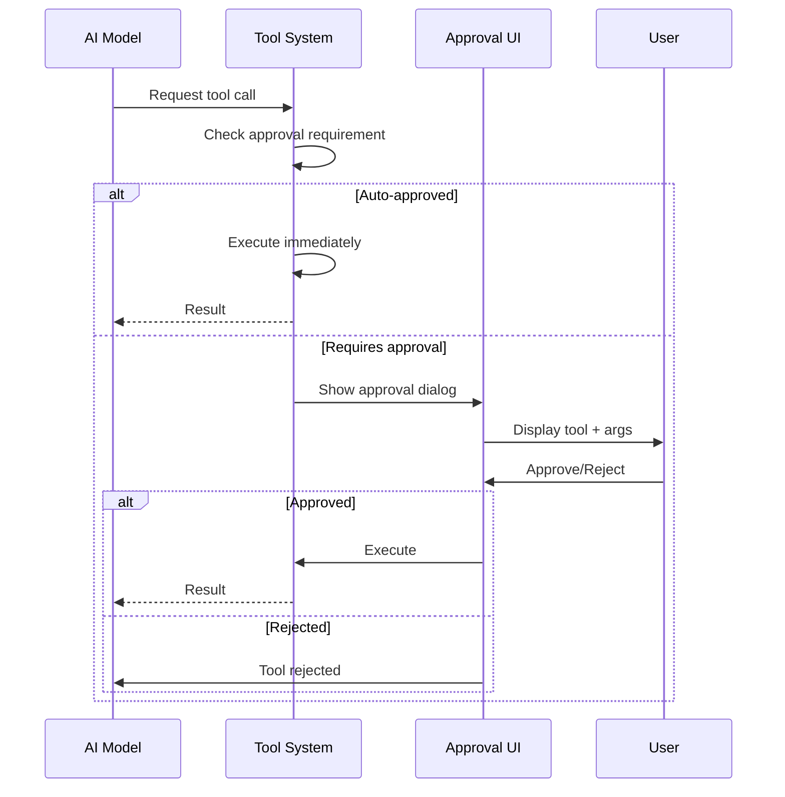

{/* VERIFIED: 2024-12-31 | code_refs: apps/extension/src/ai/tools/approvalConfig.ts, enabledTools.ts */}

Cognito AI implements a **Human-in-the-Loop (HITL)** approval system for tool execution. This ensures users maintain control over AI actions.

## Tool Categories

| Category | Approval | Risk Level | Examples |
|----------|----------|------------|----------|
| **Read-only** | Auto-approve | Low | `readPageContent`, `takeScreenshot` |
| **Navigation** | Configurable | Medium | `navigateTo`, `openTab` |
| **Automation** | Required | High | `clickByText`, `typeInField` |
| **WebMCP** | Always | External | Any page-provided tool |
| **MCP** | Configurable | Variable | Server-provided tools |

## Approval Flow

{/* MERMAID_DIAGRAM: tools.approval-flow | type: sequence | represents: Tool approval sequence | code_refs: apps/extension/src/components/features/chat/components/tool-renderers/ */}



## HITL Tool Pattern

Tools requiring approval omit the `execute` function. The AI SDK pauses for user input:

```typescript
// Tool without execute - requires HITL
const automationTool = {
  description: 'Click an element by text',
  parameters: z.object({
    text: z.string(),
    elementType: z.enum(['button', 'link', 'any'])
  }),
  // No execute - waits for addToolOutput()
};

// Executor stored separately
registerToolExecutor('clickByText', async (args) => {
  return await performClick(args.text, args.elementType);
});
```

### Approval UI Flow

1. AI SDK calls tool without `execute`
2. UI renders `CompactToolRenderer`
3. User sees tool name + arguments
4. User clicks **Approve** or **Reject**
5. On approve: executor runs, `addToolOutput()` called
6. AI receives result and continues

## Approval Configuration

### Tools Requiring Approval

```typescript
const TOOLS_REQUIRING_APPROVAL = [
  'clickByText',
  'typeInField',
  'scrollPage',
  'submitForm',
  // ... automation tools
];
```

### Auto-Approved Tools

```typescript
const AUTO_APPROVED_TOOLS = [
  'readPageContent',
  'takeScreenshot',
  'searchTabs',
  'getCurrentUrl',
  // ... read-only tools
];
```

## WebMCP Approval

All WebMCP tools require approval because they:
- Execute external code on third-party sites
- May access sensitive page data
- Could perform unintended actions

### WebMCP Approval Options

| Option | Scope | Persistence |
|--------|-------|-------------|
| **Allow** | Single execution | None |
| **Trust this site** | All tools from domain | Chrome storage |
| **Always allow** | This specific tool | Chrome storage |
| **This session** | Tool for session | Memory only |

### Checking WebMCP Approval

```typescript
import { isWebmcpTool, isWebmcpAutoApproved } from '@/ai/tools/webmcpTools';

if (isWebmcpTool(toolName)) {
  const approved = isWebmcpAutoApproved(toolName);
  if (!approved) {
    // Show approval UI
  }
}
```

## MCP Tool Approval

MCP server tools can be configured:

| Configuration | Behavior |
|---------------|----------|
| **Trusted server** | Auto-approve all tools |
| **Per-tool** | Approve specific tools |
| **Default** | Prompt for each call |

### Trust a Server

```typescript
// In MCP server config
{
  serverId: 'notion',
  trusted: true,  // Auto-approve all tools
}
```

## Approval Store (`approvalStore.ts`)

Persists approval preferences:

```typescript
interface ApprovalState {
  trustedDomains: string[];
  trustedTools: string[];
  sessionApprovals: Set<string>;
}

// Check if auto-approved
function isAutoApproved(toolName: string): boolean {
  // Check trustedTools
  if (state.trustedTools.includes(toolName)) return true;
  
  // Check domain for WebMCP
  const domain = getWebmcpDomain(toolName);
  if (state.trustedDomains.includes(domain)) return true;
  
  // Check session
  if (state.sessionApprovals.has(toolName)) return true;
  
  return false;
}
```

## Implementation Details

### Tool Renderer (`CompactToolRenderer.tsx`)

Displays tool call with approval buttons:

```tsx
function CompactToolRenderer({ toolCall }) {
  const { name, args } = toolCall;
  const requiresApproval = checkApprovalRequired(name);
  
  if (requiresApproval && !isApproved(name)) {
    return (
      <ApprovalCard
        toolName={name}
        args={args}
        onApprove={() => executeAndContinue(name, args)}
        onReject={() => rejectTool(name)}
      />
    );
  }
  
  // Auto-execute and show result
  return <ToolResultCard result={result} />;
}
```

### Executor Registry

Executors stored separately from tool definitions:

```typescript
// Registry
const toolExecutors = new Map<string, ToolExecutor>();

// Register
function registerToolExecutor(name: string, executor: ToolExecutor) {
  toolExecutors.set(name, executor);
}

// Execute after approval
async function executeApprovedTool(name: string, args: any) {
  const executor = toolExecutors.get(name);
  if (!executor) throw new Error(`No executor for ${name}`);
  return await executor(args);
}
```

## Security Considerations

### Validation Layers

1. **Schema validation** — Args match tool schema
2. **Origin validation** — WebMCP tool from correct domain
3. **Tab validation** — WebMCP tool from active tab
4. **User confirmation** — High-risk actions require approval

### Attack Prevention

| Attack | Mitigation |
|--------|------------|
| **Tool shadowing** | Origin validation |
| **Argument injection** | Schema validation |
| **Cross-tab execution** | Tab ID validation |
| **Unauthorized execution** | HITL approval |

## Best Practices

### For Tool Developers

1. **Minimize risk** — Use read-only operations when possible
2. **Clear descriptions** — Help users understand what the tool does
3. **Validate inputs** — Use strict Zod schemas
4. **Handle errors** — Return meaningful error messages

### For Users

1. **Review before approving** — Check tool arguments
2. **Trust selectively** — Only trust domains you recognize
3. **Session approvals** — Use for temporary trust
4. **Check tool source** — WebMCP tools come from the current page

## Next Steps

- [Browser Automation](/docs/using-cognito/browser-automation) — Using automation tools
- [WebMCP](/docs/integrations/webmcp) — Page-provided tools
- [Threat Model](/docs/security/threat-model) — Security architecture
