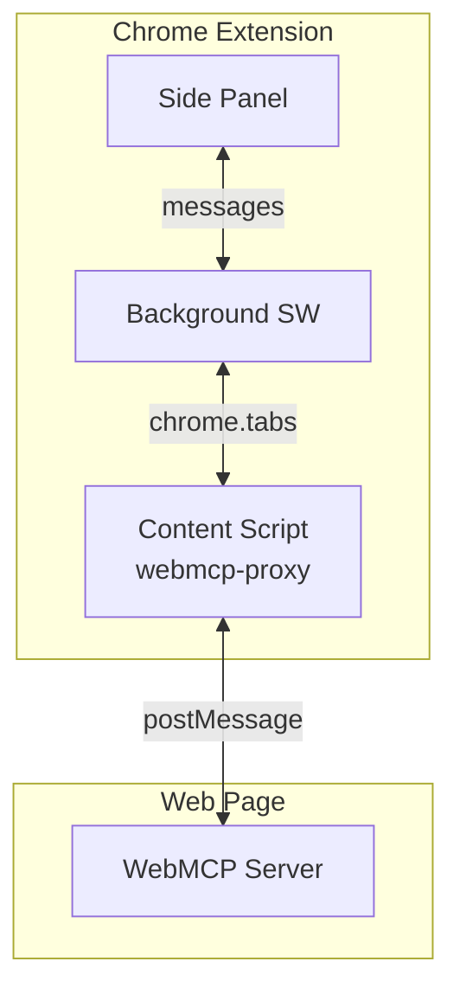
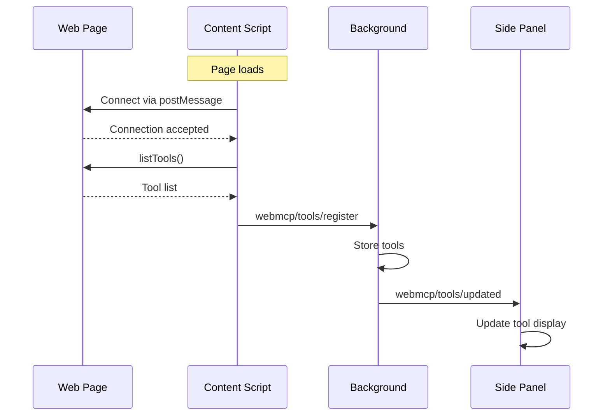
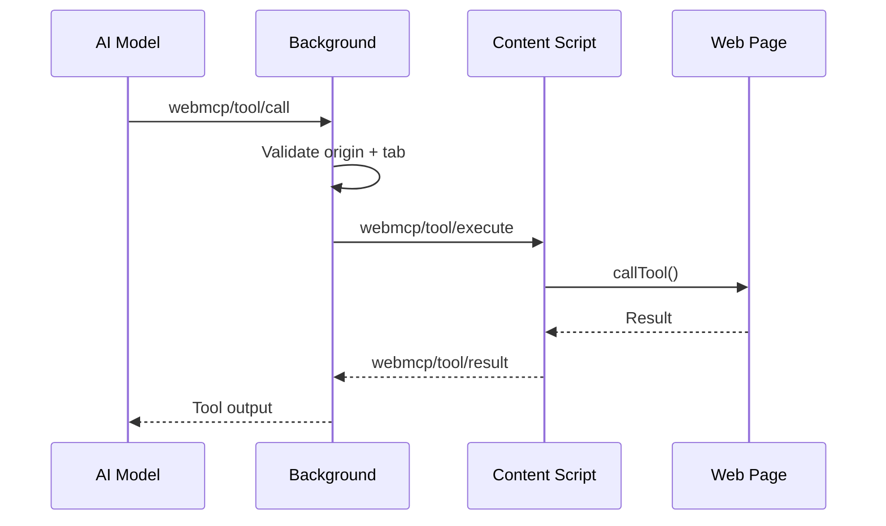

{/* VERIFIED: 2024-12-31 | code_refs: apps/extension/src/entrypoints/webmcp-proxy.content.ts, apps/extension/src/background/webmcp/ */}

WebMCP enables websites to expose tools that Cognito can discover and execute. This page covers the technical implementation.

## Architecture Overview

{/* MERMAID_DIAGRAM: webmcp.architecture-detailed | type: component | represents: WebMCP architecture | code_refs: apps/extension/src/background/webmcp/ */}



## Component Reference

| Component | Path | Purpose |
|-----------|------|---------|
| Content Script | `src/entrypoints/webmcp-proxy.content.ts` | Bridge to page |
| Manager | `src/background/webmcp/manager.ts` | State management |
| Handler | `src/background/messaging/webmcpHandler.ts` | Message routing |
| AI Tools | `src/ai/tools/webmcpTools.ts` | SDK integration |
| Hook | `src/hooks/webmcp/useWebMCPTools.ts` | React hook |

## Content Script (`webmcp-proxy`)

Injected into every page to discover WebMCP servers:

```typescript
// webmcp-proxy.content.ts

// Attempt connection on page load
async function attemptConnection() {
  const transport = new TabClientTransport();
  const client = new McpClient(transport);
  
  try {
    await client.connect();
    const tools = await client.listTools();
    
    // Report to background
    chrome.runtime.sendMessage({
      type: 'webmcp/tools/register',
      tools,
      tabId: currentTabId,
      domain: location.hostname,
      url: location.href
    });
  } catch (error) {
    // No WebMCP server on this page
  }
}

// Handle tool execution requests
chrome.runtime.onMessage.addListener((message) => {
  if (message.type === 'webmcp/tool/execute') {
    return handleToolExecution(message);
  }
});
```

### TabClientTransport

Custom MCP transport using `postMessage`:

```typescript
class TabClientTransport {
  send(message: McpMessage) {
    window.postMessage({
      type: 'mcp-request',
      payload: message
    }, '*');
  }
  
  receive(): Promise<McpMessage> {
    return new Promise((resolve) => {
      window.addEventListener('message', (event) => {
        if (event.data.type === 'mcp-response') {
          resolve(event.data.payload);
        }
      });
    });
  }
}
```

## Background Manager

Maintains state for active tab's WebMCP tools:

```typescript
// manager.ts
interface WebMCPState {
  tools: WebMCPTool[];
  activeTabId: number | null;
  activeDomain: string | null;
  isDiscovering: boolean;
  lastUpdated: number;
}

// Register tools from content script
export function registerWebMCPTools(data: ToolsRegisterPayload) {
  const { tools, tabId, domain, url } = data;
  
  // Only track active tab
  if (tabId !== state.activeTabId) return;
  
  state.tools = tools.map(tool => ({
    ...tool,
    name: `webmcp_${domain}_${tool.name}`,
    originalName: tool.name,
    domain,
    tabId,
    url
  }));
  
  broadcastToolsUpdate();
}
```

### Active Tab Tracking

Only tracks tools from the currently active tab:

```typescript
// Tab switch handling
chrome.tabs.onActivated.addListener(async ({ tabId }) => {
  // Clear previous tab's tools
  clearWebMCPTools();
  setActiveTab(tabId);
  
  // Trigger discovery on new tab
  chrome.tabs.sendMessage(tabId, {
    type: 'webmcp/tools/refresh'
  });
});
```

## Message Flow

### Tool Discovery



### Tool Execution



## Security Validation

Three-layer validation before execution:

### 1. Origin Validation

```typescript
function validateToolOrigin(tool: WebMCPTool): boolean {
  if (tool.domain !== state.activeDomain) {
    log.error('Origin mismatch', { 
      toolDomain: tool.domain,
      activeDomain: state.activeDomain 
    });
    return false;
  }
  return true;
}
```

### 2. Tab ID Validation

```typescript
function validateToolTabId(tool: WebMCPTool): boolean {
  if (tool.tabId !== state.activeTabId) {
    log.error('Tab ID mismatch', {
      toolTabId: tool.tabId,
      activeTabId: state.activeTabId
    });
    return false;
  }
  return true;
}
```

### 3. Schema Validation

```typescript
function validateArgsAgainstSchema(args: object, schema: JSONSchema): boolean {
  // Check required properties
  for (const prop of schema.required || []) {
    if (!(prop in args)) {
      return false;
    }
  }
  
  // Check types
  for (const [key, value] of Object.entries(args)) {
    const propSchema = schema.properties?.[key];
    if (!validateType(value, propSchema)) {
      return false;
    }
  }
  
  return true;
}
```

## AI SDK Integration

Convert WebMCP tools to AI SDK format:

```typescript
// webmcpTools.ts
export async function getWebMCPToolsFromBackground() {
  const { tools } = await chrome.runtime.sendMessage({
    type: 'webmcp/tools/list'
  });
  
  return convertWebMCPToolsToAITools(tools);
}

function convertWebMCPToolsToAITools(tools: WebMCPTool[]) {
  const result: Record<string, Tool> = {};
  
  for (const tool of tools) {
    const executor = createExecutor(tool);
    registerWebmcpToolExecutor(tool.name, executor);
    
    result[tool.name] = {
      description: `[WebMCP - ${tool.domain}] ${tool.description}`,
      parameters: convertToZod(tool.inputSchema),
      // No execute - requires HITL approval
    };
  }
  
  return result;
}
```

## Tool Naming

WebMCP tools are prefixed to prevent collisions:

```text
Pattern: webmcp_{domain}_{originalName}

Examples:
- webmcp_example.com_search
- webmcp_app.notion.com_create_page
```

### Name Sanitization

Tool names are sanitized for Gemini compatibility:

```typescript
function sanitizeToolName(name: string): string {
  let sanitized = name;
  
  // Prefix if starts with digit
  if (/^[0-9]/.test(sanitized)) {
    sanitized = `tool_${sanitized}`;
  }
  
  // Replace invalid chars
  sanitized = sanitized.replace(/[^a-zA-Z0-9_.:-]/g, '_');
  
  return sanitized;
}
```

## React Hook (`useWebMCPTools`)

Provides WebMCP state to components:

```typescript
// useWebMCPTools.ts
export function useWebMCPTools() {
  const [tools, setTools] = useState<WebMCPTool[]>([]);
  const [isLoading, setIsLoading] = useState(false);
  const [error, setError] = useState<string | null>(null);
  
  useEffect(() => {
    // Listen for updates
    const listener = (message: any) => {
      if (message.type === 'webmcp/tools/updated') {
        setTools(message.tools);
      }
    };
    
    chrome.runtime.onMessage.addListener(listener);
    return () => chrome.runtime.onMessage.removeListener(listener);
  }, []);
  
  return {
    tools,
    isLoading,
    error,
    refresh: () => triggerDiscovery(),
    disabledTools,
    toggleTool,
    enabledCount,
    currentDomain
  };
}
```

## For Page Developers

Implement WebMCP on your site:

```typescript
// Minimal WebMCP server
window.addEventListener('message', (event) => {
  if (event.data.type !== 'mcp-request') return;
  
  const { id, method, params } = event.data.payload;
  
  if (method === 'initialize') {
    respond(id, { protocolVersion: '2024-11-05' });
  }
  
  if (method === 'tools/list') {
    respond(id, {
      tools: [{
        name: 'search',
        description: 'Search the site',
        inputSchema: {
          type: 'object',
          properties: { query: { type: 'string' } },
          required: ['query']
        }
      }]
    });
  }
  
  if (method === 'tools/call') {
    const result = executeTool(params.name, params.arguments);
    respond(id, { content: [{ type: 'text', text: result }] });
  }
});

function respond(id: number, result: any) {
  window.postMessage({
    type: 'mcp-response',
    payload: { jsonrpc: '2.0', id, result }
  }, '*');
}
```

## Next Steps

- [WebMCP Integration](/docs/integrations/webmcp) — User guide
- [Tools & Approval](/docs/architecture/tools-and-approval) — Approval system
- [MCP Client](/docs/architecture/mcp-client) — Remote MCP architecture
