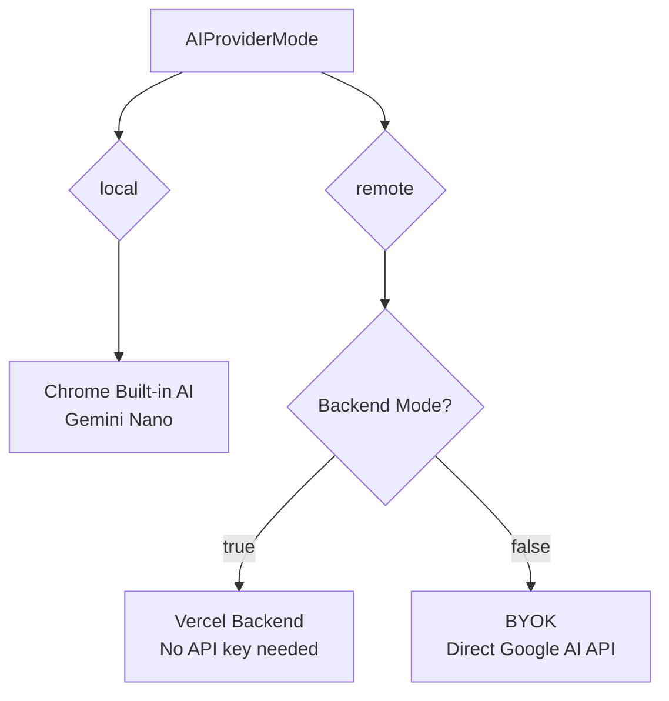

{/* VERIFIED: 2024-12-31 | code_refs: apps/extension/src/stores/ */}

Cognito AI uses **4 distinct "mode" concepts**. Understanding these prevents confusion when configuring the extension.

## Mode Summary

| Type | Values | Purpose | Store |
|------|--------|---------|-------|
| **AIProviderMode** | `local` / `remote` | WHERE AI runs | `useModelStore.mode` |
| **ToolsMode** | `chat` / `agent` / `adaptive` / `custom` | WHICH TOOLS available | `useToolsStore.currentMode` |
| **ChatMode** | `text` / `voice` | User INPUT METHOD | `useUINavigationStore.chatMode` |
| **Backend Mode** | `boolean` | HOW remote API is called | `useSettingsStore.useBackendMode` |

## AIProviderMode (Where AI Runs)

Determines whether AI processing happens locally or in the cloud.



### Local Mode

| Aspect | Details |
|--------|---------|
| **AI Model** | Gemini Nano (Chrome built-in) |
| **Requirements** | Chrome with AI features enabled |
| **Privacy** | All processing on device |
| **Capabilities** | Limited (no tools, shorter context) |

### Remote Mode

Determined by **Backend Mode** setting:

| Backend Mode | API | Requirements |
|--------------|-----|--------------|
| `true` | Vercel backend | None (shared quota) |
| `false` | Google AI directly | Your API key |

## ToolsMode (Which Tools Available)

Determines which tools the AI can use during conversations.

| Mode | Tools | Use Case |
|------|-------|----------|
| **chat** | Minimal (readPageContent, takeScreenshot) | Simple Q&A |
| **agent** | Full browser automation | Complex tasks |
| **adaptive** | Meta-tools (discoverTools, executeTools) | Dynamic discovery |
| **custom** | User-selected | Personal preference |

### Chat Mode Tools

```typescript
const chatTools = {
  readPageContent,  // Extract page text
  takeScreenshot,   // Capture visible area
  searchTabs,       // Find open tabs
  // ... minimal set
};
```

### Agent Mode Tools

```typescript
const agentTools = {
  ...chatTools,
  navigateTo,       // Open URL
  clickByText,      // Click elements
  typeInField,      // Fill inputs
  scrollPage,       // Scroll viewport
  // ... full automation
};
```

### Adaptive Mode

Uses meta-tools for dynamic discovery:

1. AI calls `discoverTools` to see available tools
2. AI selects relevant tools via `executeTools`
3. Tools load on-demand

### Custom Mode

User selects specific tools:

1. Open **Settings** → **Tools**
2. Toggle individual tools on/off
3. Only enabled tools available to AI

## ChatMode (Input Method)

How the user interacts with the AI.

| Mode | Description |
|------|-------------|
| **text** | Standard keyboard input |
| **voice** | Voice input via microphone |

### Switch Input Mode

- Click the **microphone** button to toggle voice mode
- Voice mode requires ElevenLabs integration

## Backend Mode (API Routing)

Only applies when `AIProviderMode = remote`.

| Value | API Route | Requirements |
|-------|-----------|--------------|
| `true` | Through Vercel backend | None |
| `false` | Direct to Google AI | Your API key |

### When to Use Backend Mode

| Scenario | Recommendation |
|----------|----------------|
| No API key | Backend Mode |
| Rate limited | Switch to BYOK |
| Privacy priority | BYOK (fewer intermediaries) |
| StdIO MCP servers | Either (backend proxies) |

### Graceful Degradation

When Backend Mode hits rate limits:

1. Backend returns 429 status
2. Extension checks for BYOK key
3. If key exists, auto-switches to BYOK
4. Shows notification to user

## Feature Flags

Build-time flags that enable/disable features:

| Flag | Effect | Default |
|------|--------|---------|
| `WXT_HIDE_LOCAL_MODE` | Hide local AI option | `false` |
| `WXT_YOUTUBE_BADGE_PREFETCH_ENABLED` | Prefetch YouTube badges | `true` |

Configure in `.env` file (see [Environment Variables](/docs/configuration/env-vars)).

## Type Imports

When working with modes in code:

```typescript
// AIProviderMode
import type { AIProviderMode, AIMode } from '@/stores/chat/types';

// ToolsMode
import type { ToolsMode } from '@/types/settings';
import type { ToolMode } from '@/stores/tools/types';

// ChatMode
import type { ChatMode } from '@/stores/ui/types';
```

## Switching Modes

### Via UI

- **AIProviderMode**: Settings → AI Provider
- **ToolsMode**: Settings → Tools → Mode dropdown
- **ChatMode**: Microphone button toggle
- **Backend Mode**: Settings → Use Backend toggle

### Via Code

```typescript
// AIProviderMode
useModelStore.getState().setMode('remote');

// ToolsMode
useToolsStore.getState().setCurrentMode('agent');

// ChatMode
useUINavigationStore.getState().setChatMode('voice');

// Backend Mode
useSettingsStore.getState().setUseBackendMode(true);
```

## Next Steps

- [Provider Setup](/docs/getting-started/provider-setup) — Configure your AI provider
- [AI System Architecture](/docs/architecture/ai-system) — How modes interact
