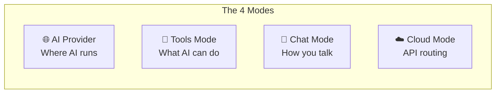
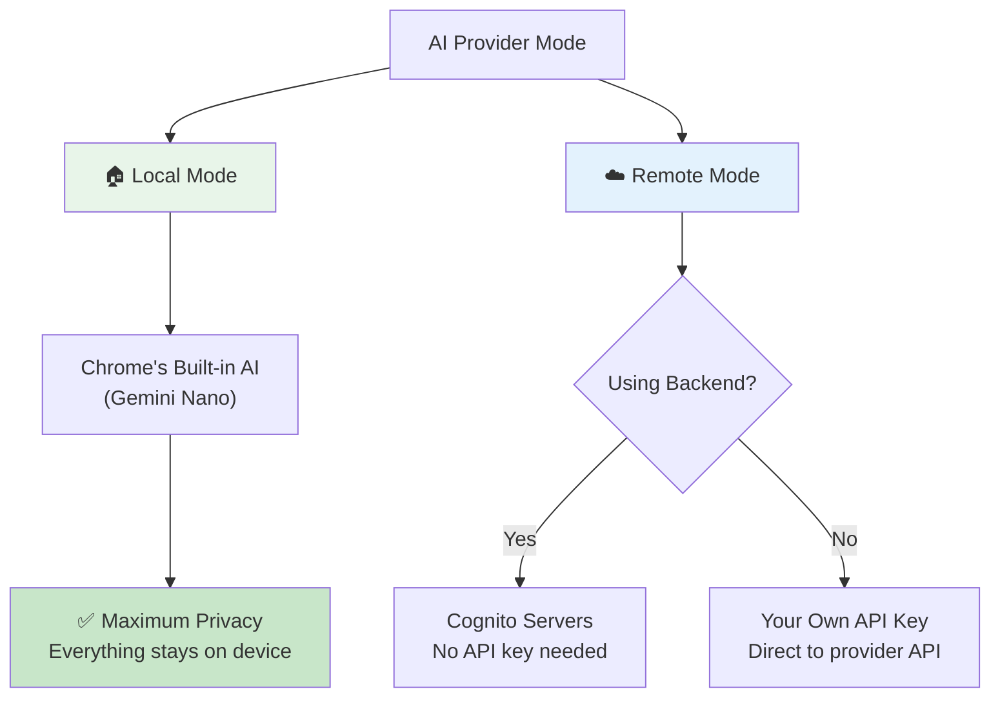
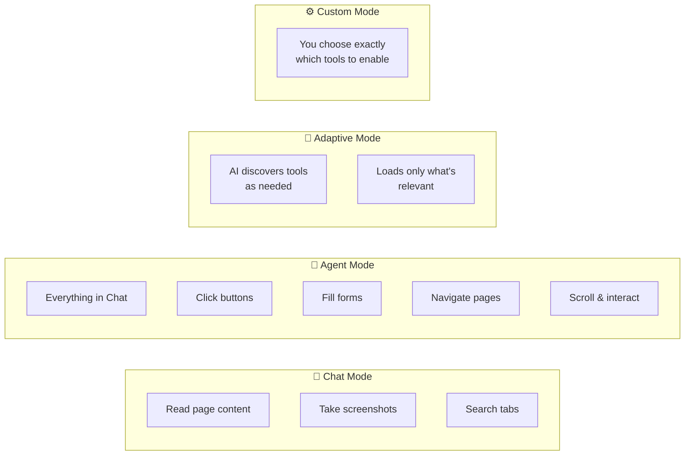
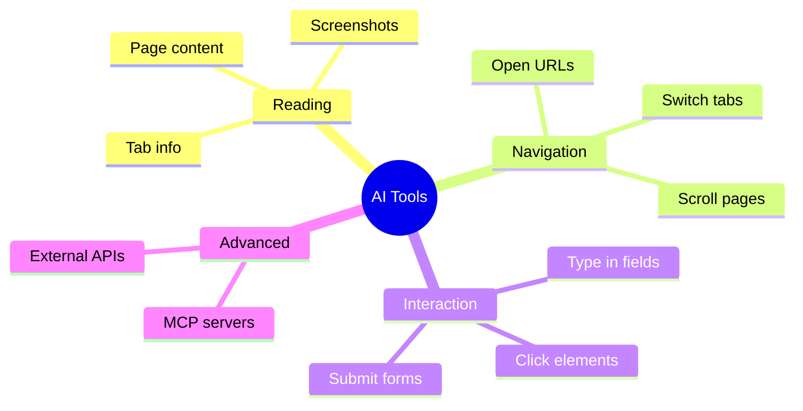
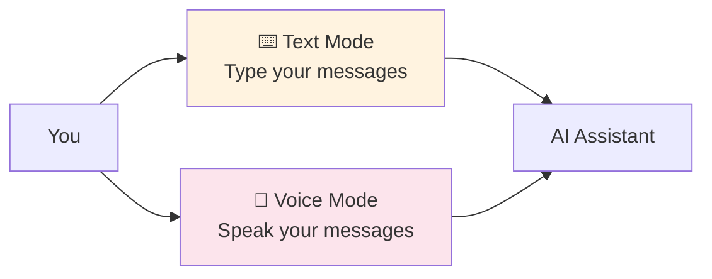
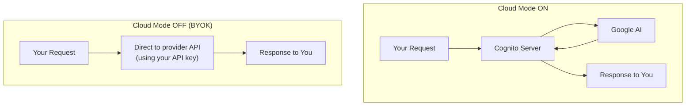
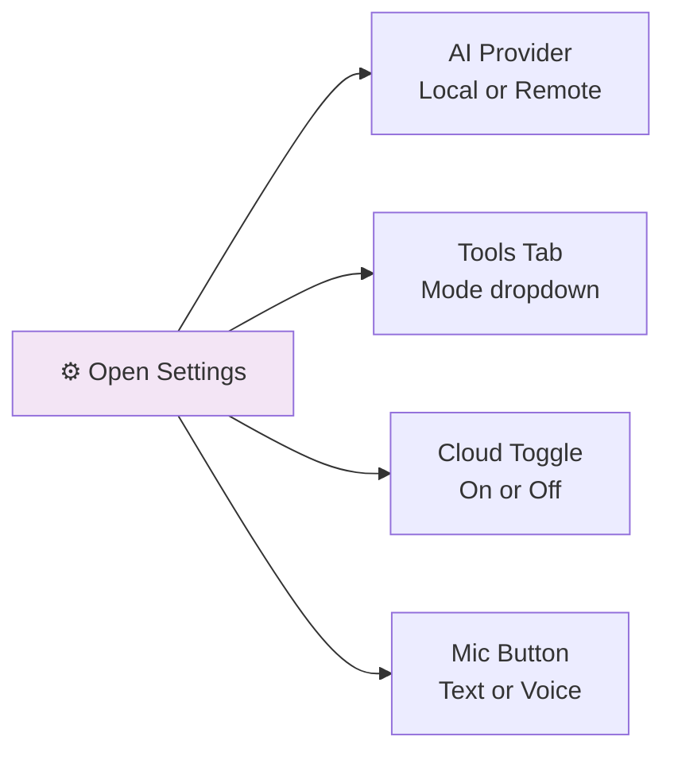

Cognito AI has **4 different modes** that control how the extension works. This guide explains each one in simple terms.

## Quick Overview

| Mode | What It Controls | Options |
|------|-----------------|---------|
| **AI Provider** | Where the AI processing happens | Local (on device) or Remote (cloud) |
| **Tools Mode** | What actions AI can perform | Chat, Agent, Adaptive, or Custom |
| **Chat Mode** | How you communicate with AI | Text or Voice |
| **Cloud Mode** | How remote AI is accessed | Cognito servers or your own API key |

---

## AI Provider Mode

This determines **where** your AI processing happens.

### Local Mode
- **What it is**: AI runs entirely on your computer using Chrome's built-in Gemini Nano
- **Best for**: Maximum privacy—nothing leaves your device
- **Limitations**: Fewer capabilities, no browser automation tools

### Remote Mode  
- **What it is**: AI runs in the cloud for full power
- **Best for**: Complex tasks, browser automation, longer conversations
- **How to access**: Via Cognito's backend OR bring your own API key

---

## Tools Mode

This determines **what the AI can do** during your conversation.

| Mode | Capabilities | When to Use |
|------|-------------|-------------|
| **Chat** | Reading pages, screenshots, tab search | Simple Q&A, summarizing content |
| **Agent** | Full browser control | Automating tasks, filling forms, navigating |
| **Adaptive** | AI picks tools dynamically | Balanced approach, efficient token usage |
| **Custom** | Only tools you select | Fine-grained control over AI abilities |

### Tool Categories at a Glance

---

## Chat Mode

This is simply **how you communicate** with the AI.

| Mode | How It Works |
|------|-------------|
| **Text** | Type your messages normally |
| **Voice** | Click the microphone to speak (requires ElevenLabs setup) |

**To switch**: Click the **microphone button** in the chat interface.

---

## Cloud Mode

This controls **how the AI is accessed** when using Remote mode.

| Setting | What Happens | Best For |
|---------|-------------|----------|
| **Cloud ON** | Requests go through Cognito's servers | Quick start, no setup needed |
| **Cloud OFF** (BYOK) | Direct connection with your API key | Higher limits, more privacy |

### Smart Fallback

If the backend hits rate limits and you have an API key saved, Cognito automatically switches to your key—no interruption needed!

---

## Feature Flags

These are optional settings that control specific features:

| Feature | What It Does | Default |
|---------|-------------|---------|
| **Hide Local Mode** | Hides the local AI option in settings | On |
| **YouTube Badge Prefetch** | Pre-loads AI badges on YouTube videos | On |

These are configured during setup and most users won't need to change them.

---

## How to Change Modes

All modes can be changed from **Settings**:

1. **AI Provider**: Settings → AI Provider section
2. **Tools Mode**: Settings → Tools tab → Mode dropdown  
3. **Cloud Mode**: Settings → Cloud toggle
4. **Chat Mode**: Microphone button in chat (not in settings)

---

## Recommended Configurations

| Use Case | AI Provider | Tools Mode | Backend |
|----------|-------------|-----------|---------|
| **Privacy focused** | Local | Chat | N/A |
| **Casual browsing** | Remote | Chat | On |
| **Task automation** | Remote | Agent | On or Off |
| **Power user** | Remote | Custom | Off (BYOK) |

## Next Steps

- [Provider Setup](/docs/getting-started/provider-setup) — Configure your AI provider
- [AI System Architecture](/docs/architecture/ai-system) — Technical deep-dive into how modes work
