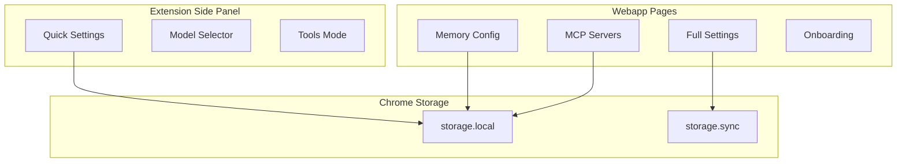

{/* VERIFIED: 2024-12-31 | code_refs: apps/extension/src/stores/, apps/webapp/src/app/ */}

Cognito AI settings are split between the extension (quick access) and webapp (full configuration). This guide explains where each setting lives.

## Settings Architecture

{/* MERMAID_DIAGRAM: settings.architecture | type: component | represents: Settings split between extension and webapp | code_refs: apps/extension/src/stores/, apps/webapp/ */}



## Extension Settings

Quick settings accessible directly in the side panel:

| Setting | Location | Description |
|---------|----------|-------------|
| **AI Model** | Model selector | Choose Gemini variant |
| **Mode** | Toggle | Backend vs BYOK |
| **Tools Mode** | Dropdown | Chat/Agent/Adaptive/Custom |
| **Voice Mode** | Button | Enable voice input |

### Access Extension Settings

1. Open the side panel (`Ctrl+Shift+H`)
2. Click the **Settings** gear icon
3. Quick settings appear inline

## Webapp Settings

Full configuration pages opened in a new tab:

| Page | Route | Purpose |
|------|-------|---------|
| **Settings** | `/settings` | All preferences |
| **Onboarding** | `/onboarding` | First-time setup |
| **Reminders** | `/reminders` | Reminder management |
| **Features** | `/features` | Feature showcase |
| **Troubleshooting** | `/troubleshooting` | Help and debugging |
| **Changelog** | `/changelog` | Version history |

{/* VERIFIED: 2024-12-31 | code_refs: apps/webapp/src/app/ */}

### Access Webapp Settings

1. Open the side panel
2. Click **Settings** → **Open Full Settings**
3. Webapp opens in a new tab

Or navigate directly to the webapp URL.

## Settings Categories

### AI Provider

| Setting | Description | Values |
|---------|-------------|--------|
| **Google API Key** | Your Gemini API key | String |
| **Use Backend Mode** | Use hosted API | Boolean |
| **Model** | AI model selection | gemini-2.5-flash, etc. |

### Memory (Supermemory)

| Setting | Description | Default |
|---------|-------------|---------|
| **API Key** | Supermemory API key | — |
| **Enable Supermemory** | Master toggle | false |
| **Auto Extraction** | Extract facts from chat | false |
| **Min Messages** | Threshold for extraction | 4 |

### Tools

| Setting | Description | Default |
|---------|-------------|---------|
| **Tools Mode** | Tool availability | `chat` |
| **Enabled Tools** | Custom tool selection | All |
| **MCP Servers** | Connected servers | None |

### Voice

| Setting | Description | Default |
|---------|-------------|---------|
| **Voice Model** | ElevenLabs voice | Default |
| **Auto-speak** | Read responses aloud | false |

## Storage Locations

Settings are persisted in Chrome storage:

| Storage | Data |
|---------|------|
| **storage.local** | User preferences, MCP tokens, memory |
| **storage.sync** | Synced across Chrome profiles |
| **IndexedDB (Dexie)** | Messages, threads, reminders |

### Access Storage (Debug)

```javascript
// In extension devtools console
chrome.storage.local.get(null, console.log);
chrome.storage.sync.get(null, console.log);
```

## Settings Sync

Extension and webapp stay in sync via Chrome storage events:

1. Webapp updates a setting
2. Change written to `chrome.storage.sync`
3. Extension receives `storage.onChanged` event
4. Zustand store updates automatically

See [Model Configuration Sync](/docs/architecture/ai-system) for details.

## Next Steps

- [Environment Variables](/docs/configuration/env-vars) — Build-time configuration
- [Modes & Feature Flags](/docs/configuration/modes-and-feature-flags) — Understanding the mode system
- [Permissions](/docs/configuration/permissions) — Chrome permissions explained
