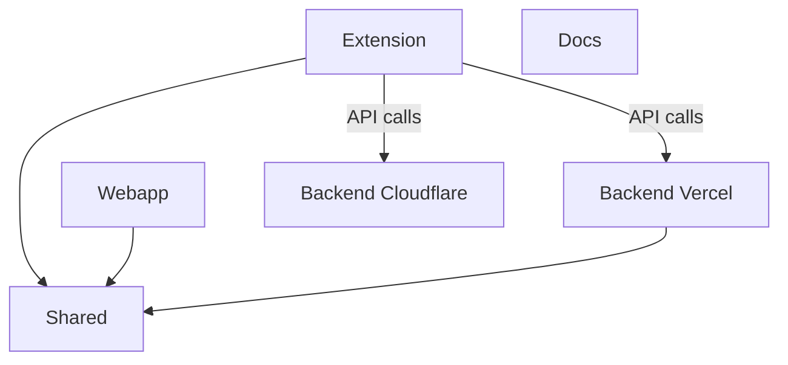

{/* VERIFIED: 2024-12-31 | code_refs: MONOREPO.md */}

This guide walks you through the Cognito AI codebase, explaining where to find things and how packages relate.

## Top-Level Structure

```text
cognito-ai/
├── apps/                    # Applications
│   ├── extension/           # Chrome Extension (main product)
│   ├── docs/                # Documentation site (you're reading this)
│   └── webapp/              # Settings pages (opened in tabs)
├── packages/                # Shared packages
│   ├── shared/              # Shared types and constants
│   ├── backend-cloudflare/  # ElevenLabs voice proxy
│   └── backend-vercel/      # AI + transcript API
├── docs/                    # Internal design documents
├── .cursor/                 # Cursor AI rules
├── .gemini/                 # Gemini AI configuration
├── package.json             # Root package
├── pnpm-workspace.yaml      # Workspace config
├── MONOREPO.md              # Architecture doc
├── CONTRIBUTING.md          # Contribution guide
└── SETUP.md                 # Setup instructions
```

## Extension (`apps/extension/`)

The core Chrome Extension built with WXT and React 19.

### Source Structure

```text
apps/extension/src/
├── entrypoints/             # WXT entry points
│   ├── sidepanel/           # Main UI (React)
│   │   ├── index.html       # HTML shell
│   │   ├── main.tsx         # React entry
│   │   └── App.tsx          # Root component
│   ├── background.ts        # Service worker
│   └── contents/            # Content scripts
│       ├── webmcp-proxy.content.ts
│       └── ...
├── components/              # React components
│   ├── ui/                  # Base primitives (shadcn)
│   │   └── primitives/      # Never modify directly
│   ├── features/            # Feature-specific
│   │   ├── chat/            # Chat interface
│   │   ├── mcp/             # MCP UI
│   │   └── settings/        # Settings UI
│   └── shared/              # Reusable components
├── stores/                  # Zustand state
│   ├── settings/            # User preferences
│   ├── chat/                # Messages, threads
│   ├── model/               # AI model config
│   ├── tools/               # Tool state
│   └── mcp/                 # MCP connections
├── ai/                      # AI integration
│   ├── chat/                # Chat implementation
│   ├── tools/               # Tool definitions
│   │   ├── manager.ts       # Tool aggregation
│   │   └── webmcpTools.ts   # WebMCP integration
│   ├── backend/             # Backend mode
│   └── prompts/             # System prompts
├── mcp/                     # MCP client
│   ├── client/              # SSE client
│   ├── discovery.ts         # OAuth discovery
│   ├── oauth.ts             # OAuth flow
│   └── state.ts             # Connection state
├── background/              # Background services
│   ├── messaging/           # Message handlers
│   │   ├── router.ts        # Message routing
│   │   ├── mcpHandler.ts    # MCP messages
│   │   └── webmcpHandler.ts # WebMCP messages
│   ├── mcp/                 # MCP management
│   ├── webmcp/              # WebMCP management
│   └── supermemory/         # Memory services
├── db/                      # Local database (Dexie)
├── hooks/                   # React hooks
├── types/                   # TypeScript types
└── utils/                   # Utilities
    ├── env.ts               # Environment variables
    └── ...
```

### Key Files

| File | Purpose |
|------|---------|
| `wxt.config.ts` | WXT + manifest config |
| `tailwind.config.ts` | TailwindCSS config |
| `tsconfig.json` | TypeScript config |
| `GEMINI.md` | AI agent context |

## Webapp (`apps/webapp/`)

Settings and configuration pages as a Next.js app.

```text
apps/webapp/
├── src/
│   ├── app/                 # Next.js pages
│   │   ├── settings/        # Settings page
│   │   ├── onboarding/      # Onboarding flow
│   │   ├── reminders/       # Reminders UI
│   │   └── ...
│   ├── components/          # React components
│   └── lib/                 # Utilities
├── public/                  # Static assets
└── docs/                    # Implementation docs
```

## Docs (`apps/docs/`)

This documentation site, built with Fumadocs.

```text
apps/docs/
├── content/
│   └── docs/                # MDX documentation
│       ├── getting-started/
│       ├── architecture/
│       └── ...
├── source.config.ts         # Fumadocs config
└── app/                     # Next.js app
```

## Shared (`packages/shared/`)

Common types and constants.

```text
packages/shared/
├── src/
│   ├── types/               # Shared types
│   │   ├── writer.ts        # WriteTone, etc.
│   │   ├── chat.ts          # Chat types
│   │   └── ...
│   ├── constants/           # Shared constants
│   │   ├── prompts.ts       # TONE_INSTRUCTIONS, etc.
│   │   └── ...
│   └── index.ts             # Exports
└── dist/                    # Compiled output
```

**Usage:**
```typescript
import type { WriteTone } from '@cognito/shared';
import { TONE_INSTRUCTIONS } from '@cognito/shared';
```

## Backend Vercel (`packages/backend-vercel/`)

Express API for AI and content services.

```text
packages/backend-vercel/
├── src/
│   ├── routes/              # API routes
│   │   ├── ai.ts            # /api/ai/*
│   │   ├── transcript.ts    # /simple-transcript
│   │   ├── search.ts        # /web-search
│   │   └── ...
│   ├── services/            # Business logic
│   ├── middleware/          # Rate limiting, logging
│   └── index.ts             # Express app
└── vercel.json              # Vercel config
```

## Backend Cloudflare (`packages/backend-cloudflare/`)

ElevenLabs voice proxy.

```text
packages/backend-cloudflare/
├── src/
│   └── index.ts             # Worker handlers
└── wrangler.toml            # Cloudflare config
```

## Finding Things

### "Where do I add a new tool?"

```text
apps/extension/src/ai/tools/
├── registry.ts              # Add tool definition here
├── manager.ts               # Registered automatically
└── [tool-name].ts           # Create tool file
```

### "Where do I add a new MCP server?"

```text
apps/extension/src/constants/mcpServers.tsx  # Pre-configured servers
apps/extension/src/mcp/                      # Client implementation
```

### "Where are the React components?"

```text
apps/extension/src/components/
├── features/chat/           # Chat components
├── features/mcp/            # MCP components
└── ui/                      # Base components
```

### "Where is the background logic?"

```text
apps/extension/src/background/
├── messaging/               # Message handling
├── mcp/                     # MCP connections
└── supermemory/             # Memory features
```

### "Where are types defined?"

```text
packages/shared/src/types/   # Shared types
apps/extension/src/types/    # Extension-specific types
```

## Package Dependencies



## Next Steps

- [Monorepo Architecture](/docs/architecture/monorepo) — Package details
- [Extension Architecture](/docs/architecture/extension-architecture) — Extension internals
- [Coding Standards](/docs/contributing/coding-standards) — Code conventions
