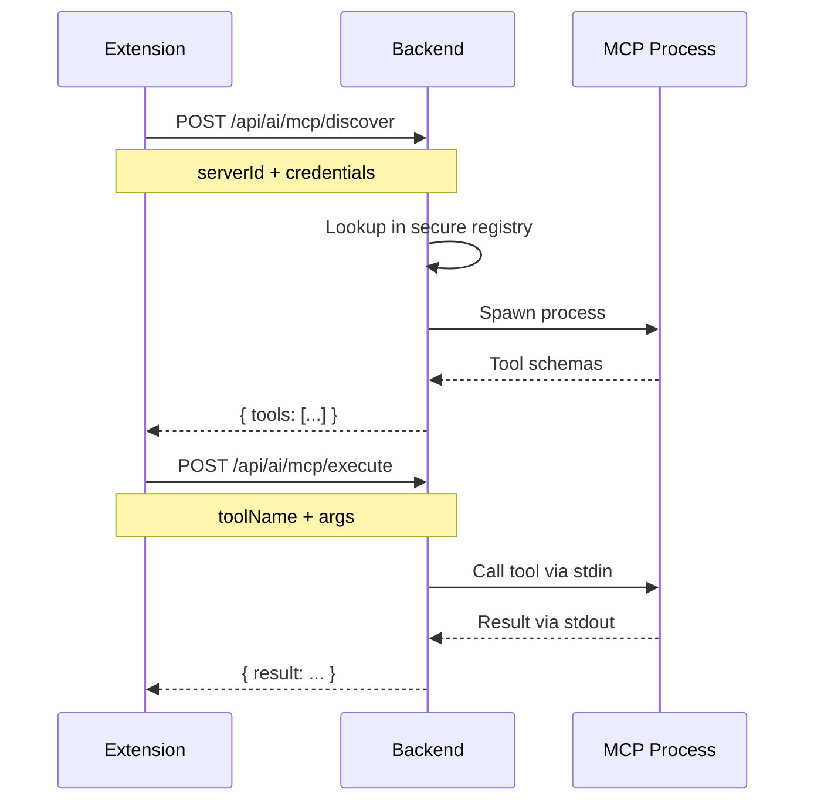

{/* VERIFIED: 2024-12-31 | code_refs: packages/backend-vercel/src/routes/ */}

The Cognito backend (`@cognito/backend-vercel`) provides AI processing, YouTube transcripts, web search, and content extraction services. These enable features like Backend Mode (no API key required) and enhanced content tools.

## Available Services

| Service | Endpoint | Purpose |
|---------|----------|---------|
| **AI Chat** | `/api/ai/chat-with-tools` | Chat with tool execution |
| **YouTube Transcripts** | `/simple-transcript` | Video transcripts + metadata |
| **Web Search** | `/web-search` | Search via Tavily |
| **Content Retrieval** | `/retrieve` | Extract content from URLs |
| **Metadata** | `/metadata` | OpenGraph metadata extraction |

## Backend Mode vs BYOK

| Feature | Backend Mode | BYOK Mode |
|---------|--------------|-----------|
| **API Key Required** | No | Yes (your key) |
| **AI Model** | Fixed (gemini-2.5-flash) | Any supported model |
| **Rate Limits** | Shared quotas | Your API limits |
| **Tool Execution** | Server-side + frontend | Frontend only |
| **StdIO MCP** | Supported | Via backend proxy |

## AI Chat

### Endpoints

| Endpoint | Purpose |
|----------|---------|
| `/api/ai/chat-with-tools` | Main chat with tool support |
| `/api/ai/write` | AI writing with tone/platform |
| `/api/ai/rewrite` | Text rewriting with presets |
| `/api/ai/summarize` | Text summarization |
| `/api/ai/suggestions` | Contextual action suggestions |
| `/api/ai/usage` | Check usage stats |

### Chat Modes

The chat endpoint supports three modes:

| Mode | Description | System Prompt |
|------|-------------|---------------|
| `chat` | Simple conversations | Minimal |
| `agent` | Full agentic mode | Tool usage guidance |
| `adaptive` | Dynamic tool discovery | executeTools + discoverTools |

{/* VERIFIED: 2024-12-31 | code_refs: packages/backend-vercel/src/routes/ai/chat.ts */}

### Example Request

```typescript
// Chat with tools
const response = await fetch('/api/ai/chat-with-tools', {
  method: 'POST',
  headers: { 'Content-Type': 'application/json' },
  body: JSON.stringify({
    messages: [{ role: 'user', content: 'Hello!' }],
    mode: 'chat',
    frontendTools: [...],  // Tool schemas for frontend execution
    mcpServers: [...]      // StdIO MCP server configs
  })
});
```

## YouTube Transcripts

Fetch video transcripts and metadata via Supadata:

### Request

```typescript
POST /simple-transcript
{
  "videoId": "dQw4w9WgXcQ"
}
```

### Response

```typescript
{
  "transcript": [
    { "start": 0.0, "duration": 4.2, "text": "We're no strangers..." }
  ],
  "metadata": {
    "title": "Video Title",
    "duration": 212,
    "channel": "Channel Name"
  }
}
```

## Web Search

Search the web via Tavily:

### Request

```typescript
POST /web-search
{
  "query": "latest AI news",
  "limit": 5
}
```

### Response

```typescript
{
  "results": [
    {
      "title": "Result Title",
      "url": "https://example.com",
      "snippet": "Description..."
    }
  ]
}
```

## Content Retrieval

Extract content from URLs via Jina Reader:

### Request

```typescript
POST /retrieve
{
  "url": "https://example.com/article"
}
```

### Response

```typescript
{
  "content": "Extracted article text...",
  "title": "Article Title"
}
```

## Rate Limiting

The backend implements trust-based tiered rate limiting:

### Trust Levels

| Level | Client Type | Per-Minute | Daily | Monthly |
|-------|-------------|------------|-------|---------|
| 3 | Extension Token | 30 | 200 | 2000 |
| 2 | Fingerprint + IP | 20 | 100 | 1000 |
| 1 | IP only | 10 | 50 | 500 |

### Rate Limit Headers

```http
X-RateLimit-Remaining: 15
Retry-After: 60
X-RateLimit-Degraded: true
```

### Check Usage

```typescript
GET /api/ai/usage

// Response
{
  "remaining": {
    "minute": 25,
    "daily": 180,
    "monthly": 1800
  },
  "limits": {
    "minute": 30,
    "daily": 200,
    "monthly": 2000
  }
}
```

## Graceful Degradation

When backend rate limits are exceeded:

1. Extension detects rate limit response
2. If user has BYOK API key configured:
   - Automatically switches to BYOK mode
   - Shows notification to user
3. If no API key:
   - Shows rate limit error
   - Suggests adding API key

## StdIO MCP via Backend

The backend enables StdIO MCP servers (command-line tools) that browsers cannot spawn:

{/* MERMAID_DIAGRAM: backend.stdio-mcp | type: sequence | represents: StdIO MCP flow | code_refs: packages/backend-vercel/src/routes/ai/mcp.ts */}



> **Security**: Commands are stored in a secure server-side registry, not sent from the frontend.

### Endpoints

| Endpoint | Purpose |
|----------|---------|
| `/api/ai/mcp/discover` | Discover tools from StdIO server |
| `/api/ai/mcp/execute` | Execute a tool |

### Caching

Tool discovery results are cached in Redis:
- **Key format**: `mcp:tools:{sha256(cmd+args)}`
- **TTL**: 24 hours
- **Bypass**: `?skipCache=true`

## External Dependencies

| Service | Purpose | Required |
|---------|---------|----------|
| **Google AI (Gemini)** | Primary AI provider | Yes |
| **Supadata** | YouTube transcripts | Yes |
| **Tavily** | Web search | Optional |
| **Jina Reader** | URL content extraction | Optional |
| **Upstash Redis** | Rate limiting, caching | Optional |

## Environment Variables

| Variable | Purpose |
|----------|---------|
| `GOOGLE_AI_API_KEY` | Required for AI endpoints |
| `SUPADATA_API_KEY` | Required for transcripts |
| `TAVILY_API_KEY` | Optional for web search |
| `JINA_API_KEY` | Optional for URL retrieval |
| `UPSTASH_REDIS_REST_URL` | For rate limiting |
| `UPSTASH_REDIS_REST_TOKEN` | For rate limiting |

## Error Responses

| Status | Meaning |
|--------|---------|
| 200 | Success |
| 400 | Bad request (missing params) |
| 401 | Unauthorized |
| 429 | Rate limit exceeded |
| 500 | Server error |

## Next Steps

- [Backend Mode](/docs/architecture/ai-system) — How backend AI works
- [MCP StdIO Architecture](/docs/architecture/mcp-client) — StdIO proxy details
- [Rate Limiting](/docs/troubleshooting/rate-limits) — Managing quotas
