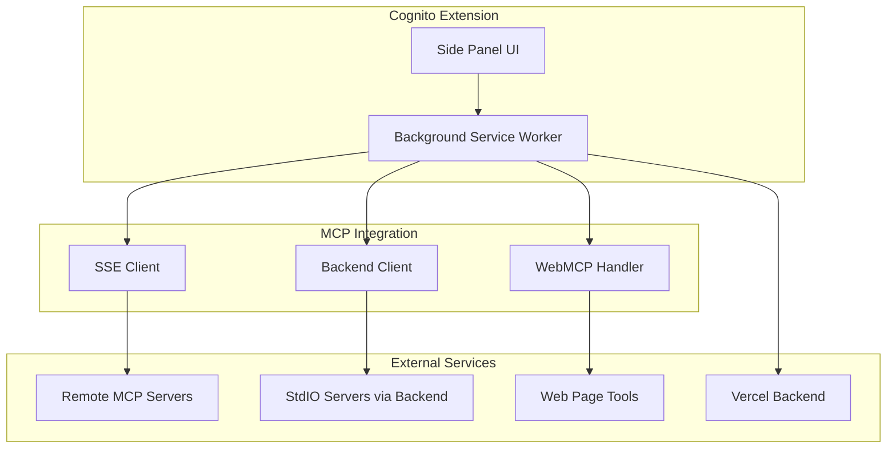

{/* VERIFIED: 2024-12-31 | code_refs: apps/extension/src/mcp/, apps/extension/src/background/ */}

Cognito AI extends its capabilities through external integrations. Connect to **MCP servers**, use **WebMCP** for page-provided tools, or leverage **backend services** for AI and content features.

## Integration Types

| Type | Description | Authentication |
|------|-------------|----------------|
| **Remote MCP** | Hosted MCP servers (Notion, Linear, etc.) | OAuth 2.0 / API tokens |
| **StdIO MCP** | Backend-proxied command-line servers | API tokens via backend |
| **WebMCP** | Tools provided by web pages | None (page-native) |
| **Backend Services** | AI chat, YouTube transcripts, web search | Automatic |

## Quick Start

**Add an MCP server:**
1. Open the side panel (`Ctrl+Shift+H`)
2. Navigate to **Settings** → **MCP Servers**
3. Enable a server and complete authentication

**Use page tools:**
- Pages implementing WebMCP expose tools automatically
- Discover available tools in the chat interface

## Available Integrations

<Cards>
  <Card title="MCP Overview" href="/docs/integrations/mcp-overview" />
  <Card title="Remote MCP Servers" href="/docs/integrations/remote-mcp" />
  <Card title="WebMCP" href="/docs/integrations/webmcp" />
  <Card title="Supermemory" href="/docs/integrations/supermemory" />
  <Card title="Backend Services" href="/docs/integrations/backends" />
</Cards>

## Architecture

{/* MERMAID_DIAGRAM: integrations.overview | type: component | represents: Integration architecture | code_refs: apps/extension/src/mcp/, apps/extension/src/background/mcp/ */}

## Next Steps

- [MCP Overview](/docs/integrations/mcp-overview) — Understand the Model Context Protocol
- [Remote MCP](/docs/integrations/remote-mcp) — Connect to hosted MCP servers
- [Architecture](/docs/architecture/mcp-client) — Deep dive into MCP client implementation
