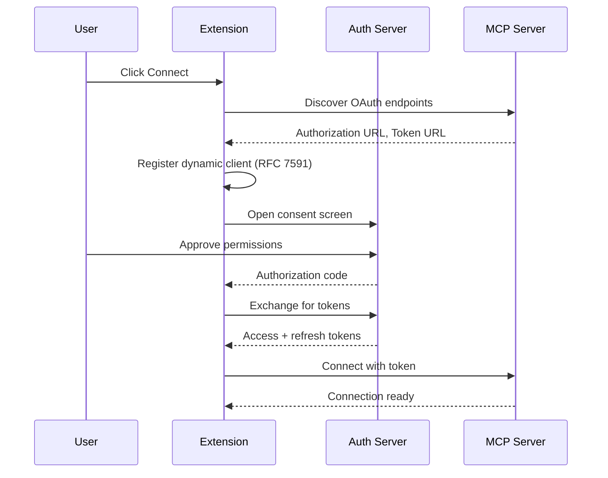
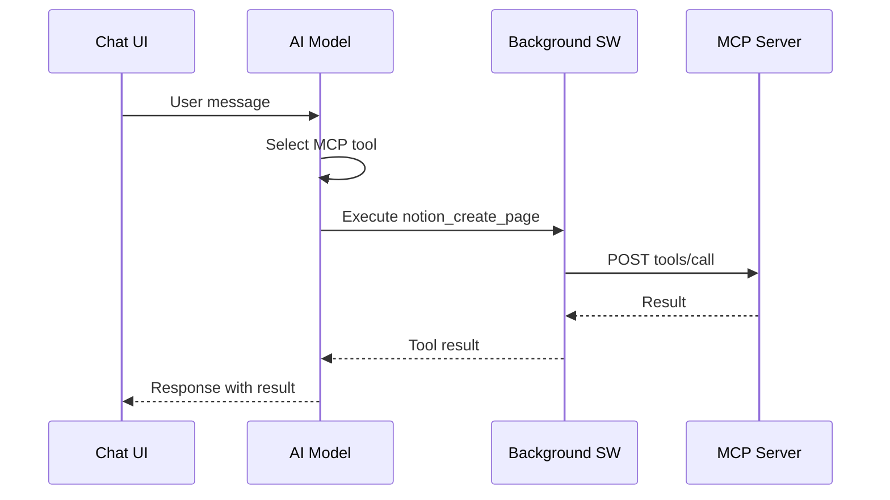

{/* VERIFIED: 2024-12-31 | code_refs: apps/extension/src/mcp/client/, apps/extension/src/constants/mcpServers.tsx */}

Remote MCP servers are hosted services that expose tools via SSE/HTTP transport. Cognito connects to these servers and makes their tools available to the AI assistant.

## Supported Servers

| Server | Category | Tools |
|--------|----------|-------|
| **Notion** | Productivity | Page/database management |
| **Linear** | Project Management | Issue tracking |
| **Ahrefs** | SEO | Keyword research, backlinks |
| **Supabase** | Database | Query, insert, update |

{/* VERIFIED: 2024-12-31 | code_refs: apps/extension/src/constants/mcpServers.tsx */}

## Connect a Server

### Open MCP Settings

1. Open the side panel (`Ctrl+Shift+H`)
2. Navigate to **Settings** → **MCP Servers**

### Enable the Server

1. Find the server in the list
2. Toggle **Enable** 
3. Click **Connect** to start OAuth

### Complete OAuth

{/* MERMAID_DIAGRAM: mcp.oauth-flow | type: sequence | represents: OAuth authentication flow | code_refs: apps/extension/src/mcp/oauth.ts */}



The OAuth flow uses:
- **Dynamic Client Registration** (RFC 7591) — Automatic client setup
- **PKCE** — Secure code exchange
- **Chrome Identity API** — Handles redirect securely

## Server Status

After connecting, the server shows one of these states:

| Status | Meaning | Action |
|--------|---------|--------|
| **Connected** | Ready to use | Tools available in chat |
| **Auth Required** | Needs OAuth | Click Connect |
| **Connecting** | Establishing connection | Wait |
| **Error** | Connection failed | Check logs, reconnect |

## Using Server Tools

Once connected, server tools appear in the AI's tool palette. Ask naturally:

> "Create a new page in Notion called 'Meeting Notes'"

The AI will:
1. Select the appropriate MCP tool
2. Execute it via the connected server
3. Return the result

## Tool Execution Flow

{/* MERMAID_DIAGRAM: mcp.tool-execution | type: sequence | represents: Tool execution via MCP | code_refs: apps/extension/src/ai/mcp/proxy.ts */}



## Transport Protocols

Remote servers use one of two protocols:

### Streamable HTTP (Preferred)

Modern protocol using POST requests with SSE responses:

```http
POST /mcp HTTP/1.1
Content-Type: application/json
Accept: text/event-stream
MCP-Protocol-Version: 2025-06-18
Authorization: Bearer {token}

{"jsonrpc":"2.0","id":1,"method":"tools/call","params":{...}}
```

### HTTP+SSE (Legacy)

Older protocol with separate GET stream and POST endpoint:

1. **GET `/sse`** — Opens persistent SSE stream
2. Server sends `endpoint` event with message URL
3. **POST** to message endpoint for requests
4. Responses arrive via SSE stream

## Token Refresh

Cognito automatically refreshes OAuth tokens before expiration:

1. Schedules refresh 5 minutes before `expires_in`
2. Uses refresh token to get new access token
3. Updates stored credentials
4. Continues using connection

If refresh fails, the server status changes to **Auth Required**.

## Connection Management

### Reconnection

If a connection drops, Cognito attempts automatic reconnection with exponential backoff:

| Attempt | Delay |
|---------|-------|
| 1 | 1s |
| 2 | 2s |
| 3 | 4s |
| 4 | 8s |
| Max | 30s |

### Disconnect

To disconnect a server:
1. Open **Settings** → **MCP Servers**
2. Toggle **Enable** off
3. Optionally click **Disconnect** to clear tokens

## Troubleshooting

### OAuth Popup Blocked

**Symptom**: Nothing happens when clicking Connect

**Solution**: Allow popups for the extension or try again

### Connection Timeout

**Symptom**: Status stuck on "Connecting"

**Solutions**:
- Check network connectivity
- Verify the MCP server is online
- Check browser console for errors

### Invalid Token

**Symptom**: Was working, now shows "Auth Required"

**Solution**: Token expired and refresh failed. Reconnect to re-authenticate.

## Next Steps

- [WebMCP](/docs/integrations/webmcp) — Page-provided tools
- [MCP Client Architecture](/docs/architecture/mcp-client) — Implementation details
- [MCP Troubleshooting](/docs/troubleshooting/mcp) — Common issues
