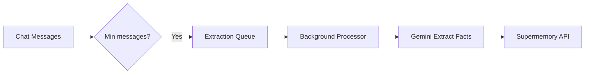
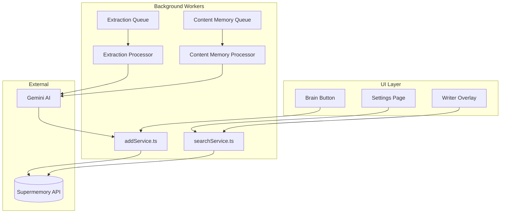

{/* VERIFIED: 2024-12-31 | code_refs: apps/extension/src/background/supermemory/ */}

Supermemory is an external service that stores user-approved memories (facts, preferences, personal context) and provides semantic search. Cognito integrates with Supermemory to enable personalized AI responses.

## Features

| Feature | Description |
|---------|-------------|
| **Manual Memory** | Save facts from chat via the Brain button |
| **Auto Extraction** | Automatically extract facts from conversations |
| **Memory Search** | Retrieve relevant memories during AI generation |
| **Content Memory** | Store insights from page interactions |

## Setup

### Get an API Key

1. Create an account at [Supermemory](https://supermemory.ai)
2. Generate an API key from your dashboard
3. Copy the key for the next step

### Configure in Cognito

1. Open **Settings** → **Memory**
2. Paste your Supermemory API key
3. Toggle **Enable Supermemory** on

### Verify Connection

The status indicator shows:
- **Connected** — Ready to use
- **Invalid** — API key is incorrect
- **Not configured** — Key not entered

## Manual Memory (Brain Button)

Save facts from chat conversations manually:

1. Highlight messages in the chat
2. Click the **🧠 Brain** button
3. AI extracts facts from the selection
4. Facts are saved to Supermemory

**Status indicators:**
- **Analyzing** — Extracting facts
- **Success** — Facts saved
- **No facts** — No extractable information
- **Error** — Save failed

## Auto Memory Extraction

Automatically extract facts from chat conversations:

1. Enable **Auto Memory Extraction** in Settings
2. Set minimum messages threshold (default: 4)
3. Facts are extracted in the background as you chat

{/* MERMAID_DIAGRAM: supermemory.extraction | type: flowchart | represents: Auto extraction flow | code_refs: apps/extension/src/background/supermemory/extraction/ */}



### Configuration

| Setting | Purpose | Default |
|---------|---------|---------|
| `supermemoryEnabled` | Master on/off switch | `false` |
| `autoMemoryExtraction` | Enable background extraction | `false` |
| `autoMemoryMinMessages` | Min messages before extraction | `4` |

## Memory Search

Cognito searches your memories to personalize AI responses:

### In Writer/Rewriter

1. Enable **Use memories** when writing
2. AI retrieves relevant memories
3. Output is personalized based on your context

### How It Works

```typescript
// Search memories for relevant context
const memories = await searchMemories({
  query: userQuery,
  limit: 10,
  threshold: 0.7,
  rerank: true
});

// Format for AI prompt
const context = formatMemoriesForPrompt(memories);
```

{/* VERIFIED: 2024-12-31 | code_refs: apps/extension/src/background/supermemory/searchService.ts */}

## Content Memory

Store insights from page interactions (Writer, Rewriter, Summarizer):

1. Use any content tool on a page
2. Insights are queued for processing
3. Background processor extracts structured facts
4. Facts are saved to Supermemory

### Supported Sources

| Source | What's Captured |
|--------|-----------------|
| **Writer** | Topics, writing style, preferences |
| **Rewriter** | Editing patterns, tone choices |
| **Summarizer** | Key topics of interest |

## Architecture

{/* MERMAID_DIAGRAM: supermemory.architecture | type: component | represents: Supermemory integration architecture | code_refs: apps/extension/src/background/supermemory/ */}



## Error Handling

| Scenario | Handling |
|----------|----------|
| **Missing API key** | Features disabled, UI shows status |
| **Invalid key (401/403)** | Shows "Invalid API key" |
| **Rate limit (429)** | Retry with exponential backoff |
| **Network failure** | Retry up to 3 times |
| **Browser restart** | Queue items resume on startup |
| **Queue overflow** | New items discarded with warning |
| **Large facts** | Truncated to 1024 chars |

## Troubleshooting

### Memories Not Saving

**Check:**
- Is Supermemory enabled in Settings?
- Is the API key valid? (check status indicator)
- Is there network connectivity?

### Memories Not Appearing in Responses

**Check:**
- Is "Use memories" enabled for the tool?
- Are memories relevant to the query?
- The semantic search may not find matches

### Auto Extraction Not Working

**Check:**
- Is `autoMemoryExtraction` enabled?
- Have you sent enough messages? (check `autoMemoryMinMessages`)
- Check background worker logs for errors

## Privacy Considerations

- Memories are stored in Supermemory's cloud
- Each profile has a unique user ID for isolation
- Facts are extracted by Gemini before storage
- You control what gets saved via settings

## Next Steps

- [Memory Features](/docs/using-cognito/memory) — Using memory in daily workflows
- [Settings Reference](/docs/configuration/settings) — All memory settings
