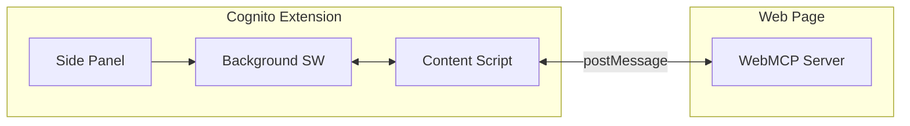
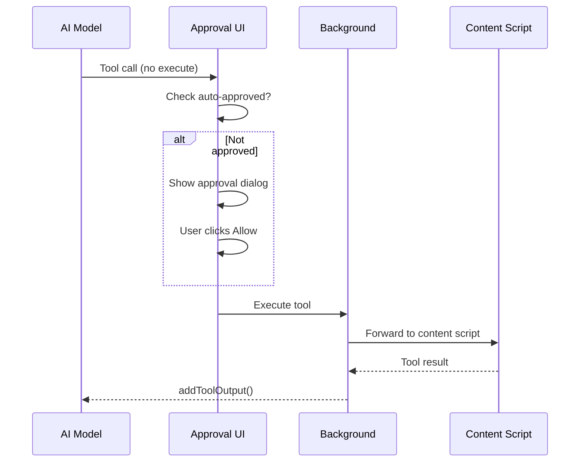

{/* VERIFIED: 2024-12-31 | code_refs: apps/extension/src/entrypoints/webmcp-proxy.content.ts, apps/extension/src/background/webmcp/ */}

WebMCP enables websites to expose tools that Cognito can discover and execute. Unlike remote MCP servers, WebMCP tools run directly in the page context with no server infrastructure required.

## How WebMCP Works

{/* MERMAID_DIAGRAM: webmcp.overview | type: component | represents: WebMCP architecture | code_refs: apps/extension/src/entrypoints/webmcp-proxy.content.ts */}



**Discovery flow:**
1. Content script connects to page's WebMCP server
2. Discovers available tools via `listTools()`
3. Reports tools to background service worker
4. Tools appear in the chat interface

**Execution flow:**
1. AI selects a WebMCP tool
2. Request routes through background to content script
3. Content script calls `callTool()` on page's server
4. Result returns to AI

## Tool Discovery

WebMCP tools are discovered automatically when navigating to enabled websites. Tools refresh on:

- Tab switches
- Page navigation
- Page reloads
- Manual refresh

### Active Tab Focus

Cognito tracks tools only from the **currently active tab**. Switching tabs clears the previous tab's tools and discovers new ones.

## Using WebMCP Tools

### View Available Tools

1. Open the side panel
2. Click the **Tools** button
3. Look for the **WebMCP** section
4. Tools show with the page's favicon

### Enable/Disable Tools

Individual tools can be toggled on/off:
- Toggle shows enabled state
- Disabled tools won't be used by AI
- Preferences persist across sessions

### Tool Naming Convention

Tools are prefixed to prevent conflicts:

```text
webmcp_{domain}_{originalName}
```

**Example:** A tool named `search` on `example.com` becomes `webmcp_example.com_search`.

## Tool Approval

All WebMCP tools require user approval before execution (Human-in-the-Loop pattern).

### Why Approval is Required

| Risk | Description |
|------|-------------|
| **External Code** | Tools execute on third-party websites |
| **Security** | Tools could perform unintended actions |
| **Privacy** | Tools may access sensitive page data |

### Approval Options

| Action | Scope | Storage |
|--------|-------|---------|
| **Allow** | Single execution | None |
| **Trust this site** | All tools from domain | Persisted |
| **Always allow** | This specific tool | Persisted |
| **This session only** | Tool for session | In-memory |

{/* MERMAID_DIAGRAM: webmcp.approval-flow | type: sequence | represents: Tool approval flow | code_refs: apps/extension/src/ai/tools/webmcpTools.ts */}



## Security

WebMCP includes multiple validation layers:

### Origin Validation

Tools must match the active tab's domain. Prevents tool shadowing attacks.

```typescript
// Tool from example.com cannot execute on other domains
if (tool.domain !== activeDomain) {
  throw new SecurityError('Tool origin mismatch');
}
```

### Tab ID Validation

Tools must belong to the active tab. Prevents cross-tab execution.

```typescript
if (tool.tabId !== activeTabId) {
  throw new SecurityError('Tool tab mismatch');
}
```

### Schema Validation

Tool arguments are validated against the declared schema. Prevents parameter injection.

### Validation Flow

```text
Tool Call → Origin Check → Tab ID Check → Schema Check → Execute
       ↓            ↓              ↓             ↓
    Reject      Reject        Reject       Proceed
```

## For Website Developers

Implement WebMCP on your site to expose tools to Cognito users.

### Basic Implementation

```typescript
// Your page's WebMCP server
window.addEventListener('message', (event) => {
  if (event.data.type === 'mcp/connect') {
    // Handle MCP connection
  }
});

// Respond to listTools
function handleListTools() {
  return {
    tools: [
      {
        name: 'search',
        description: 'Search the site',
        inputSchema: {
          type: 'object',
          properties: {
            query: { type: 'string' }
          },
          required: ['query']
        }
      }
    ]
  };
}

// Handle tool execution
function handleCallTool(name: string, args: object) {
  if (name === 'search') {
    return performSearch(args.query);
  }
}
```

{/* NOTE: WebMCP page implementation follows MCP protocol via postMessage - no separate page-side SDK docs */}

### Requirements

- Respond to MCP protocol messages via `postMessage`
- Implement `listTools()` to return available tools
- Implement `callTool(name, args)` for execution
- Optionally emit `ToolListChanged` notifications

## Message Types

| Message | Direction | Purpose |
|---------|-----------|---------|
| `webmcp/tools/register` | CS → BG | Register discovered tools |
| `webmcp/tools/list` | SP → BG | Get current tools |
| `webmcp/tool/call` | BG → CS | Execute a tool |
| `webmcp/tool/result` | CS → BG | Return execution result |
| `webmcp/tools/updated` | BG → SP | Broadcast tool updates |

## Troubleshooting

### Tools Not Appearing

**Symptoms**: WebMCP section empty or missing

**Checks**:
- Is the website WebMCP-enabled?
- Is the content script loaded? (Check extension console)
- Try refreshing the page

### Tool Execution Failed

**Symptoms**: Tool call returns error

**Checks**:
- Check page console for errors
- Verify the page's WebMCP server is functioning
- Check if page navigation occurred mid-execution

### Security Error

**Symptoms**: "Tool origin mismatch" or "Tool tab mismatch"

**Cause**: Tab switched during tool execution

**Solution**: Stay on the tool's page during execution

## Next Steps

- [WebMCP Architecture](/docs/architecture/webmcp-architecture) — Implementation details
- [Tool Approval System](/docs/architecture/tools-and-approval) — HITL approval flow
- [WebMCP Troubleshooting](/docs/troubleshooting/webmcp) — Common issues
