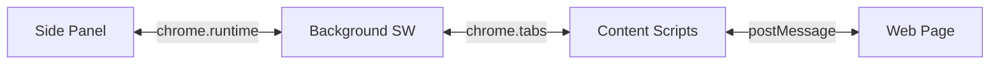

{/* VERIFIED: 2024-12-31 | code_refs: apps/extension/src/background/messaging/ */}

Reference for internal message types used between extension contexts.

## Message Architecture



## Message Format

All messages follow this structure:

```typescript
interface ExtensionMessage {
  type: string;           // Message identifier
  payload?: unknown;      // Message data
}
```

## MCP Messages

### Type Prefix: `mcp/`

| Type | Direction | Purpose |
|------|-----------|---------|
| `mcp/{serverId}/connect` | SP → BG | Connect to MCP server |
| `mcp/{serverId}/disconnect` | SP → BG | Disconnect from server |
| `mcp/{serverId}/status/get` | SP → BG | Get connection status |
| `mcp/{serverId}/auth/start` | SP → BG | Start OAuth flow |
| `mcp/{serverId}/tool/call` | AI → BG | Execute MCP tool |
| `mcp/all/status` | BG → SP | Broadcast all statuses |

### Example

```typescript
// Connect to Notion MCP server
chrome.runtime.sendMessage({
  type: 'mcp/notion/connect'
});

// Execute a tool
chrome.runtime.sendMessage({
  type: 'mcp/notion/tool/call',
  payload: {
    name: 'create_page',
    arguments: { title: 'New Page' }
  }
});
```

## WebMCP Messages

### Type Prefix: `webmcp/`

| Type | Direction | Purpose |
|------|-----------|---------|
| `webmcp/tools/register` | CS → BG | Register discovered tools |
| `webmcp/tools/list` | SP → BG | Get current tools |
| `webmcp/tools/state` | SP → BG | Get full WebMCP state |
| `webmcp/tools/discover` | SP → BG | Trigger discovery |
| `webmcp/tools/updated` | BG → SP | Broadcast tool updates |
| `webmcp/tool/call` | AI → BG | Execute WebMCP tool |
| `webmcp/tool/execute` | BG → CS | Forward execution |
| `webmcp/tool/result` | CS → BG | Return execution result |

### Interfaces

```typescript
interface WebMCPToolsRegisterMessage {
  type: 'webmcp/tools/register';
  tools: WebMCPTool[];
  tabId: number;
  domain: string;
  url: string;
}

interface WebMCPToolCallRequest {
  type: 'webmcp/tool/call';
  payload: {
    toolName: string;
    args: Record<string, unknown>;
  };
}

interface WebMCPToolExecutionResult {
  type: 'webmcp/tool/result';
  requestId: string;
  success: boolean;
  result?: unknown;
  error?: string;
}
```

## DOM Messages

### Type Prefix: `dom/`

| Type | Direction | Purpose |
|------|-----------|---------|
| `dom/read` | BG → CS | Read page content |
| `dom/click` | BG → CS | Click an element |
| `dom/type` | BG → CS | Type in a field |
| `dom/scroll` | BG → CS | Scroll the page |
| `dom/screenshot` | BG → CS | Capture screenshot |

### Example

```typescript
// Read page content
const content = await chrome.tabs.sendMessage(tabId, {
  type: 'dom/read'
});

// Click an element
await chrome.tabs.sendMessage(tabId, {
  type: 'dom/click',
  selector: '#submit-btn'
});
```

## Supermemory Messages

### Type Prefix: `supermemory/`

| Type | Direction | Purpose |
|------|-----------|---------|
| `supermemory/search` | SP → BG | Search memories |
| `supermemory/add` | SP → BG | Add a memory |
| `supermemory/status` | SP → BG | Check connection |

## Settings Messages

### Type Prefix: `settings/`

| Type | Direction | Purpose |
|------|-----------|---------|
| `settings/get` | SP → BG | Get current settings |
| `settings/update` | SP → BG | Update settings |
| `settings/sync` | BG → SP | Sync settings change |

## Message Router

The background service worker routes messages by type prefix:

```typescript
// background/messaging/router.ts
function routeMessage(message: ExtensionMessage) {
  const { type } = message;
  
  if (type.startsWith('mcp/')) {
    return mcpHandler(message);
  }
  if (type.startsWith('webmcp/')) {
    return webmcpHandler(message);
  }
  if (type.startsWith('dom/')) {
    return domHandler(message);
  }
  if (type.startsWith('settings/')) {
    return settingsHandler(message);
  }
  // ... more handlers
}
```

## Sending Messages

### From Side Panel to Background

```typescript
// Send and wait for response
const result = await chrome.runtime.sendMessage({
  type: 'mcp/notion/status/get'
});
```

### From Background to Content Script

```typescript
// Send to specific tab
const result = await chrome.tabs.sendMessage(tabId, {
  type: 'dom/read'
});
```

### From Content Script to Page

```typescript
// Via postMessage
window.postMessage({
  type: 'mcp-request',
  payload: { method: 'tools/list' }
}, '*');
```

## Listening for Messages

### In Background

```typescript
chrome.runtime.onMessage.addListener((message, sender, sendResponse) => {
  const result = routeMessage(message);
  
  if (result instanceof Promise) {
    result.then(sendResponse);
    return true; // Keep channel open for async
  }
  
  sendResponse(result);
});
```

### In Content Script

```typescript
chrome.runtime.onMessage.addListener((message, sender, sendResponse) => {
  if (message.type === 'dom/read') {
    const content = document.body.innerText;
    sendResponse({ content });
  }
});
```

## Type Safety

Define typed message handlers:

```typescript
type MessageHandler<T, R> = (message: T) => Promise<R>;

const handlers: Record<string, MessageHandler<unknown, unknown>> = {
  'mcp/connect': handleMcpConnect,
  'webmcp/tools/list': handleWebmcpToolsList,
  // ...
};
```

## See Also

- [Extension Architecture](/docs/architecture/extension-architecture) — Context communication
- [WebMCP Architecture](/docs/architecture/webmcp-architecture) — WebMCP message flow
- [MCP Client](/docs/architecture/mcp-client) — MCP message handling
