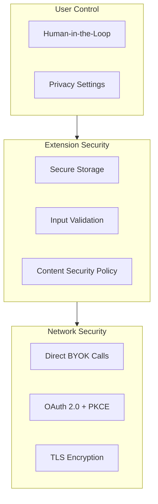

Cognito AI is designed with **privacy as a core principle**. Your data stays on your device, your API keys never leave it, and AI actions require your approval.

## Privacy Principles

| Principle | Implementation |
|-----------|----------------|
| **Local-first** | Data stored on device, not in the cloud |
| **BYOK Security** | Your API keys call Google directly |
| **Human-in-the-Loop** | Sensitive actions require approval |
| **No Telemetry** | No usage tracking or analytics |

## Security Architecture

{/* MERMAID_DIAGRAM: security.overview | type: component | represents: Security layers | code_refs: apps/extension/src/ */}



## Data Handling Summary

| Data Type | Location | External Access |
|-----------|----------|-----------------|
| Conversations | IndexedDB (local) | Never |
| Settings | Chrome Storage | Never |
| API Keys | Chrome Secure Storage | Never |
| Page Content | Memory only | Only via AI API when needed |

## Security Topics

<Cards>
  <Card title="Privacy Model" href="/docs/security/privacy-model" />
  <Card title="Secrets & Keys" href="/docs/security/secrets-and-keys" />
  <Card title="Threat Model" href="/docs/security/threat-model" />
</Cards>

## Quick Reference

### What Data Is Accessed?

| Feature | Data Accessed | When |
|---------|---------------|------|
| **Chat** | Current page text | When you ask about the page |
| **Writer** | Text selection | When you invoke Writer |
| **Browser Automation** | DOM elements | When executing actions |
| **MCP** | Server-specific | When using MCP tools |

### What Data Is Sent Externally?

| Mode | Destination | Data Sent |
|------|-------------|-----------|
| **Local** | None | Nothing |
| **BYOK** | Google AI directly | Messages + context |
| **Backend** | Cognito Vercel | Messages + context |
| **Voice** | ElevenLabs via proxy | Audio |

### What Is Never Sent?

- Passwords and sensitive form fields
- Credit card numbers
- SSN and personal identifiers
- Full browsing history
- Data from other tabs

## Security Measures

### Human-in-the-Loop

All potentially risky actions require approval:
- Browser automation (clicks, typing)
- WebMCP tool execution
- Sensitive MCP operations

### Content Security Policy

Strict CSP prevents XSS and injection attacks:
```json
{
  "extension_pages": "script-src 'self' 'wasm-unsafe-eval'; object-src 'self'"
}
```

### Secure Storage

Chrome's encrypted storage protects:
- API keys
- OAuth tokens
- User preferences

## Next Steps

- [Privacy Model](/docs/security/privacy-model) — How data flows
- [Secrets & Keys](/docs/security/secrets-and-keys) — Key management
- [Threat Model](/docs/security/threat-model) — Security analysis
