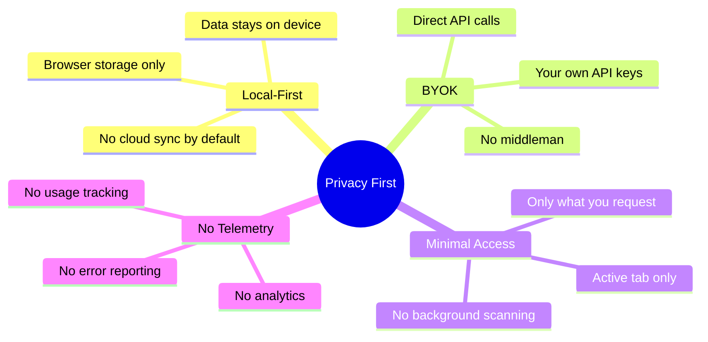
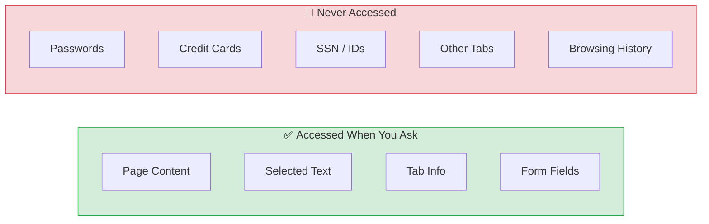
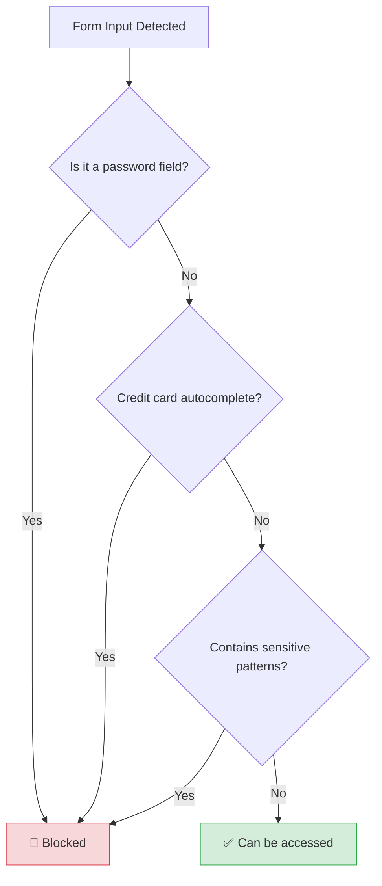
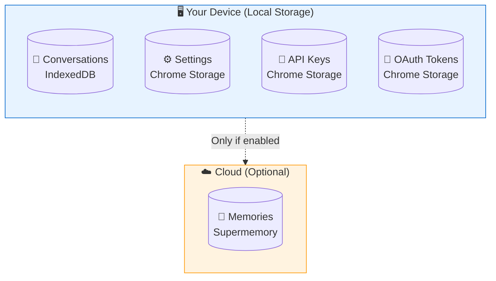
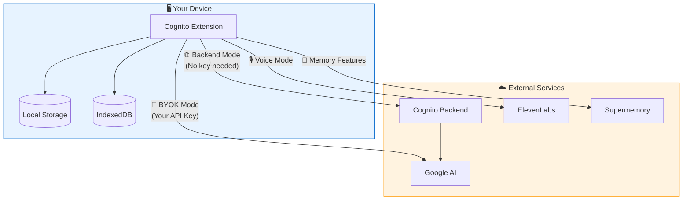
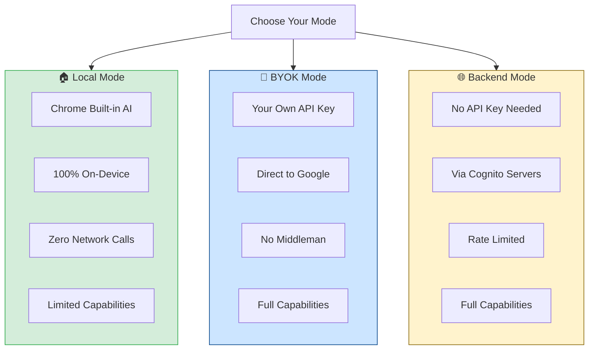
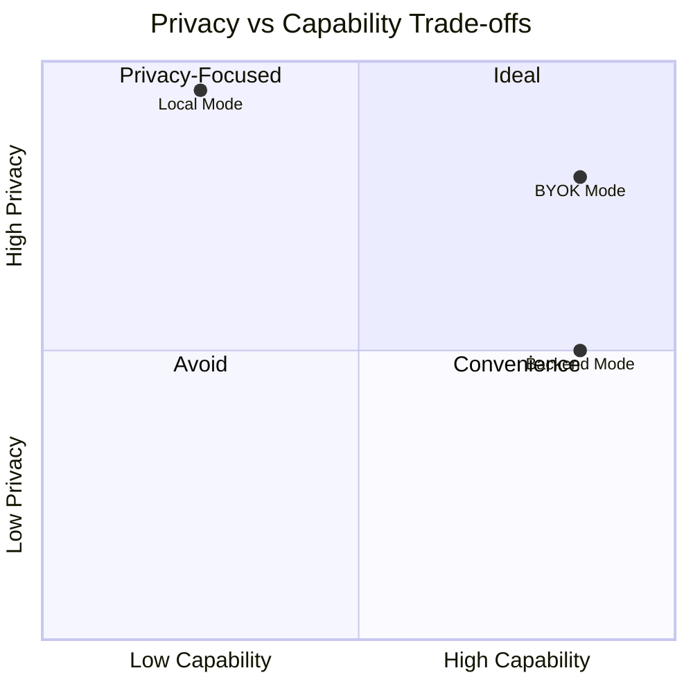
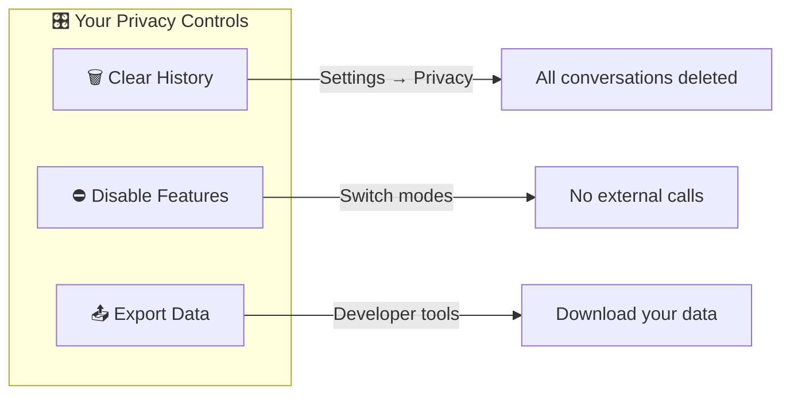

import { Callout } from 'fumadocs-ui/components/callout';

{/* VERIFIED: 2024-12-31 | code_refs: apps/extension/src/db/, apps/extension/src/ai/ */}

Cognito AI is designed with privacy as a core principle. This page explains what data is accessed, where it's stored, and what is sent externally.

<Callout type="info" title="Privacy First">
  Your data stays on your device by default. External services are only used when you explicitly enable cloud features.
</Callout>

## Core Privacy Principles

| Principle | What It Means |
|-----------|---------------|
| **Local-first** | Data stays on your device unless you use cloud features |
| **BYOK** | Your API keys make direct calls, never pass through our servers |
| **Minimal access** | Only access data you explicitly interact with |
| **No telemetry** | No usage tracking, analytics, or error reporting |

## What Data Does Cognito Access?

### What Cognito Accesses

| Data Type | When | Purpose |
|-----------|------|---------|
| **Page content** | When you ask about the page | Provide AI context |
| **Selected text** | When you invoke Writer/Rewriter | Transform content |
| **Tab info** | When using tab features | Navigation, search |
| **Form fields** | When automating | Fill inputs |

### What Cognito Never Accesses

<Callout type="warn" title="Automatic Protection">
  Sensitive fields are automatically detected and excluded. Cognito uses multiple detection methods to ensure your private data is never captured.
</Callout>

| Data Type | Protection Method |
|-----------|-------------------|
| **Passwords** | Input type detection |
| **Credit cards** | Autocomplete detection |
| **SSN/Personal IDs** | Pattern matching |
| **Other tabs** | Active tab only |
| **Browsing history** | Not accessed |

## Where Is Your Data Stored?

All user data is stored locally on your device by default:

| Data | Storage Location | Encryption | Cloud Sync |
|------|-----------------|------------|------------|
| **Conversations** | Your browser (IndexedDB) | Browser-level | ❌ No |
| **Settings** | Chrome local storage | Chrome encryption | Optional |
| **API keys** | Chrome local storage | Chrome encryption | ❌ No |
| **OAuth tokens** | Chrome local storage | Chrome encryption | ❌ No |
| **Memories** | Supermemory | External service | ✅ Yes (if enabled) |

<Callout title="Your Data, Your Control">
  Conversations and messages never leave your browser. They are stored in IndexedDB which is:
  - **Isolated** — Not accessible to websites you visit
  - **Persistent** — Remains until you clear it
  - **Private** — Only Cognito can access it
</Callout>

## Data Flow Overview

This diagram shows how your data flows depending on which mode you use:

{/* MERMAID_DIAGRAM: privacy.data-flow | type: flowchart | represents: Data flow paths | code_refs: apps/extension/src/ai/ */}

## Understanding the Different Modes

### Local Mode — Maximum Privacy

<Callout type="info" title="Best for Privacy">
  Local mode uses Chrome's built-in AI (Gemini Nano). All processing happens on your device with zero data sent externally.
</Callout>

- ✅ All processing on your device
- ✅ No network calls
- ⚠️ Limited capabilities compared to cloud models

### BYOK Mode — Your Keys, Your Control

- ✅ Your API key calls Google directly
- ✅ Key never leaves your browser
- ✅ Request goes directly to `googleapis.com`
- ✅ No intermediary servers

### Backend Mode — Convenience

- ✅ No API key needed
- ⚠️ Messages routed through Cognito backend
- ⚠️ Subject to rate limits
- Backend uses server-side credentials

### Voice Mode — ElevenLabs Integration

- Audio processed by ElevenLabs
- Proxied via Cognito Cloudflare worker
- Audio data is transient (not stored)
- No conversation storage on servers

### Memory Features — Supermemory

<Callout type="warn" title="Cloud Service">
  Memory features require Supermemory, which stores data in the cloud. Only enable this if you're comfortable with cloud storage.
</Callout>

- Facts extracted from conversations
- Stored in Supermemory's cloud
- Requires separate API key

## Privacy Comparison by Mode

| Mode | Privacy Level | Capabilities | Best For |
|------|--------------|--------------|----------|
| **Local** | 🟢 Highest | Limited | Sensitive tasks |
| **BYOK** | 🟢 High | Full | Power users |
| **Backend** | 🟡 Medium | Full | Casual users |

## User Controls

### Managing Your Privacy

### Clear Conversation History

1. Open **Settings**
2. Navigate to **Privacy**
3. Click **Clear All Conversations**

### Disable External Features

| Feature | How to Disable |
|---------|----------------|
| Backend mode | Switch to Local or BYOK mode |
| Voice mode | Don't enable in settings |
| Supermemory | Don't configure API key |

<Callout title="Full Control">
  You can always switch between modes. Use Local mode for maximum privacy on sensitive tasks, and BYOK or Backend mode when you need more powerful AI capabilities.
</Callout>

### Export Your Data

Your data belongs to you. Export it anytime:

1. Open Chrome Developer Tools (`F12`)
2. Go to **Application** → **IndexedDB**
3. Find the Cognito database
4. Export conversations as needed

## Next Steps

- [Secrets & Keys](/docs/security/secrets-and-keys) — Key storage
- [Threat Model](/docs/security/threat-model) — Security analysis
- [Configuration](/docs/configuration) — Privacy settings
