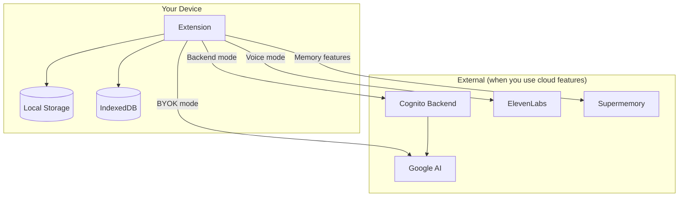

{/* VERIFIED: 2024-12-31 | code_refs: apps/extension/src/db/, apps/extension/src/ai/ */}

Cognito AI is designed with privacy as a core principle. This page explains what data is accessed, where it's stored, and what is sent externally.

## Core Privacy Principles

| Principle | What It Means |
|-----------|---------------|
| **Local-first** | Data stays on your device unless you use cloud features |
| **BYOK** | Your API keys make direct calls, never pass through our servers |
| **Minimal access** | Only access data you explicitly interact with |
| **No telemetry** | No usage tracking, analytics, or error reporting |

## Data Categories

### What Cognito Accesses

| Data Type | When | Purpose |
|-----------|------|---------|
| **Page content** | When you ask about the page | Provide AI context |
| **Selected text** | When you invoke Writer/Rewriter | Transform content |
| **Tab info** | When using tab features | Navigation, search |
| **Form fields** | When automating | Fill inputs |

### What Cognito Never Accesses

| Data Type | Protection Method |
|-----------|-------------------|
| **Passwords** | Input type detection |
| **Credit cards** | Autocomplete detection |
| **SSN/Personal IDs** | Pattern matching |
| **Other tabs** | Active tab only |
| **Browsing history** | Not accessed |

```typescript
// SECURITY: Example from DOM extraction
const value = isSensitiveInput(input) ? undefined : input.value;

function isSensitiveInput(input: HTMLInputElement): boolean {
  // Type-based detection
  if (input.type === 'password') return true;
  
  // Autocomplete-based detection
  const autocomplete = input.autocomplete.toLowerCase();
  const sensitiveAutocomplete = ['cc-number', 'cc-exp', 'cc-csc', 
    'current-password', 'new-password'];
  if (sensitiveAutocomplete.includes(autocomplete)) return true;
  
  // Name/ID pattern matching
  const sensitivePattern = /password|card|cvv|csc|ssn|secret|pin/i;
  if (sensitivePattern.test(input.name + input.id)) return true;
  
  return false;
}
```

## Data Storage

All user data is stored locally on your device:

| Data | Storage | Encryption | Sync |
|------|---------|------------|------|
| **Conversations** | IndexedDB (Dexie) | Browser-level | No |
| **Settings** | `chrome.storage.local` | Chrome encryption | Optional |
| **API keys** | `chrome.storage.local` | Chrome encryption | No |
| **OAuth tokens** | `chrome.storage.local` | Chrome encryption | No |
| **Memories** | Supermemory API | External service | Yes |

### Local Database (IndexedDB)

Messages and threads are stored in IndexedDB:

```typescript
// Simplified Dexie schema
const db = new Dexie('cognito-ai');
db.version(1).stores({
  messages: '++id, threadId, timestamp',
  threads: '++id, createdAt, updatedAt'
});
```

This data:
- Never leaves your browser
- Is not accessible to websites
- Persists until you clear it

## Data Flow

{/* MERMAID_DIAGRAM: privacy.data-flow | type: flowchart | represents: Data flow paths | code_refs: apps/extension/src/ai/ */}



## External Services

### Local Mode (No External Access)

Uses Chrome's built-in AI (Gemini Nano):
- All processing on device
- No network calls
- Limited capabilities

### BYOK Mode (Direct to Google)

Your API key calls Google directly:
- Key stays in your browser
- Request goes directly to `googleapis.com`
- No intermediary servers

### Backend Mode (Via Cognito)

Messages routed through Cognito backend:
- No API key needed
- Subject to rate limits
- Backend uses server-side credentials

### Voice Mode (ElevenLabs)

Audio processed by ElevenLabs:
- Proxied via Cognito Cloudflare worker
- Audio data is transient
- No conversation storage

### Memory Features (Supermemory)

If you enable Supermemory:
- Facts extracted from conversations
- Stored in Supermemory's cloud
- Requires separate API key

## Privacy-Preserving Features

### On-Device Processing

For privacy-sensitive tasks, use Local mode:
- Chrome built-in AI
- Zero external data transfer
- Trade-off: limited capabilities

### BYOK for Control

BYOK provides:
- Direct API relationship with Google
- Your usage quota
- No Cognito involvement

### Minimal Context

AI receives only:
- Your current message
- Page content you requested
- Your selected conversation history

## User Controls

### Clear Conversation History

1. Open **Settings**
2. Navigate to **Privacy**
3. Click **Clear All Conversations**

### Disable External Features

| Feature | How to Disable |
|---------|----------------|
| Backend mode | Switch to BYOK |
| Voice mode | Don't enable |
| Supermemory | Don't configure |

### Export Your Data

Data can be exported from IndexedDB using browser developer tools.

## Next Steps

- [Secrets & Keys](/docs/security/secrets-and-keys) — Key storage
- [Threat Model](/docs/security/threat-model) — Security analysis
- [Configuration](/docs/configuration) — Privacy settings
