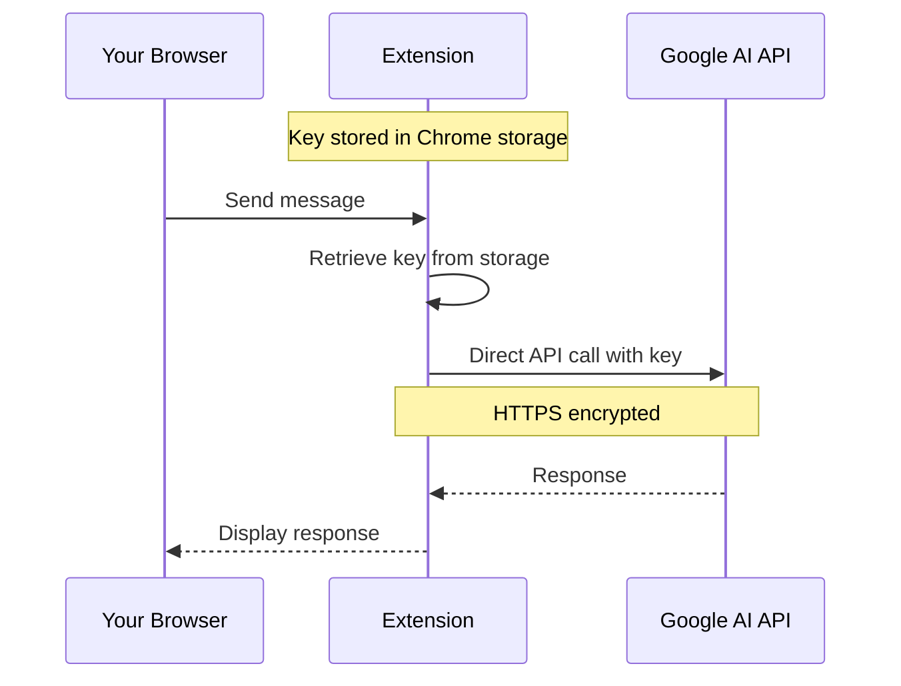
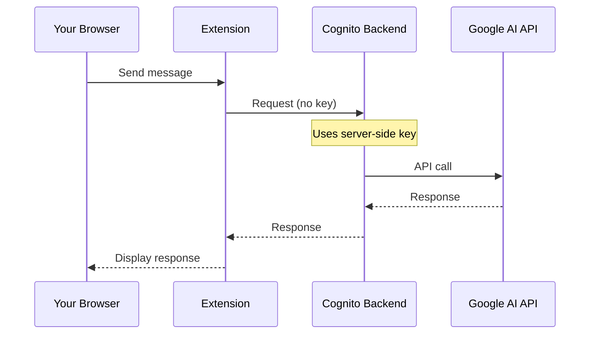

{/* VERIFIED: 2024-12-31 | code_refs: apps/extension/src/stores/settings/ */}

Cognito AI handles API keys and secrets with care. This page explains how your credentials are stored and protected.

## Key Types

| Key Type | Purpose | Storage |
|----------|---------|---------|
| **Google AI API Key** | BYOK mode AI calls | Chrome storage |
| **Supermemory API Key** | Memory features | Chrome storage |
| **MCP OAuth Tokens** | Server authentication | Chrome storage |
| **MCP Credentials** | Dynamic client registration | Chrome storage |

## Storage Security

All secrets are stored using Chrome's storage API:

```typescript
// How keys are stored
chrome.storage.local.set({
  'settings:googleApiKey': encryptedKey
});
```

### Chrome Storage Protection

Chrome's storage provides:
- **Encryption at rest** on the filesystem
- **Isolation** from web pages
- **Extension-only access** via manifest permissions

### What This Means

| Protection | Status |
|------------|--------|
| Other extensions can't read | ✅ Protected |
| Websites can't read | ✅ Protected |
| On-disk encryption | ✅ Chrome handles |
| Cross-device sync | ⚠️ Optional |
| Memory extraction | ⚠️ Possible with admin access |

> **Important**: If Chrome sync is enabled, API keys may sync across devices. Disable sync for maximum security.

## BYOK Mode Security

In BYOK (Bring Your Own Key) mode:

{/* MERMAID_DIAGRAM: secrets.byok | type: sequence | represents: BYOK API call flow | code_refs: apps/extension/src/ai/ */}



### BYOK Benefits

| Benefit | Explanation |
|---------|-------------|
| **No intermediary** | Direct to Google, no Cognito servers |
| **Your quota** | Uses your API limits |
| **Your billing** | Charges to your account |
| **Privacy** | Cognito never sees your key |

### BYOK Verification

Verify your key never leaves the browser:
1. Open Chrome DevTools → Network tab
2. Send a message in BYOK mode
3. Observe requests go directly to `generativelanguage.googleapis.com`

## Backend Mode

In Backend mode, **no user API key is required**:



### Backend Mode Trade-offs

| Aspect | Impact |
|--------|--------|
| Convenience | No key setup needed |
| Privacy | Messages pass through backend |
| Rate limits | Shared quotas apply |
| Model choice | Fixed model (gemini-2.5-flash) |

## MCP Credentials

### OAuth Tokens

MCP servers using OAuth store:
- Access tokens
- Refresh tokens
- Expiration times

```typescript
interface McpOAuthTokens {
  access_token: string;
  refresh_token?: string;
  expires_in: number;
  token_type: string;
}
```

### Token Refresh

Tokens are automatically refreshed:
1. Schedule refresh 5 minutes before expiry
2. Use refresh token to get new access token
3. Update stored tokens
4. Continue using connection

### Revoking Access

To revoke MCP server access:
1. Go to **Settings** → **MCP Servers**
2. Click **Disconnect** on the server
3. Tokens are deleted from storage
4. Visit the service's settings to fully revoke

## Supermemory API Key

Stored separately from AI keys:

```typescript
// Storage key
'supermemory:apiKey'
```

### Supermemory Security

| Aspect | Details |
|--------|---------|
| Storage | Chrome local storage |
| Usage | Retrieved per-request |
| Server calls | Direct to Supermemory API |
| Privacy | Facts sent to external service |

## Best Practices

### For All Users

1. **Use BYOK for sensitive work** — Direct to Google, no intermediaries
2. **Don't share API keys** — Each key should be used by one person
3. **Monitor usage** — Check Google AI Studio for unexpected usage
4. **Regularly rotate** — Generate new keys periodically

### For Organizations

1. **Separate keys per user** — Don't share organization keys
2. **Use API key restrictions** — Limit to specific IP ranges
3. **Set billing alerts** — Monitor for unexpected charges
4. **Review permissions** — Audit connected MCP servers

### Key Management

| Action | How |
|--------|-----|
| **View key** | Settings → AI Provider |
| **Update key** | Settings → AI Provider → Edit |
| **Remove key** | Settings → AI Provider → Clear |
| **Rotate key** | Generate new in Google AI Studio, update in Cognito |

## Troubleshooting

### "Invalid API Key" Error

**Checks:**
1. Key is correctly copied (no extra spaces)
2. Key is active in Google AI Studio
3. Billing is enabled on Google Cloud project

### Key Not Working After Chrome Sync

**Solution:**
1. Disable Chrome sync for extension data
2. Re-enter your API key
3. Keys will stay local to this device

### MCP Token Expired

**Solution:**
1. Server shows "Auth Required" status
2. Click **Connect** to re-authenticate
3. Complete OAuth flow again

## Next Steps

- [Privacy Model](/docs/security/privacy-model) — Data handling
- [Provider Setup](/docs/getting-started/provider-setup) — Configure your key
- [Configuration](/docs/configuration) — Settings overview
