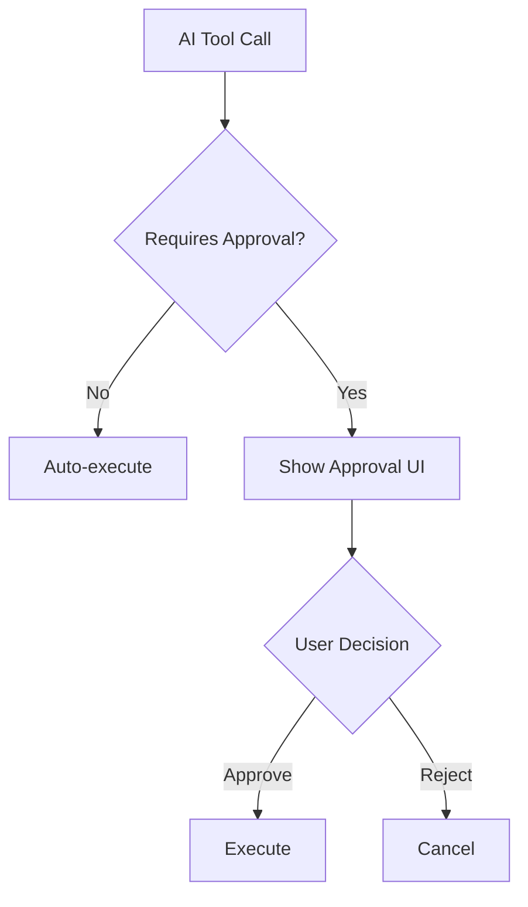

{/* VERIFIED: 2024-12-31 | code_refs: apps/extension/src/ai/tools/approvalConfig.ts */}

This page documents Cognito AI's threat model, including attack vectors, mitigations, and known limitations.

## Attack Surface Overview

| Surface | Risk Level | Mitigation |
|---------|------------|------------|
| **Browser Extension** | Medium | Minimal permissions, CSP |
| **AI Tool Execution** | High | Human-in-the-Loop (HITL) |
| **WebMCP** | High | Origin validation, HITL |
| **MCP Servers** | Medium | OAuth, token isolation |
| **Network** | Low | TLS, direct BYOK calls |

## Threat Categories

### 1. Malicious Tool Execution

**Threat**: AI executes harmful browser actions

**Mitigations**:
- Human-in-the-Loop approval for automation tools
- Read-only tools auto-approved, write tools require consent
- Clear display of tool arguments before approval



### 2. WebMCP Attacks

**Threat**: Malicious websites exploit WebMCP tools

| Attack | Description | Mitigation |
|--------|-------------|------------|
| **Tool shadowing** | Site registers tools mimicking legitimate ones | Origin validation |
| **Cross-tab execution** | Tool from tab A executes in tab B | Tab ID validation |
| **Parameter injection** | Unexpected args passed to tools | Schema validation |
| **Unauthorized execution** | Tools run without consent | HITL approval |

**Validation Flow**:
```text
Tool Call → Origin Check → Tab ID Check → Schema Check → User Approval → Execute
```

### 3. MCP Server Attacks

**Threat**: Compromised MCP servers

**Mitigations**:
- OAuth with PKCE prevents token interception
- Per-server token isolation (one server can't access another's tokens)
- User can revoke access at any time
- Tools display server origin

### 4. Data Exfiltration

**Threat**: Sensitive data sent to AI or external services

**Mitigations**:
- Sensitive input detection (passwords, credit cards)
- Values stripped before sending to AI
- Defense-in-depth at extraction, formatting, AND transport layers

```typescript
// Example: Sensitive field detection
function isSensitiveInput(input: HTMLInputElement): boolean {
  // Type-based
  if (input.type === 'password') return true;
  
  // Autocomplete-based
  const sensitive = ['cc-number', 'cc-csc', 'current-password'];
  if (sensitive.includes(input.autocomplete)) return true;
  
  // Pattern-based
  const pattern = /password|card|cvv|ssn|secret|pin/i;
  if (pattern.test(input.name + input.id)) return true;
  
  return false;
}
```

### 5. API Key Theft

**Threat**: Attacker obtains user's API key

**Mitigations**:
- Keys stored in Chrome's encrypted storage
- Never exposed to web pages
- BYOK calls go directly to Google (not via backend)

**Limitations**:
- Admin/malware with system access could extract keys
- Chrome sync may expose keys across devices

### 6. Prompt Injection

**Threat**: Page content manipulates AI behavior

**Mitigations**:
- System prompts are fixed, not from page content
- Page content is clearly delimited in context
- HITL approval for destructive actions

**Limitations**:
- AI may still be influenced by adversarial page content
- Read-only actions don't require approval

### 7. Denial of Service

**Threat**: Resource exhaustion attacks

**Mitigations**:
- Backend rate limiting (tiered by trust level)
- Queue limits for background processing
- Automatic cleanup of stuck processes

## Security Controls

### Human-in-the-Loop (HITL)

Tools requiring approval:

| Category | Examples | Approval |
|----------|----------|----------|
| **Read-only** | `readPageContent`, `takeScreenshot` | Auto |
| **Navigation** | `navigateTo` | Configurable |
| **Automation** | `clickByText`, `typeInField` | Required |
| **WebMCP** | Any page tool | Always |

### Content Security Policy

Extension pages use strict CSP:

```json
{
  "extension_pages": "script-src 'self' 'wasm-unsafe-eval'; object-src 'self'"
}
```

This prevents:
- Inline script execution
- External script loading
- XSS attacks

### Permission Model

Minimal Chrome permissions requested:

| Permission | Justification |
|------------|---------------|
| `sidePanel` | Core UI |
| `storage` | Settings persistence |
| `tabs` | Page interaction |
| `activeTab` | Current page access |
| `scripting` | Content scripts |
| `<all_urls>` | Universal page access |

## Known Limitations

### Cannot Prevent

| Limitation | Explanation |
|------------|-------------|
| **System-level malware** | Admin access bypasses extension security |
| **Browser vulnerabilities** | Extension security depends on browser |
| **Sophisticated prompt injection** | AI remains vulnerable to manipulation |
| **User approval bypass** | Users may approve malicious actions |

### Trust Assumptions

| Assumption | If Violated |
|------------|-------------|
| Chrome is secure | All bets off |
| Google AI API is trustworthy | Content could leak |
| User reads approval dialogs | Malicious tools approved |
| MCP servers are legitimate | Arbitrary tool execution |

## Security Recommendations

### For Users

1. **Review before approving** — Read tool arguments carefully
2. **Use BYOK for sensitive work** — Direct API calls, no intermediary
3. **Trust MCP servers selectively** — Only enable servers you recognize
4. **Monitor API usage** — Check for unexpected activity
5. **Keep Chrome updated** — Security patches protect extension

### For Contributors

1. **Never log sensitive data** — API keys, tokens, passwords
2. **Validate all inputs** — Use Zod schemas strictly
3. **Maintain defense-in-depth** — Check at multiple layers
4. **Add SECURITY comments** — Document sensitive handling
5. **Test edge cases** — Adversarial inputs, malformed data

## Reporting Security Issues

If you discover a security vulnerability:

1. **Do not** open a public GitHub issue
2. Email security concerns to the maintainers
3. Include reproduction steps
4. Allow time for a fix before disclosure

## Next Steps

- [Tools & Approval](/docs/architecture/tools-and-approval) — HITL implementation
- [Privacy Model](/docs/security/privacy-model) — Data handling
- [Permissions](/docs/configuration/permissions) — Chrome permissions
