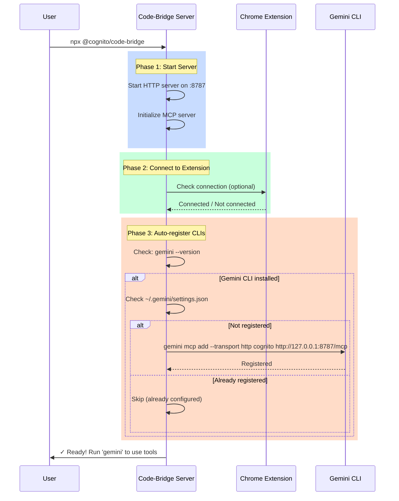
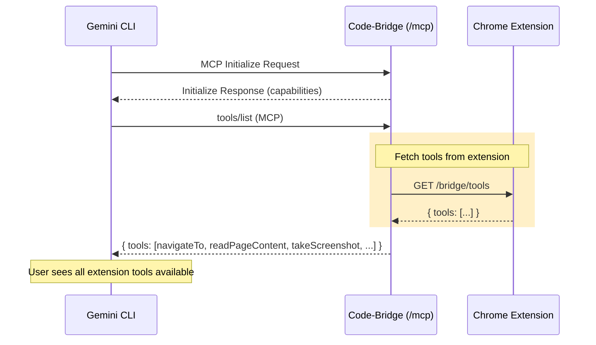
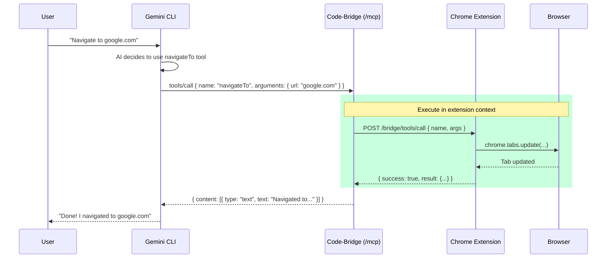

# MCP Server Integration - Implementation Plan

> **Goal**: Run `npx @cognito/code-bridge` and have all extension tools automatically available to Gemini CLI with zero configuration.

## Table of Contents

1. [Architecture Overview](#architecture-overview)
2. [Data Flow Diagrams](#data-flow-diagrams)
3. [Implementation Phases](#implementation-phases)
4. [File Changes](#file-changes)
5. [API Specifications](#api-specifications)
6. [Verification Plan](#verification-plan)

---

## Architecture Overview

```
┌─────────────────────────────────────────────────────────────────────────────┐
│                           ZERO-CONFIG MCP INTEGRATION                        │
└─────────────────────────────────────────────────────────────────────────────┘

                    User runs: npx @cognito/code-bridge
                                    │
                                    ▼
┌─────────────────────────────────────────────────────────────────────────────┐
│                         CODE-BRIDGE SERVER (:8787)                           │
│  ┌─────────────────────────────────────────────────────────────────────┐    │
│  │                        HTTP ENDPOINTS                                │    │
│  │  /health        → Health check                                       │    │
│  │  /pair/*        → Extension pairing                                  │    │
│  │  /cli/chat      → ACP chat with agents (existing)                    │    │
│  │  /mcp           → MCP HTTP Streamable Transport (NEW)                │    │
│  │  /bridge/tools  → List extension tools (NEW)                         │    │
│  └─────────────────────────────────────────────────────────────────────┘    │
│                                                                              │
│  ┌─────────────────────────────────────────────────────────────────────┐    │
│  │                     AUTO CLI REGISTRATION                            │    │
│  │  On startup:                                                         │    │
│  │  1. Detect installed CLIs (gemini --version)                         │    │
│  │  2. Check if already registered in settings                          │    │
│  │  3. Auto-register if needed                                          │    │
│  └─────────────────────────────────────────────────────────────────────┘    │
└─────────────────────────────────────────────────────────────────────────────┘
         │                              │                              │
         │ HTTP                         │ MCP/HTTP                     │ ACP
         ▼                              ▼                              ▼
┌─────────────────┐          ┌─────────────────────┐          ┌─────────────────┐
│ Chrome Extension│          │    Gemini CLI       │          │   CLI Agents    │
│  (Tool Source)  │          │    Claude Code      │          │  (via /cli/chat)│
└─────────────────┘          └─────────────────────┘          └─────────────────┘
```

---

## Data Flow Diagrams

### 1. Startup Flow



### 2. Tool Discovery Flow (via MCP)



### 3. Tool Execution Flow



---

## Implementation Phases

### Phase 1: MCP SDK Integration

**Package additions:**
```json
// packages/code-bridge/package.json
{
  "dependencies": {
    "@modelcontextprotocol/sdk": "^1.12.0"   // MCP SDK
  }
}
```

**New files:**
- `src/mcp/mcpServer.ts` - MCP server instance
- `src/mcp/toolRegistry.ts` - Dynamic tool registration
- `src/mcp/httpTransport.ts` - HTTP streamable transport handler

### Phase 2: Extension Tool API

**Changes in code-bridge:**
- Add `/bridge/tools` endpoint - List all tools with schemas
- Add `/bridge/tools/call` endpoint - Execute a tool

**Changes in extension (background):**
- Add message handler for `BRIDGE_LIST_TOOLS`
- Add message handler for `BRIDGE_CALL_TOOL`

### Phase 3: Auto CLI Registration

**New file:**
- `src/cli/autoSetup.ts` - CLI detection and registration

**Logic:**
1. Check if `gemini` command exists
2. Read `~/.gemini/settings.json`
3. If `mcpServers.cognito` doesn't exist, run `gemini mcp add`
4. Same for Claude Code (`~/.claude/mcp.json`)

### Phase 4: Enhanced Startup UX

**Modify CLI output to show:**
```
   ╭──────────────────────────────────────────────────────────────╮
   │  🧠 Cognito Code Bridge                                      │
   │                                                              │
   │  Server:    http://127.0.0.1:8787                            │
   │  MCP:       http://127.0.0.1:8787/mcp                        │
   │                                                              │
   │  Extension: ✓ Connected                                      │
   │  Tools:     23 available                                     │
   │                                                              │
   │  CLI Integration:                                            │
   │  • Gemini CLI: ✓ Auto-configured                             │
   │  • Claude Code: ✓ Auto-configured                            │
   │                                                              │
   │  Run 'gemini' in another terminal to start using tools!      │
   ╰──────────────────────────────────────────────────────────────╯
```

---

## File Changes

### New Files in `packages/code-bridge/`

#### [NEW] `src/mcp/mcpServer.ts`

```typescript
import { McpServer } from '@modelcontextprotocol/sdk/server/mcp.js';

export function createMcpServer() {
  return new McpServer({
    name: 'cognito-code-bridge',
    version: '0.1.0',
    capabilities: {
      tools: {},
    },
  });
}
```

#### [NEW] `src/mcp/toolRegistry.ts`

```typescript
import type { McpServer } from '@modelcontextprotocol/sdk/server/mcp.js';
import { z } from 'zod';

interface ExtensionTool {
  name: string;
  description: string;
  inputSchema: object;
}

export async function registerExtensionTools(
  mcpServer: McpServer,
  bridgePort: number
) {
  // Fetch tools from extension via code-bridge
  const response = await fetch(`http://127.0.0.1:${bridgePort}/bridge/tools`);
  const { tools } = await response.json() as { tools: ExtensionTool[] };
  
  for (const tool of tools) {
    mcpServer.tool(
      tool.name,
      tool.description,
      tool.inputSchema,
      async (args) => {
        const result = await callExtensionTool(bridgePort, tool.name, args);
        return {
          content: [{ type: 'text', text: JSON.stringify(result) }],
        };
      }
    );
  }
  
  return tools.length;
}

async function callExtensionTool(port: number, name: string, args: unknown) {
  const response = await fetch(`http://127.0.0.1:${port}/bridge/tools/call`, {
    method: 'POST',
    headers: { 'Content-Type': 'application/json' },
    body: JSON.stringify({ name, args }),
  });
  return response.json();
}
```

#### [NEW] `src/cli/autoSetup.ts`

```typescript
import { execSync } from 'node:child_process';
import { existsSync, readFileSync, writeFileSync, mkdirSync } from 'node:fs';
import { homedir } from 'node:os';
import { join, dirname } from 'node:path';

export interface SetupResult {
  cli: string;
  status: 'configured' | 'already_configured' | 'not_installed' | 'error';
  message?: string;
}

export function autoSetupCLIs(port: number): SetupResult[] {
  const results: SetupResult[] = [];
  
  results.push(setupGeminiCLI(port));
  results.push(setupClaudeCLI(port));
  
  return results;
}

function setupGeminiCLI(port: number): SetupResult {
  // Check if gemini CLI is installed
  try {
    execSync('gemini --version', { stdio: 'ignore' });
  } catch {
    return { cli: 'Gemini CLI', status: 'not_installed' };
  }
  
  // Check if already registered
  const settingsPath = join(homedir(), '.gemini', 'settings.json');
  if (existsSync(settingsPath)) {
    try {
      const settings = JSON.parse(readFileSync(settingsPath, 'utf-8'));
      if (settings.mcpServers?.cognito) {
        return { cli: 'Gemini CLI', status: 'already_configured' };
      }
    } catch {
      // Continue with registration
    }
  }
  
  // Register
  try {
    execSync(
      `gemini mcp add --transport http --trust --scope user cognito http://127.0.0.1:${port}/mcp`,
      { stdio: 'pipe' }
    );
    return { cli: 'Gemini CLI', status: 'configured' };
  } catch (e) {
    return { 
      cli: 'Gemini CLI', 
      status: 'error', 
      message: e instanceof Error ? e.message : String(e) 
    };
  }
}

function setupClaudeCLI(port: number): SetupResult {
  const mcpConfigPath = join(homedir(), '.claude', 'mcp.json');
  
  // Check if Claude Code is installed (check config dir exists)
  const claudeDir = join(homedir(), '.claude');
  if (!existsSync(claudeDir)) {
    return { cli: 'Claude Code', status: 'not_installed' };
  }
  
  // Check if already registered
  if (existsSync(mcpConfigPath)) {
    try {
      const config = JSON.parse(readFileSync(mcpConfigPath, 'utf-8'));
      if (config.mcpServers?.cognito) {
        return { cli: 'Claude Code', status: 'already_configured' };
      }
    } catch {
      // Continue with registration
    }
  }
  
  // Register by writing to mcp.json
  try {
    let config = existsSync(mcpConfigPath)
      ? JSON.parse(readFileSync(mcpConfigPath, 'utf-8'))
      : { mcpServers: {} };
    
    config.mcpServers = config.mcpServers || {};
    config.mcpServers.cognito = {
      url: `http://127.0.0.1:${port}/mcp`
    };
    
    mkdirSync(dirname(mcpConfigPath), { recursive: true });
    writeFileSync(mcpConfigPath, JSON.stringify(config, null, 2));
    return { cli: 'Claude Code', status: 'configured' };
  } catch (e) {
    return { 
      cli: 'Claude Code', 
      status: 'error', 
      message: e instanceof Error ? e.message : String(e) 
    };
  }
}
```

### Modified Files

#### [MODIFY] `src/server.ts`

Add MCP endpoint and tool bridge endpoints:

```typescript
// Add imports
import { createMcpServer } from './mcp/mcpServer.js';
import { StreamableHTTPServerTransport } from '@modelcontextprotocol/sdk/server/streamableHttp.js';
import { isInitializeRequest } from '@modelcontextprotocol/sdk/types.js';

// In startBridgeServer():
const mcpServer = createMcpServer();
const mcpTransports = new Map<string, StreamableHTTPServerTransport>();

// Add endpoint: /mcp (MCP HTTP streamable)
if (path === '/mcp' && (req.method === 'POST' || req.method === 'GET')) {
  await handleMcpRequest(req, res, mcpServer, mcpTransports);
  return;
}

// Add endpoint: /bridge/tools
if (path === '/bridge/tools' && req.method === 'GET') {
  const tools = await getExtensionTools();
  sendJson(res, { tools });
  return;
}

// Add endpoint: /bridge/tools/call
if (path === '/bridge/tools/call' && req.method === 'POST') {
  const body = await readJson(req);
  const result = await callExtensionTool(body.name, body.args);
  sendJson(res, result);
  return;
}
```

#### [MODIFY] `src/cli.ts`

Add auto-setup on startup:

```typescript
import { autoSetupCLIs } from './cli/autoSetup.js';

async function main() {
  // ... existing code ...
  
  await startBridgeServer({ host, port, cwd });
  
  // Auto-setup CLIs
  console.log('\n  CLI Integration:');
  const results = autoSetupCLIs(port);
  for (const result of results) {
    const icon = 
      result.status === 'configured' ? '✓' :
      result.status === 'already_configured' ? '✓' :
      result.status === 'not_installed' ? '○' : '⚠';
    
    const status = 
      result.status === 'configured' ? 'Auto-configured' :
      result.status === 'already_configured' ? 'Already configured' :
      result.status === 'not_installed' ? 'Not installed' : 'Error';
    
    console.log(`  ${icon} ${result.cli}: ${status}`);
  }
  console.log('');
}
```

### Extension Changes

#### [MODIFY] `apps/extension/src/entrypoints/background/index.ts`

Add message handlers for tool bridge:

```typescript
// Handle BRIDGE_LIST_TOOLS
chrome.runtime.onMessageExternal.addListener((message, sender, sendResponse) => {
  if (message.type === 'BRIDGE_LIST_TOOLS') {
    const tools = getAllToolsForBridge();
    sendResponse({ tools });
    return true;
  }
  
  if (message.type === 'BRIDGE_CALL_TOOL') {
    executeToolForBridge(message.name, message.args)
      .then(result => sendResponse({ result }))
      .catch(error => sendResponse({ error: error.message }));
    return true;
  }
});
```

---

## API Specifications

### Extension Tool Bridge API

#### `GET /bridge/tools`

Lists all available extension tools with their schemas.

**Response:**
```json
{
  "tools": [
    {
      "name": "navigateTo",
      "description": "Navigate to a URL in the active tab",
      "inputSchema": {
        "type": "object",
        "properties": {
          "url": { "type": "string", "description": "URL to navigate to" }
        },
        "required": ["url"]
      }
    },
    {
      "name": "readPageContent",
      "description": "Read the text content of the current page",
      "inputSchema": {
        "type": "object",
        "properties": {}
      }
    }
    // ... more tools
  ]
}
```

#### `POST /bridge/tools/call`

Execute a tool with given arguments.

**Request:**
```json
{
  "name": "navigateTo",
  "args": { "url": "https://google.com" }
}
```

**Response:**
```json
{
  "success": true,
  "result": {
    "tabId": 123,
    "url": "https://google.com"
  }
}
```

---

## Verification Plan

### Automated Tests

#### Unit Tests (code-bridge)

1. **CLI Detection Tests** (`src/cli/__tests__/autoSetup.test.ts`)
   - Mock `execSync` to simulate CLI presence/absence
   - Test `isGeminiCLIInstalled()` returns correct values
   - Test `isAlreadyRegistered()` with mock settings.json

2. **MCP Server Tests** (`src/mcp/__tests__/mcpServer.test.ts`)
   - Test MCP server initialization
   - Test tool registration
   - Test tool execution proxy

**Run tests:**
```bash
cd packages/code-bridge
pnpm test
```

### Integration Tests

#### Test: MCP Client Connection

```bash
# Terminal 1: Start code-bridge
cd packages/code-bridge
pnpm dev

# Terminal 2: Test MCP endpoint with curl
curl -X POST http://127.0.0.1:8787/mcp \
  -H "Content-Type: application/json" \
  -d '{"jsonrpc":"2.0","method":"initialize","params":{"protocolVersion":"2024-11-05","capabilities":{}},"id":1}'
```

**Expected:** JSON response with server capabilities

### Manual Testing

#### Test 1: Zero-Config Startup

1. **Setup**: Ensure Gemini CLI is installed (`npm install -g @anthropic/gemini-cli` or similar)
2. **Remove existing config** (if any):
   ```bash
   # Check current config
   cat ~/.gemini/settings.json
   # Remove cognito entry if exists
   ```
3. **Run code-bridge**:
   ```bash
   cd packages/code-bridge
   pnpm dev
   ```
4. **Expected output**:
   ```
   CLI Integration:
   ✓ Gemini CLI: Auto-configured
   ```
5. **Verify**: Check `~/.gemini/settings.json` contains `mcpServers.cognito`

#### Test 2: Tool Discovery

1. Start code-bridge: `pnpm dev`
2. Start Gemini CLI: `gemini`
3. Ask: "What tools do you have?"
4. **Expected**: Lists extension tools (navigateTo, readPageContent, etc.)

#### Test 3: Tool Execution

1. Ensure Chrome is running with Cognito extension
2. Start code-bridge: `pnpm dev`
3. Start Gemini CLI: `gemini`
4. Ask: "Navigate to github.com"
5. **Expected**: Chrome navigates to github.com

---

## Dependencies

### New NPM Packages

```bash
cd packages/code-bridge
pnpm add @modelcontextprotocol/sdk
```

### Peer Dependencies

- Chrome extension must be running for tool execution
- Gemini CLI must be installed for auto-setup to work

---

## Risk Assessment

| Risk | Mitigation |
|------|------------|
| Extension not connected | Show warning, tools will fail gracefully |
| CLI auto-registration fails | Log error, provide manual command |
| MCP transport issues | Use well-tested `@modelcontextprotocol/sdk` |
| Port conflict on 8787 | Already configurable via `--port` flag |

---

## Timeline Estimate

| Phase | Effort | Description |
|-------|--------|-------------|
| Phase 1: MCP SDK | 2-3 hours | Add MCP server, HTTP transport |
| Phase 2: Tool Bridge | 2-3 hours | Extension tool API, proxy |
| Phase 3: Auto-Setup | 1-2 hours | CLI detection, registration |
| Phase 4: Polish | 1-2 hours | UX, error handling, tests |
| **Total** | **6-10 hours** | |
